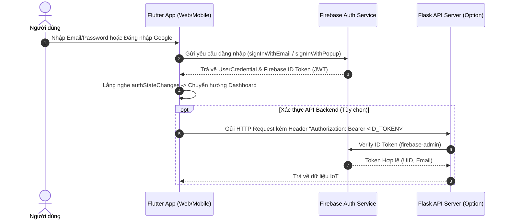

# 🔐 Hướng Dẫn Tích Hợp Firebase Authentication (Flutter Web & Mobile)

Tài liệu hướng dẫn chi tiết các bước thiết lập và xây dựng tính năng Xác thực người dùng (Authentication) bằng **Firebase** cho ứng dụng **IoT Smart Home Dashboard**.

---

## 📐 1. Sơ Đồ Kiến Trúc Luồng Xác Thực



---

## 🛠️ 2. Các Bước Thực Hiện Chi Tiết

### Bước 2.1: Cấu hình trên Firebase Console

1. Truy cập vào [Firebase Console](https://console.firebase.google.com/) và bấm **Add Project** (Tạo dự án mới).
2. Chọn mục **Authentication** ở menu bên trái -> Bấm **Get Started**.
3. Tại tab **Sign-in provider**, bật các phương thức đăng nhập:
   - **Email/Password**: Chuyển trạng thái sang `Enable` -> Save.
   - **Google**: Chuyển trạng thái sang `Enable` -> Điền email hỗ trợ -> Save.
4. **Cấu hình Domain cho Flutter Web**:
   - Vào **Authentication** -> **Settings** -> **Authorized domains**.
   - Thêm domain `localhost` vào danh sách (để chạy thử nghiệm local không bị chặn popup).

---

### Bước 2.2: Thêm Phụ Thuộc (Dependencies) Trong Flutter

Thêm các package sau vào file `pubspec.yaml`:

```yaml
dependencies:
  flutter:
    sdk: flutter
  firebase_core: ^3.12.0
  firebase_auth: ^5.5.1
  google_sign_in: ^6.2.2
```

Chạy lệnh để tải thư viện:
```bash
flutter pub get
```

Chạy lệnh tự động tạo file cấu hình `lib/firebase_options.dart`:
```bash
# Cài đặt CLI nếu chưa có
dart pub global activate flutterfire_cli

# Khởi chạy kết nối tới Firebase Project của bạn
flutterfire configure
```

---

### Bước 2.3: Khởi Tạo Firebase trong `lib/main.dart`

Cập nhật hàm `main()` trong file `lib/main.dart`:

```dart
import 'package:flutter/material.dart';
import 'package:firebase_core/firebase_core.dart';
import 'firebase_options.dart';
import 'view/pages/auth_wrapper.dart';

void main() async {
  WidgetsFlutterBinding.ensureInitialized();
  
  // Khởi tạo Firebase SDK
  await Firebase.initializeApp(
    options: DefaultFirebaseOptions.currentPlatform,
  );

  runApp(const MyApp());
}

class MyApp extends StatelessWidget {
  const MyApp({super.key});

  @override
  Widget build(BuildContext context) {
    return MaterialApp(
      debugShowCheckedModeBanner: false,
      title: 'IoT Dashboard',
      theme: ThemeData(
        useMaterial3: true,
        colorSchemeSeed: Colors.blue,
      ),
      home: const AuthWrapper(),
    );
  }
}
```

---

### Bước 2.4: Tạo `AuthService` (`lib/data/services/auth_service.dart`)

Tạo lớp dịch vụ tập trung quản lý các thao tác xác thực:

```dart
import 'package:firebase_auth/firebase_auth.dart';
import 'package:flutter/foundation.dart';
import 'package:google_sign_in/google_sign_in.dart';

class AuthService {
  final FirebaseAuth _auth = FirebaseAuth.instance;

  AuthService() {
    // Trên môi trường Web, không gọi initialize() của GoogleSignIn 
    // để tránh lỗi treo màn hình DWDS
    if (!kIsWeb) {
      GoogleSignIn.instance.initialize();
    }
  }

  // Stream lắng nghe thay đổi trạng thái Auth
  Stream<User?> get authStateChanges => _auth.authStateChanges();

  // Lấy User hiện tại
  User? get currentUser => _auth.currentUser;

  // 1. Đăng ký Email & Mật khẩu
  Future<UserCredential?> signUpWithEmail({
    required String email,
    required String password,
  }) async {
    try {
      return await _auth.createUserWithEmailAndPassword(
        email: email,
        password: password,
      );
    } on FirebaseAuthException catch (e) {
      throw Exception(_handleAuthException(e));
    }
  }

  // 2. Đăng nhập Email & Mật khẩu
  Future<UserCredential?> signInWithEmail({
    required String email,
    required String password,
  }) async {
    try {
      return await _auth.signInWithEmailAndPassword(
        email: email,
        password: password,
      );
    } on FirebaseAuthException catch (e) {
      throw Exception(_handleAuthException(e));
    }
  }

  // 3. Đăng nhập bằng Google (Đã tối ưu cho cả Web và Mobile)
  Future<UserCredential?> signInWithGoogle() async {
    try {
      if (kIsWeb) {
        // Dùng Popup dành riêng cho Flutter Web
        GoogleAuthProvider authProvider = GoogleAuthProvider();
        return await _auth.signInWithPopup(authProvider);
      } else {
        // Dùng SDK native cho Android / iOS
        final GoogleSignInAccount? googleUser = await GoogleSignIn.instance.authenticate();
        if (googleUser == null) return null; // Người dùng hủy

        final GoogleSignInAuthentication googleAuth = await googleUser.authentication;
        final AuthCredential credential = GoogleAuthProvider.credential(
          idToken: googleAuth.idToken,
        );

        return await _auth.signInWithCredential(credential);
      }
    } catch (e) {
      throw Exception("Đăng nhập Google thất bại: $e");
    }
  }

  // 4. Đăng xuất
  Future<void> signOut() async {
    if (!kIsWeb) {
      await GoogleSignIn.instance.signOut();
    }
    await _auth.signOut();
  }

  // Lấy ID Token để gửi sang Backend Flask nếu cần
  Future<String?> getIdToken() async {
    return await _auth.currentUser?.getIdToken();
  }

  // Xử lý thông báo lỗi tiếng Việt
  String _handleAuthException(FirebaseAuthException e) {
    switch (e.code) {
      case 'user-not-found':
        return 'Tài khoản không tồn tại.';
      case 'wrong-password':
        return 'Mật khẩu không chính xác.';
      case 'email-already-in-use':
        return 'Email này đã được đăng ký.';
      case 'weak-password':
        return 'Mật khẩu quá yếu (tối thiểu 6 ký tự).';
      case 'invalid-email':
        return 'Định dạng Email không hợp lệ.';
      default:
        return 'Lỗi xác thực: ${e.message}';
    }
  }
}
```

---

### Bước 2.5: Điều Hướng Tự Động (`lib/view/pages/auth_wrapper.dart`)

Tạo widget tự động kiểm tra xem người dùng đã đăng nhập hay chưa:

```dart
import 'package:flutter/material.dart';
import 'package:firebase_auth/firebase_auth.dart';
import '../../data/services/auth_service.dart';
import 'login_page.dart';
import 'home_page.dart'; // Màn hình chính sau khi đăng nhập

class AuthWrapper extends StatelessWidget {
  const AuthWrapper({super.key});

  @override
  Widget build(BuildContext context) {
    final authService = AuthService();

    return StreamBuilder<User?>(
      stream: authService.authStateChanges,
      builder: (context, snapshot) {
        if (snapshot.connectionState == ConnectionState.waiting) {
          return const Scaffold(
            body: Center(child: CircularProgressIndicator()),
          );
        }

        if (snapshot.hasData && snapshot.data != null) {
          // Đã đăng nhập -> Vào Home Page Dashboard
          return const HomePage();
        }

        // Chưa đăng nhập -> Vào Login Page
        return const LoginPage();
      },
    );
  }
}
```

---

### Bước 2.6: Tích Hợp Xác Thực token ở Backend Flask (`app.py`)

Nếu hệ thống backend Flask cần bảo mật API và kiểm tra Token:

1. Cài đặt SDK Firebase Admin trên Python:
   ```bash
   pip install firebase-admin
   ```

2. Cấu hình middleware xác thực trong `app.py`:
   ```python
   import firebase_admin
   from firebase_admin import auth, credentials
   from flask import Flask, request, jsonify

   # Nạp file Khóa dịch vụ (Service Account Key) từ Firebase Console
   cred = credentials.Certificate("firebase_service_account.json")
   firebase_admin.initialize_app(cred)

   app = Flask(__name__)

   def check_auth(f):
       def wrapper(*args, **kwargs):
           auth_header = request.headers.get("Authorization")
           if not auth_header or not auth_header.startswith("Bearer "):
               return jsonify({"error": "Thiếu Authorization header"}), 401
           
           token = auth_header.split("Bearer ")[1]
           try:
               decoded_token = auth.verify_id_token(token)
               request.user = decoded_token # Lưu thông tin user vào request
               return f(*args, **kwargs)
           except Exception as e:
               return jsonify({"error": "Token không hợp lệ hoặc đã hết hạn", "details": str(e)}), 401
       return wrapper

   @app.route("/api/sensor-data", methods=["GET"])
   @check_auth
   def get_sensor_data():
       user_id = request.user["uid"]
       return jsonify({
           "message": f"Dữ liệu cảm biến dành cho User: {user_id}",
           "temperature": 28.5,
           "humidity": 65
       })
   ```

---

## 📋 Checklist Kiểm Tra Lỗi Thường Gặp (Troubleshooting)

- [ ] **Lỗi `unauthorized-domain` trên Web**: Đảm bảo domain/host đang chạy Flutter Web (ví dụ `localhost`) đã được thêm vào mục **Authorized domains** trong Firebase Console.
- [ ] **Treo trắng màn hình Web khi đăng nhập Google**: Tránh gọi `GoogleSignIn.instance.initialize()` trên Web. Hãy sử dụng `signInWithPopup(GoogleAuthProvider())`.
- [ ] **Đăng xuất bị lỗi trên Web**: Chỉ gọi `GoogleSignIn.instance.signOut()` khi `!kIsWeb`. Trên Web chỉ gọi `FirebaseAuth.instance.signOut()`.
- [ ] **Quên `WidgetsFlutterBinding.ensureInitialized()`**: Bắt buộc phải có trước khi gọi `Firebase.initializeApp()`.
