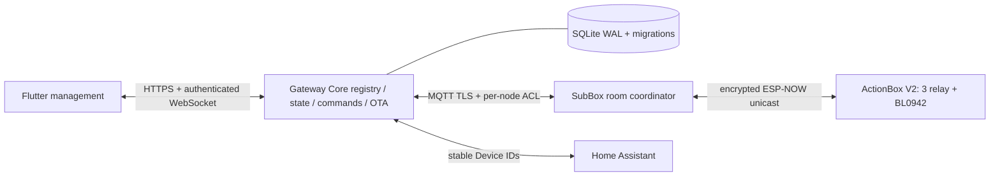

# Home Competition Core V1 design

The supplied master prompt is the acceptance contract. Preserve working voice,
relay safety, metering and HA paths. ActionBox_V2 is the user-selected hardware.

## Protocol and trust

HC-NOW uses little-endian explicit serialization, no packed-struct wire casts:
magic HC, version, type, flags, payload length, 64-bit message ID, 32-bit source
and destination logical IDs, 64-bit boot/session ID, sequence, config revision.
Header 38 bytes; payload at most 196 bytes; 16-byte truncated HMAC-SHA256 covers
header and payload (250 bytes total). Each peer has a distinct 256-bit application
key plus a 128-bit ESP-NOW LMK. HMAC authenticates; it does not encrypt. CCMP is
required on the radio. Gateway/SubBox use TLS. Never broadcast keys.

Receiver session admission is separate from replay checking: a random boot ID
alone cannot authorize a new session. Authenticated challenge/response admits
the boot; old boot reports are rejected. Sequence exhaustion requires rekey/session
renewal, not wrap. Idempotent SET_STATE commands carry a unique message ID,
config revision and bounded lifetime. A duplicate reuses the cached ACK; no
TOGGLE primitive. RECEIVED/ACCEPTED do not imply APPLIED. TIMEOUT is uncertainty.

Provisioning uses unique manufacturing credentials, setup codes and physical
presence. Gateway challenge binds factory ID, assignment, expiry and nonce;
registration is staged until peer persistence and configuration ACK. Gateway
is ownership authority, hardware is reported-state authority. Unpair revokes
credentials, invalidates routes and cancels pending work atomically.

## Storage and state

Dedicated versioned SQLite database, foreign keys, WAL and immediate write
transactions. Unique active assignments and bindings, explicit membership roles,
durable commands/outbox, boot admission and monotonic sequences. State transitions
and audit entries commit together. A binding change invalidates pending commands;
Device ID survives rename/rebinding. Invalid CT has null current, not zero.
No raw ADC storage. Restart makes availability stale until a fresh report.

## Transport and resources

Four ActionBoxes per SubBox in V1 (existing voice capacity). Baseline 250 bytes,
32 replay/ACK slots, bounded RX/TX queues, 5 s heartbeat, 2 s telemetry, 15 s stale
threshold. Retry at bounded intervals, expire commands rather than replaying
after reconnect. ESP-NOW peer channel 0 follows STA; ActionBox performs short
channel discovery steps in its network worker, without blocking safety/voice.
Large config transfers use bounded fragments; OTA uses independent offset chunks
with progress and retries, not whole-image reassembly in RAM.

## OTA and recovery

Signed manifest binds model, version, image size and SHA256. Image validation is
required before changing boot partition; the gateway cannot turn transmitted
bytes into success. States: QUEUED, TRANSFERRING, VERIFYING, REBOOTING,
HEALTH_CHECK, SUCCEEDED/FAILED/ROLLED_BACK/ABORTED. Only post-boot identity/version
and successful health check complete the job. ActionBox receives all chunks via
ESP-NOW. OTA runs below relay/safety priority. No automatic eFuse writes.
Gateway release updates stage a version, back up SQLite, run migrations and health
checks, then switch release; preserve data and support rollback.

## API and App

`/api/v1`, bearer authentication, home-scoped Owner/Member/Installer permissions,
uniform errors and request validation, bounded rate limits. WebSocket always sends
a fresh snapshot on connect; events cause reconciliation, never optimistic
reported-state changes. Keep electrical-device names independent of IDs.
Core management is an explicit mode within the existing Flutter app. Secure
provisioning and OTA must not display success until Gateway confirms completion.

## Verification boundaries

Host C/Python vectors, registry/API integration, fault simulation and Flutter
tests prove software behavior. ESP-IDF builds prove compilation only. Radio,
relay contacts, CT calibration, power-cut OTA and manufacturing provisioning
remain UNVERIFIED until the HIL plan is executed on real equipment.
