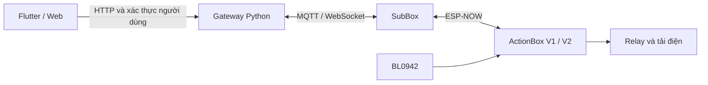

# Báo cáo rà soát code theo mức sẵn sàng thương mại

**Ngày:** 18/10/2026, múi giờ Asia/Bangkok.  
**Phiên bản:** `8d9d5ada848d05c136054ac5070b21a8235f0573`.  
**Kết luận:** **CHƯA ĐỦ ĐIỀU KIỆN PHÁT HÀNH THƯƠNG MẠI.** Nền tảng kiến trúc có thể tiếp tục phát triển; ưu tiên hoàn thiện bảo mật, tính đúng của điều khiển và cập nhật thiết bị trước khi thêm tính năng.

## Repo làm gì và phạm vi đánh giá

Hệ thống điều khiển nhà thông minh gồm app Flutter/Web, Gateway Python xử lý giọng nói và quản trị, SubBox điều phối theo phòng, ActionBox/ActionBox_V2 đóng cắt relay và đo điện. MQTT và ESP-NOW nối các tầng; Gateway có registry SQLite, phân quyền và giao diện OTA.

Mốc tải dùng để thiết kế phương án nghiệm thu: **1 Gateway, 10 SubBox, tối đa 4 ActionBox mỗi SubBox, 5 người dùng, chạy 24/7**. Đây là giả định đánh giá, **không phải công suất đã đo**. ASR hiện chỉ xử lý một lượt đồng thời; khi hai luồng cùng đến, sản phẩm phải trả trạng thái bận rõ ràng hoặc có hàng đợi hữu hạn.

Vùng mã ứng dụng chính có **173 file / 36.794 dòng** Python, Dart, C/C++/header, tính trên Gateway, app và ba firmware ActionBox, ActionBox_V2, SubBox. Đã đọc sâu đường điều khiển, ACK, phân quyền HTTP/WebSocket, registry, MQTT, OTA, relay/sensor/safety và repository Flutter; những vùng còn lại được kiểm tra chọn lọc theo rủi ro. Không tuyên bố đã đọc từng dòng của toàn repo.

Phạm vi bổ sung: cấu hình Docker/Mosquitto/systemd, Gradle/AndroidManifest, test hiện có; đọc chọn lọc OTA của `Esp32S3_Master` vì Gateway còn tham chiếu đường tương thích này. Không sửa mã nguồn ứng dụng, firmware hoặc cấu hình triển khai trong đợt rà soát.

## Thước đo thương mại

Các chuẩn dưới đây được dùng làm **khung đối chiếu kỹ thuật**, không phải tuyên bố chứng nhận hay kết luận pháp lý cho một thị trường cụ thể.

| Khung tham chiếu | Nội dung áp dụng |
|---|---|
| [ETSI EN 303 645 V3.1.3](https://www.etsi.org/deliver/etsi_en/303600_303699/303645/03.01.03_60/en_303645v030103p.pdf) | Kiểm soát truy cập, cập nhật an toàn, bảo vệ thông tin bí mật, bảo mật liên lạc, chịu lỗi mất kết nối, kiểm tra đầu vào. Các nhóm liên quan: 5.1, 5.3–5.9, 5.13. |
| [NISTIR 8259A](https://csrc.nist.gov/pubs/ir/8259/a/final) | Định danh thiết bị, cấu hình, bảo vệ dữ liệu, giới hạn truy cập giao diện, cập nhật và nhận biết trạng thái an ninh. |
| [OWASP ASVS 5.0.0](https://owasp.org/projects/asvs) | Mục tiêu kiểm thử tương đương mức 2 cho HTTP/API: xác thực, phân quyền theo đối tượng, session và dữ liệu. Chưa thực hiện đánh giá đủ mọi điều khoản ASVS. |
| [Espressif ESP-NOW](https://docs.espressif.com/projects/esp-idf/en/stable/esp32s3/api-reference/network/esp_now.html) | Ghép cặp có khóa, mã hóa unicast và ACK ở tầng ứng dụng. Broadcast không được ESP-NOW mã hóa. |
| [Espressif OTA](https://docs.espressif.com/projects/esp-idf/en/stable/esp32s3/api-reference/system/ota.html) | Xác minh firmware, tự kiểm tra sau boot, rollback và chống hạ xuống bản có lỗi bảo mật. |
| Tiêu chí sản phẩm của đợt audit | Kết quả điều khiển trung thực, tự động hóa hoạt động khi app đóng, cập nhật đúng thiết bị, dữ liệu đo đúng kênh, build lặp lại được và phục hồi sau sự cố. |

Tài liệu Espressif liên kết dùng nhánh `stable` tại thời điểm tra cứu; repo dùng ESP-IDF 6.0.2. Khi triển khai phải kiểm tra lại API/Kconfig trên đúng phiên bản đã khóa.

**Mức ưu tiên:** P0 = chặn phát hành do đường truy cập/điều khiển không được bảo vệ; P1 = phải sửa trước khi bán tính năng tương ứng; P2 = cần hoàn thiện cho vận hành và bảo trì; P3 = tối ưu sau khi đã xử lý tính đúng và bảo mật. Đây là thứ tự xử lý của dự án, không phải điểm CVSS.

| Hạng mục | Đánh giá | Căn cứ chính |
|---|---|---|
| Kiến trúc phân tầng | Có nền tảng tốt | Bảo vệ điện tại ActionBox, điều phối theo phòng, xử lý ngôn ngữ tại Gateway. |
| Xác thực và bảo mật kênh | Chưa đạt | WebSocket và ESP-NOW còn đường không xác thực; cấu hình broker không đồng bộ với firmware. |
| Tính đúng của điều khiển | Chưa đạt | App báo bật khi Gateway báo lỗi; voice báo lỗi khi đã nhận ACK; mất kênh 3. |
| Xác nhận tải/đo điện | Chưa đạt | Chưa kiểm tra ngưỡng/độ mới của LOAD_REPORT; ánh xạ công suất sai. |
| Tự động hóa | Chưa hoàn thiện | Automation của repository production chỉ nằm trong RAM. |
| Cập nhật và phát hành | Chưa đạt | OTA có fallback sai đích, hợp đồng tải firmware chưa khép kín, Android release dùng debug key. |
| An toàn trên tải điện thật | Chưa đủ bằng chứng | Có logic fail-safe và host test; chưa đo PCB, relay, nhiễu điện, nhiệt, thời gian cắt thực. |
| Vận hành dài hạn | Chưa đủ bằng chứng | Chưa có số đo tải trên Pi, soak test, diễn tập phục hồi và cơ chế giới hạn dữ liệu đầy đủ. |

## Những điểm đang làm đúng

- Auth đã yêu cầu bootstrap password đủ dài, dùng scrypt, có TTL session và giới hạn thử đăng nhập. Không còn cơ sở để lặp lại nhận xét cũ rằng bản hiện tại mặc định cho đăng nhập bằng `admin123`.
- HTTP relay có kiểm tra quyền theo node, kiểm tra action/channel và trả kết quả verifier; input HTTP có giới hạn kích thước và thời gian đọc.
- Gateway có correlation request/session và phân biệt ACK với xác nhận tải trong mô hình kết quả, dù một số caller chưa cập nhật đúng.
- Registry hiện lấy SQLite làm nguồn dữ liệu chính; JSON là đường nhập/backup. Nhận xét cũ về ghi toàn bộ JSON sau mỗi heartbeat không còn đúng với revision này.
- ASR được đưa ra khỏi event loop, có khóa giới hạn đồng thời và từ chối confidence thấp; NLU có kiểm thử phủ định, ngữ cảnh và phân giải thiết bị mơ hồ.
- ActionBox_V2 reset relay khi khởi động, cắt xung cuộn bằng timer, khóa thao tác relay, từ chối ON khi thiếu mẫu cảm biến, có fault latch và watchdog. Đây là nền tảng cần giữ khi sửa phần truyền thông.
- App Android lưu session bằng Android Keystore/AES-GCM và tắt backup. Mock data chỉ bật qua cờ build; repository production là đường mặc định.

## Phát hiện phải sửa trước khi thương mại hóa

### 1. [P0] WebSocket nhận lệnh giao thức và ACK không cần xác thực

**Vị trí:** [audio_server.py:133](/home/tuan/.codex/worktrees/d283/Home-Assistant-IoT-/Gateway/gateway/audio_server.py:133), [audio_server.py:183](/home/tuan/.codex/worktrees/d283/Home-Assistant-IoT-/Gateway/gateway/audio_server.py:183), [audio_server.py:227](/home/tuan/.codex/worktrees/d283/Home-Assistant-IoT-/Gateway/gateway/audio_server.py:227), [config.py:165](/home/tuan/.codex/worktrees/d283/Home-Assistant-IoT-/Gateway/gateway/config.py:165).

- **Chức năng:** Cổng audio cũng đăng ký node, nhận ACK và khởi chạy xử lý voice.
- **Vấn đề:** `WS_AUDIO_TOKEN`, `WS_AUDIO_TOKENS` và cấu hình TLS được khai báo nhưng không được áp dụng trong server; handler tin `id` do client gửi. Tái hiện R2: gửi ACK không có hello/token vẫn ghi được ACK của node khác, ngay cả khi đã đặt token trong config.
- **Sửa tối thiểu:** Xác thực ngay handshake, gắn danh tính đã xác thực với socket, kiểm tra mọi node/ACK theo danh tính đó và từ chối trùng danh tính; cấu hình WSS thực sự hoặc proxy có xác thực với backend chỉ nghe loopback.
- **Nếu bỏ qua:** Client truy cập được cổng 8765 có thể giả trạng thái, chiếm tuyến WebSocket của node hoặc gửi audio vào đường điều khiển. Khả năng tiếp cận cổng trên hệ thống đang triển khai chưa được đo.

### 2. [P0] ActionBox không kiểm tra nguồn lệnh ESP-NOW và dùng peer không mã hóa

**Vị trí:** [espnow_transport.cpp:32](/home/tuan/.codex/worktrees/d283/Home-Assistant-IoT-/Firmware/firmware_esp/ActionBox_V2/src/network/espnow_transport.cpp:32), [espnow_transport.cpp:149](/home/tuan/.codex/worktrees/d283/Home-Assistant-IoT-/Firmware/firmware_esp/ActionBox_V2/src/network/espnow_transport.cpp:149), [task_manager.cpp:146](/home/tuan/.codex/worktrees/d283/Home-Assistant-IoT-/Firmware/firmware_esp/ActionBox_V2/src/system/task_manager.cpp:146), [SubBox transport:68](/home/tuan/.codex/worktrees/d283/Home-Assistant-IoT-/Firmware/firmware_esp/SubBox/src/audio/audio_transport/espnow_audio_transport.cpp:68).

- **Chức năng:** Radio chuyển lệnh từ SubBox tới relay và gửi heartbeat/telemetry.
- **Vấn đề:** Callback ActionBox chuyển mọi nguồn tới worker, peer đặt `encrypt=false`, và worker không đối chiếu MAC với SubBox đã ghép cặp trước khi thực thi. `hardware_uid`, node ID, session và request ID là trường nhận dạng, không phải bằng chứng bí mật; SubBox còn chấp nhận mọi peer nếu danh sách tin cậy rỗng.
- **Sửa tối thiểu:** Ghép cặp bằng thao tác vật lý, cấp khóa LMK riêng từng cặp ở cả hai đầu, giới hạn nguồn lệnh, từ chối điều khiển khi chưa provision; heartbeat broadcast chỉ dùng khám phá, không được tự đổi kênh/cập nhật trạng thái tin cậy.
- **Nếu bỏ qua:** Thiết bị ở phạm vi radio có thể giả nguồn điều khiển hoặc heartbeat khi biết thông tin định danh. Phát hiện dựa trên code; chưa thử tấn công RF hay đóng cắt tải thật. V1 có cùng file transport.

### 3. [P1] API đổi Wi-Fi công khai cả sau khi đã cài đặt

**Vị trí:** [web_server.py:173](/home/tuan/.codex/worktrees/d283/Home-Assistant-IoT-/Gateway/gateway/web_server.py:173), [web_server.py:846](/home/tuan/.codex/worktrees/d283/Home-Assistant-IoT-/Gateway/gateway/web_server.py:846).

- **Chức năng:** Cho app cấu hình Wi-Fi của Gateway qua `nmcli`.
- **Vấn đề:** `/api/wifi/connect` nằm trong danh sách public, không có cửa sổ commissioning, kiểm tra interface hay bằng chứng thao tác vật lý. R1 xác nhận request không token đi tới lệnh `nmcli`; chưa thực thi `nmcli` thật.
- **Sửa tối thiểu:** Bình thường chỉ admin được thay Wi-Fi; chế độ thiết lập ban đầu phải có thời hạn, token một lần và chỉ mở qua interface setup đã chọn. Giới hạn số subprocess và timeout thao tác mạng.
- **Nếu bỏ qua:** Người truy cập được HTTP của Gateway có thể gây mất kết nối hoặc chuyển mạng, nếu tài khoản service có quyền NetworkManager; kiểm tra Origin không thay thế xác thực client mạng.

### 4. [P1] Broker đi kèm vừa mở ẩn danh, vừa không tương thích SubBox hiện tại

**Vị trí:** [mosquitto.conf:1](/home/tuan/.codex/worktrees/d283/Home-Assistant-IoT-/MQTT_Server/mosquitto/config/mosquitto.conf:1), [docker-compose.yml:5](/home/tuan/.codex/worktrees/d283/Home-Assistant-IoT-/MQTT_Server/docker-compose.yml:5), [subbox_mqtt_client.cpp:40](/home/tuan/.codex/worktrees/d283/Home-Assistant-IoT-/Firmware/firmware_esp/SubBox/src/mqtt/subbox_mqtt_client.cpp:40), [Gateway .env.example:5](/home/tuan/.codex/worktrees/d283/Home-Assistant-IoT-/Gateway/.env.example:5).

- **Chức năng:** Docker cung cấp broker, PostgreSQL, Adminer và subscriber.
- **Vấn đề:** Mosquitto chỉ cấu hình 1883/anonymous, không ACL; SubBox yêu cầu `mqtts://`, CA và credential nên không kết nối được broker mẫu này. Compose cũng công bố PostgreSQL/Adminer ra mọi interface với password DB cố định; `.env.example` chọn 8883 nhưng không cung cấp cấu hình CA mà Gateway bắt buộc cần.
- **Sửa tối thiểu:** Cung cấp một bộ triển khai production đồng bộ: listener TLS, credential riêng từng thiết bị, ACL theo topic, secret bên ngoài repo; bỏ publish DB/Adminer mặc định hoặc bind localhost cho bảo trì.
- **Nếu bỏ qua:** Cài theo repo có thể không hoạt động; nếu bật đường MQTT cũ cho chạy thì client mạng có thể publish command/telemetry không được phân quyền. Không khẳng định broker thực tế của người dùng đang dùng cấu hình này.

### 5. [P1] App báo relay đã bật khi Gateway trả thất bại

**Vị trí:** [gateway_client.dart:290](/home/tuan/.codex/worktrees/d283/Home-Assistant-IoT-/App/dtv_energy_flutter/lib/services/gateway_client.dart:290), [smart_home_repository.dart:329](/home/tuan/.codex/worktrees/d283/Home-Assistant-IoT-/App/dtv_energy_flutter/lib/repositories/smart_home_repository.dart:329).

- **Chức năng:** App hiển thị trạng thái tạm thời khi chờ lệnh và cập nhật lại sau phản hồi.
- **Vấn đề:** `relay()` không kiểm tra `result['success']` hoặc `verify`, luôn ghi lại trạng thái yêu cầu nếu HTTP không ném exception. R10: HTTP 200 + `success:false, verify:timeout`, snapshot vẫn OFF, nhưng app kết thúc ở ON; repository bỏ qua map kết quả.
- **Sửa tối thiểu:** Chỉ chấp nhận `ack_only`/`confirmed_load` cùng `success=true`; các kết quả khác phải hủy trạng thái tạm, giữ trạng thái xác nhận gần nhất và trả lỗi cho UI. Không ghi đè snapshot mới bằng trạng thái suy đoán.
- **Nếu bỏ qua:** Người dùng có thể tin tải đã tắt/bật trong khi không có bằng chứng; đây là lỗi chức năng, không chỉ lỗi trình bày.

### 6. [P1] Voice báo thất bại dù đã có ACK hoặc xác nhận tải

**Vị trí:** [main.py:322](/home/tuan/.codex/worktrees/d283/Home-Assistant-IoT-/Gateway/gateway/main.py:322), [main.py:418](/home/tuan/.codex/worktrees/d283/Home-Assistant-IoT-/Gateway/gateway/main.py:418), [verify_engine.py:123](/home/tuan/.codex/worktrees/d283/Home-Assistant-IoT-/Gateway/gateway/verify_engine.py:123).

- **Chức năng:** Gateway biến kết quả verifier thành phản hồi bằng giọng nói và tổng hợp lệnh nhiều thiết bị.
- **Vấn đề:** Verifier trả `ACK_ONLY`/`CONFIRMED_LOAD`, nhưng caller chỉ coi `VerifyResult.SUCCESS` là thành công. R12 tái hiện cả hai kết quả hợp lệ đều thành câu “Thiết bị … không xác nhận trạng thái yêu cầu”; nhánh bulk cũng tính chúng là thất bại.
- **Sửa tối thiểu:** Chuẩn hóa một hợp đồng kết quả cho HTTP, voice và bulk: đã gửi, đã ACK, đã xác nhận tải, lỗi, timeout; diễn đạt riêng ACK và xác nhận tải. Sửa chime và bộ đếm bulk theo cùng hợp đồng.
- **Nếu bỏ qua:** Người dùng nhận phản hồi mâu thuẫn với thiết bị, lặp lệnh không cần thiết và mất niềm tin vào hệ thống.

### 7. [P1] Xác nhận tải không kiểm tra tải, thời gian hay đúng kênh

**Vị trí:** [verify_engine.py:119](/home/tuan/.codex/worktrees/d283/Home-Assistant-IoT-/Gateway/gateway/verify_engine.py:119), [task_manager.cpp:192](/home/tuan/.codex/worktrees/d283/Home-Assistant-IoT-/Firmware/firmware_esp/ActionBox_V2/src/system/task_manager.cpp:192).

- **Chức năng:** Dùng BL0942 để phân biệt relay nhận lệnh và tải thực sự hoạt động.
- **Vấn đề:** Chỉ cần cấu hình threshold không rỗng và `sample.valid=true` là trả `confirmed_load`; R3 dùng sai kênh, mẫu cũ và 0 W vẫn được xác nhận bật. Ngược lại, firmware gửi LOAD_REPORT sau ACK ít nhất khoảng settle time, còn verifier trả ngay khi thấy ACK nên thường không đợi được báo cáo mới (R4).
- **Sửa tối thiểu:** Chờ LOAD_REPORT theo deadline riêng; kiểm tra node/channel/request/session/boot, timestamp sau lệnh, tuổi mẫu, fault và ngưỡng ON/OFF đã hiệu chuẩn. Timeout của mẫu phải là `ack_only`/`load_unverified`, không tự nâng thành xác nhận tải.
- **Nếu bỏ qua:** Tính năng “vòng kín” có thể xác nhận một tải không hoạt động hoặc bỏ mất phép xác minh thực tế; không dùng nhãn `confirmed_load` làm căn cứ an toàn cho đến khi sửa.

### 8. [P1] Hỗ trợ relay thứ ba chưa xuyên suốt Gateway và app

**Vị trí:** [main.py:525](/home/tuan/.codex/worktrees/d283/Home-Assistant-IoT-/Gateway/gateway/main.py:525), [smart_home_repository.dart:122](/home/tuan/.codex/worktrees/d283/Home-Assistant-IoT-/App/dtv_energy_flutter/lib/repositories/smart_home_repository.dart:122), [smart_home_repository.dart:199](/home/tuan/.codex/worktrees/d283/Home-Assistant-IoT-/App/dtv_energy_flutter/lib/repositories/smart_home_repository.dart:199), [registry_manager.py:255](/home/tuan/.codex/worktrees/d283/Home-Assistant-IoT-/Gateway/gateway/registry_manager.py:255).

- **Chức năng:** ActionBox_V2 có ba relay; API điều khiển và một số test đã hỗ trợ `ch3`.
- **Vấn đề:** Telemetry vẫn ghi `[ch1,ch2]`, app dựng cố định hai kênh, capability SQLite ghi số relay bằng 2. R5 biến `[0,0,1]` thành `[0,0]`; R14 đưa ba kênh vào repository production nhưng chỉ nhận hai thiết bị.
- **Sửa tối thiểu:** Dùng danh sách channel/capability thực của thiết bị ở mọi tầng; cập nhật discovery, provisioning, metadata, snapshot, app và test hợp đồng ba kênh. Kiểm tra `GatewayClient.relay` cũng còn map trạng thái tạm chỉ ch1/ch2.
- **Nếu bỏ qua:** Kênh 3 biến mất hoặc mất trạng thái sau telemetry, dù test gọi riêng HTTP `ch3` vẫn qua.

### 9. [P1] OTA có thể gửi firmware cho thiết bị khác đích đã chọn

**Vị trí:** [ota_manager.py:281](/home/tuan/.codex/worktrees/d283/Home-Assistant-IoT-/Gateway/gateway/ota_manager.py:281), [ota_manager.py:302](/home/tuan/.codex/worktrees/d283/Home-Assistant-IoT-/Gateway/gateway/ota_manager.py:302).

- **Chức năng:** Admin chọn node để cập nhật qua MQTT/WebSocket.
- **Vấn đề:** Nếu không tìm thấy socket đích, code chọn socket duy nhất hoặc toàn bộ speaker đang hoạt động. R7 yêu cầu `TARGET_OFFLINE` nhưng socket `DIFFERENT_NODE` nhận OTA; R8 cho MQTT `publish=False` mà API vẫn báo `success=True`.
- **Sửa tối thiểu:** Node cụ thể phải khớp danh tính và capability OTA; không có tuyến thì trả offline/unsupported. Await thao tác gửi, kiểm tra boolean publish; trả `queued` tách biệt với `downloaded`, `booted`, `healthy`.
- **Nếu bỏ qua:** Cập nhật có thể ảnh hưởng board không được chọn; giao diện vẫn báo đã phát lệnh dù không gửi thành công.

### 10. [P1] Luồng OTA chưa có hợp đồng tải và hỗ trợ firmware khép kín

**Vị trí:** [ota_manager.py:270](/home/tuan/.codex/worktrees/d283/Home-Assistant-IoT-/Gateway/gateway/ota_manager.py:270), [web_server.py:173](/home/tuan/.codex/worktrees/d283/Home-Assistant-IoT-/Gateway/gateway/web_server.py:173), [web_server.py:712](/home/tuan/.codex/worktrees/d283/Home-Assistant-IoT-/Gateway/gateway/web_server.py:712), [subbox_mqtt_client.cpp:130](/home/tuan/.codex/worktrees/d283/Home-Assistant-IoT-/Firmware/firmware_esp/SubBox/src/mqtt/subbox_mqtt_client.cpp:130).

- **Chức năng:** Gateway phát URL để thiết bị tự tải bản cập nhật.
- **Vấn đề:** URL gửi ra không có credential tải; endpoint lại yêu cầu session/API key của người dùng, R6 nhận 401. SubBox chỉ subscribe command/voice response và chưa thấy handler OTA tương ứng trong ba firmware chính; có partition OTA không đồng nghĩa đã triển khai OTA.
- **Sửa tối thiểu:** Thiết kế quyền tải theo thiết bị hoặc vé tải một lần, gắn image/hash/device/TTL; chỉ quảng bá OTA cho model thực sự có updater. Hoàn tất adapter và bài test từ trigger đến boot xác nhận, hoặc ẩn OTA cho model chưa hỗ trợ.
- **Nếu bỏ qua:** Tính năng có giao diện nhưng không cập nhật được chuỗi ActionBox/SubBox hiện hành; sửa bằng cách mở toàn bộ endpoint tải public sẽ để lại bài toán kiểm soát truy cập.

### 11. [P1] OTA chưa ràng buộc image với board và chưa có chuỗi phát hành đáng tin cậy

**Vị trí:** [ota_manager.py:43](/home/tuan/.codex/worktrees/d283/Home-Assistant-IoT-/Gateway/gateway/ota_manager.py:43), [ota_manager.py:109](/home/tuan/.codex/worktrees/d283/Home-Assistant-IoT-/Gateway/gateway/ota_manager.py:109), [web_server.py:651](/home/tuan/.codex/worktrees/d283/Home-Assistant-IoT-/Gateway/gateway/web_server.py:651), [ActionBox sdkconfig:699](/home/tuan/.codex/worktrees/d283/Home-Assistant-IoT-/Firmware/firmware_esp/ActionBox/sdkconfig:699).

- **Chức năng:** Nhận và phân phối file firmware `.bin`.
- **Vấn đề:** File không hợp lệ vẫn được lưu và upload báo success; trigger không chặn theo `valid_esp`, model board hoặc partition. Cùng ESP32-S3 không có nghĩa cùng pinout relay; MD5 được dùng làm metadata nhưng không xác thực nhà phát hành, và các profile hiện có chưa chứng minh secure boot/rollback production được bật.
- **Sửa tối thiểu:** Manifest được ký chứa board revision, protocol, version, kích thước và SHA-256; xác minh chữ ký trên thiết bị, từ chối sai board, tự kiểm tra và rollback sau boot. Chốt quy trình ký/giữ khóa trước khi provision secure boot cho lô sản xuất.
- **Nếu bỏ qua:** Operator có thể chọn nhầm binary cùng chip nhưng khác GPIO, hoặc phân phối image không có nguồn gốc được xác minh. Chưa kiểm tra eFuse và chữ ký của binary trên thiết bị đã lắp; không suy diễn cấu hình thực tế từ tên file “commercial”.

### 12. [P1] Cấu hình HTTP, cookie và app chưa tạo thành một đường triển khai an toàn

**Vị trí:** [web_server.py:52](/home/tuan/.codex/worktrees/d283/Home-Assistant-IoT-/Gateway/gateway/web_server.py:52), [web_server.py:742](/home/tuan/.codex/worktrees/d283/Home-Assistant-IoT-/Gateway/gateway/web_server.py:742), [gateway_client.dart:51](/home/tuan/.codex/worktrees/d283/Home-Assistant-IoT-/App/dtv_energy_flutter/lib/services/gateway_client.dart:51), [AndroidManifest.xml:14](/home/tuan/.codex/worktrees/d283/Home-Assistant-IoT-/App/dtv_energy_flutter/android/app/src/main/AndroidManifest.xml:14).

- **Chức năng:** Web và app truy cập API Gateway.
- **Vấn đề:** Server là HTTP thuần, app tự thêm `http://` và cho phép cleartext; đăng nhập/password/token vì thế có thể đi dạng không mã hóa. Cookie Web có `Secure`, nên truy cập trực tiếp bằng HTTP qua IP LAN thông thường không duy trì được cookie; repo chưa có cấu hình TLS proxy đi kèm để khép kín đường này.
- **Sửa tối thiểu:** Đóng gói HTTPS proxy/certificate onboarding, bind backend loopback, app ưu tiên HTTPS và quy trình tin cậy certificate rõ ràng. Giữ cookie Secure; chỉ cho HTTP tạm trong commissioning được giới hạn.
- **Nếu bỏ qua:** Cài mặc định vừa làm yếu bảo mật vừa gây lỗi đăng nhập Web tùy cách truy cập. Hệ thống đã có proxy bên ngoài repo có thể giảm rủi ro này, nhưng chưa được kiểm chứng trong đợt audit.

### 13. [P1] Automation production chỉ là danh sách trên RAM

**Vị trí:** [smart_home_repository.dart:89](/home/tuan/.codex/worktrees/d283/Home-Assistant-IoT-/App/dtv_energy_flutter/lib/repositories/smart_home_repository.dart:89), [smart_home_repository.dart:437](/home/tuan/.codex/worktrees/d283/Home-Assistant-IoT-/App/dtv_energy_flutter/lib/repositories/smart_home_repository.dart:437), [automation_screen.dart:338](/home/tuan/.codex/worktrees/d283/Home-Assistant-IoT-/App/dtv_energy_flutter/lib/features/automation/automation_screen.dart:338).

- **Chức năng:** UI cho thêm/bật/tắt tự động hóa, kể cả ngữ cảnh tiết kiệm khi vắng nhà.
- **Vấn đề:** Repository production chỉ cập nhật `_automations` rồi phát stream; không lưu bền, không gọi API, không gửi rule cho bộ thực thi. R11 tạo automation rồi dựng lại repository thì danh sách trống; model chỉ chứa text mô tả, chưa có trigger/action có thể thực thi.
- **Sửa tối thiểu:** Trước mắt ẩn hoặc ghi rõ chưa hỗ trợ; nếu đây là tính năng cần bán, triển khai scheduler tối thiểu tại Gateway, lưu SQLite với trigger/action có cấu trúc và log từng lần thực thi.
- **Nếu bỏ qua:** Người dùng tin đã đặt lịch nhưng thiết bị không tự chạy, mất cấu hình sau khi app khởi động lại. RuleEngine của firmware không tự nhận các automation được thêm trên app này.

### 14. [P1] Scene báo đã kích hoạt trước khi biết kết quả

**Vị trí:** [automation_screen.dart:163](/home/tuan/.codex/worktrees/d283/Home-Assistant-IoT-/App/dtv_energy_flutter/lib/features/automation/automation_screen.dart:163), [smart_home_repository.dart:483](/home/tuan/.codex/worktrees/d283/Home-Assistant-IoT-/App/dtv_energy_flutter/lib/repositories/smart_home_repository.dart:483).

- **Chức năng:** Một thao tác điều khiển nhiều tải, ví dụ scene đi ngủ/rời nhà.
- **Vấn đề:** UI không await `activateScene`; repository bỏ qua exception từng relay và âm thầm bỏ thiết bị offline. Một scene có mọi lệnh thất bại vẫn hiện “Đã kích hoạt ngữ cảnh”.
- **Sửa tối thiểu:** Trả kết quả theo thiết bị và tổng hợp complete/partial/failed; UI await kết quả, thể hiện thiết bị bỏ qua/thất bại và cho retry có kiểm soát. Chỉ song song giữa các node độc lập với giới hạn nhỏ.
- **Nếu bỏ qua:** Người dùng có thể rời nhà khi một tải cần tắt vẫn bật. Lỗi này còn tồn tại ngay cả sau khi sửa việc đọc `success:false` ở phát hiện 5.

### 15. [P1] Dữ liệu công suất không xuyên suốt và có thể bị nhân đôi trên app

**Vị trí:** [main.py:508](/home/tuan/.codex/worktrees/d283/Home-Assistant-IoT-/Gateway/gateway/main.py:508), [mqtt_handler.py:85](/home/tuan/.codex/worktrees/d283/Home-Assistant-IoT-/Gateway/gateway/mqtt_handler.py:85), [smart_home_repository.dart:119](/home/tuan/.codex/worktrees/d283/Home-Assistant-IoT-/App/dtv_energy_flutter/lib/repositories/smart_home_repository.dart:119), [smart_home_providers.dart:242](/home/tuan/.codex/worktrees/d283/Home-Assistant-IoT-/App/dtv_energy_flutter/lib/providers/smart_home_providers.dart:242).

- **Chức năng:** Hiển thị công suất theo thiết bị và tổng tiêu thụ.
- **Vấn đề:** Telemetry ba tầng cập nhật tổng công suất trong MQTT cache nhưng handler registry chỉ ghi relay/heartbeat, không đưa mẫu theo kênh vào snapshot/lịch sử app dùng. Khi có `last_telemetry.power` cấp board, repository gán cùng số đó cho từng kênh; R14 cho board 50 W, hai socket đều hiện 50 W và tổng thành 100 W.
- **Sửa tối thiểu:** Định nghĩa một schema telemetry theo node/channel kèm timestamp, validity và đơn vị; lưu/đọc cùng schema từ MQTT đến API và app. Tổng theo meter hoặc theo channel, không cộng một giá trị board nhiều lần; thiếu mẫu phải hiển thị chưa có dữ liệu.
- **Nếu bỏ qua:** Dashboard năng lượng có thể thiếu dữ liệu hoặc hiển thị sai tổng. Không sử dụng số liệu hiện tại cho tính phí hay cam kết độ chính xác đo lường.

### 16. [P1] Android release đang được ký bằng debug key

**Vị trí:** [build.gradle.kts:28](/home/tuan/.codex/worktrees/d283/Home-Assistant-IoT-/App/dtv_energy_flutter/android/app/build.gradle.kts:28).

- **Chức năng:** Build APK/AAB cho người dùng.
- **Vấn đề:** `release.signingConfig` trỏ tới `signingConfigs.getByName("debug")`; quy trình release phụ thuộc debug keystore của máy build. Android nêu rõ debug certificate không phù hợp phát hành và phần lớn store không chấp nhận. [Android app signing](https://developer.android.com/studio/publish/app-signing).
- **Sửa tối thiểu:** Dùng release/upload key được quản lý riêng, bảo vệ/backup khóa, chốt applicationId và kiểm tra certificate fingerprint trong pipeline. Kiểm thử nâng cấp giữ dữ liệu giữa hai bản ký đúng khóa.
- **Nếu bỏ qua:** Không đáp ứng đường phát hành store thông thường, khó đảm bảo cập nhật khi đổi máy build. Chưa kiểm tra certificate các APK có sẵn nên không kết luận chúng được ký bằng khóa nào.

## Nên sửa để vận hành bền vững

### 17. [P2] Ghi SQLite đồng bộ trên event loop và telemetry chưa có giới hạn lưu trữ

**Vị trí:** [registry_manager.py:73](/home/tuan/.codex/worktrees/d283/Home-Assistant-IoT-/Gateway/gateway/registry_manager.py:73), [registry_manager.py:316](/home/tuan/.codex/worktrees/d283/Home-Assistant-IoT-/Gateway/gateway/registry_manager.py:316), [registry_manager.py:1036](/home/tuan/.codex/worktrees/d283/Home-Assistant-IoT-/Gateway/gateway/registry_manager.py:1036), [registry_manager.py:1362](/home/tuan/.codex/worktrees/d283/Home-Assistant-IoT-/Gateway/gateway/registry_manager.py:1362).

- **Chức năng:** Lưu heartbeat, trạng thái và lịch sử đo điện.
- **Vấn đề:** Mỗi heartbeat có thể mở connection và commit ngay trên asyncio, SQLite timeout tới 10 giây. Thử giữ write lock 250 ms làm timer asyncio 10 ms hoàn thành sau **337,7 ms** trên máy audit; đường ghi telemetry hiện có không có retention, với giả định 40 node/2 giây có thể tạo 1.728.000 bản ghi/ngày nếu nối đầy đủ vào đường này.
- **Sửa tối thiểu:** Một worker ghi có queue hữu hạn, batch heartbeat/telemetry, ưu tiên lưu cấu hình và kết quả lệnh; retention/rollup theo ngân sách đĩa, backup SQLite nhất quán và thử restore. Giữ cache đọc trên event loop, không chia sẻ connection tùy tiện qua thread.
- **Nếu bỏ qua:** Lock/đĩa chậm kéo theo trễ ACK/WebSocket/HTTP, và dữ liệu dài ngày gây áp lực dung lượng. Con số thời gian trên là phép thử lock tổng hợp, không phải benchmark Raspberry Pi hay dự báo độ trễ thực tế.

### 18. [P2] API vocabulary bỏ qua phạm vi thiết bị của member

**Vị trí:** [web_server.py:183](/home/tuan/.codex/worktrees/d283/Home-Assistant-IoT-/Gateway/gateway/web_server.py:183), [web_server.py:405](/home/tuan/.codex/worktrees/d283/Home-Assistant-IoT-/Gateway/gateway/web_server.py:405), [main.py:820](/home/tuan/.codex/worktrees/d283/Home-Assistant-IoT-/Gateway/gateway/main.py:820).

- **Chức năng:** App xem từ vựng, alias và thông tin thiết bị phục vụ voice.
- **Vấn đề:** Member được truy cập `/api/voice/vocabulary`, nhưng hàm diagnostics duyệt toàn bộ registry mà không nhận user. R13: member không được gán node nào vẫn đọc tên/alias/node ID của thiết bị khác.
- **Sửa tối thiểu:** Truyền user vào hàm lấy vocabulary, lọc bằng cùng chính sách của `/api/nodes`; phần chẩn đoán ASR toàn hệ thống chỉ cho admin.
- **Nếu bỏ qua:** Phân quyền theo thiết bị không nhất quán, lộ cấu trúc nhà/tên thiết bị của người khác. Chưa chứng minh được API này tự cho quyền điều khiển node ngoài phạm vi.

### 19. [P2] Bộ kiểm thử chưa là điều kiện phát hành có thể lặp lại

**Vị trí:** [Gateway requirements](/home/tuan/.codex/worktrees/d283/Home-Assistant-IoT-/Gateway/requirements.txt:1), [test_hardening_contracts.py:91](/home/tuan/.codex/worktrees/d283/Home-Assistant-IoT-/Gateway/tests/test_hardening_contracts.py:91), [smart_home_repository_test.dart:10](/home/tuan/.codex/worktrees/d283/Home-Assistant-IoT-/App/dtv_energy_flutter/test/smart_home_repository_test.dart:10), [Firmware host tests:33](/home/tuan/.codex/worktrees/d283/Home-Assistant-IoT-/Firmware/tests/test_actionbox_v2.py:33).

- **Chức năng:** Bảo đảm thay đổi và artifact phát hành giữ đúng hành vi.
- **Vấn đề:** Các test hiện có đều qua sau khi chuẩn bị dependency, nhưng vẫn bỏ lọt R2/R3/R5/R10/R12/R14; một số test app dùng repository giả và một số widget test còn chạy app shell cũ. Không có workflow CI được quản lý trong repo, dependency Python chỉ có ngưỡng tối thiểu; host integration cần cJSON ở đường dẫn build phát sinh.
- **Sửa tối thiểu:** Khóa môi trường Python/IDF/Flutter, tự chuẩn bị dependency host từ lockfile, chạy test production adapter và các ca âm tính đã tái hiện; build đủ board profile, kiểm chữ ký/hash và lưu manifest cho mỗi release.
- **Nếu bỏ qua:** “Test xanh” không chứng minh chuỗi app–Gateway–SubBox–ActionBox tương thích; bản cài mới hoặc binary mới thiếu bằng chứng tương ứng với source đã review. Chưa kiểm tra CI riêng bên ngoài repository.

## Tối ưu sau khi xử lý lỗi

### 20. [P3] Hai firmware sao chép nhiều module và có mã Gateway bị che khuất

**Vị trí:** [ActionBox protocol](/home/tuan/.codex/worktrees/d283/Home-Assistant-IoT-/Firmware/firmware_esp/ActionBox/src/protocol/actionbox_protocol.cpp:1), [ActionBox_V2 protocol](/home/tuan/.codex/worktrees/d283/Home-Assistant-IoT-/Firmware/firmware_esp/ActionBox_V2/src/protocol/actionbox_protocol.cpp:1), [mqtt_handler.py:202](/home/tuan/.codex/worktrees/d283/Home-Assistant-IoT-/Gateway/gateway/mqtt_handler.py:202), [registry_manager.py:1085](/home/tuan/.codex/worktrees/d283/Home-Assistant-IoT-/Gateway/gateway/registry_manager.py:1085).

- **Chức năng:** Duy trì hai board revision và các đường tương thích cũ.
- **Vấn đề:** Có 19 file V1/V2 giống hệt nhau, tổng 2.330 dòng bị lặp; lỗi bảo mật transport cần sửa đồng thời ở hai bản. Gateway còn 15 dòng không thể chạy sau `return` trong `send_relay_set`, một `get_ota_history` 17 dòng bị định nghĩa sau ghi đè và một `broadcast_event` 8 dòng bị ghi đè.
- **Sửa tối thiểu:** Xóa khoảng 40 dòng Gateway chắc chắn không chạy; từng bước dùng chung protocol/transport/safety với build/test cho cả hai board. Giữ pinout và driver relay khác biệt rõ ràng; chưa xóa UI cũ vì test vẫn tham chiếu tới nó.
- **Nếu bỏ qua:** Các bản sửa lệch nhau giữa V1/V2, tăng công review và khả năng tái xuất hiện lỗi. Không cần thêm framework hay factory để giải quyết việc dùng chung này.

**Tiềm năng tinh gọn:** khoảng **40 dòng** có thể xóa trực tiếp, tối đa **2.330 dòng trùng** có thể gom sau khi kiểm chứng build; **0 dependency** được chứng minh là có thể bỏ ngay. Không cộng hai con số này thành cam kết diff trước khi thực hiện.

## Phương án tối ưu được đề xuất

Giữ kiến trúc hiện tại: một Gateway, SQLite, MQTT và firmware theo phòng. Chưa có bằng chứng cần microservice, Kubernetes, Redis hay đổi Flutter/Python. Hiệu quả lớn nhất đến từ loại bỏ trạng thái giả và thống nhất hợp đồng giao thức.

| Giai đoạn | Công việc chính | Điều kiện hoàn thành |
|---|---|---|
| A — khóa đường điều khiển | Sửa 1–4, 12, 18; chuẩn hóa commissioning và secret theo thiết bị | Không có HTTP/WS/RF client chưa provision điều khiển được; broker ACL và TLS được kiểm thử cả hai chiều. |
| B — tính đúng đầu-cuối | Sửa 5–8, 14–15; một contract kết quả dùng chung; schema channel/telemetry thống nhất | Chạy được ON/OFF, lỗi, timeout, tải không hoạt động và ba kênh; UI/voice/telemetry không mâu thuẫn. |
| C — cập nhật và vòng đời | Sửa 9–11, 16; thêm capability/version compatibility, ký release, backup/restore | Sai board/sai chữ ký bị từ chối; mất điện khi cập nhật phục hồi được; APK nâng cấp đúng danh tính. |
| D — tính năng và vận hành | Quyết định phạm vi automation (13), worker/retention (17), pipeline và HIL (19) | Automation chạy khi app đóng; tải mục tiêu và sự cố dài ngày có số đo; cài mới từ manifest tái hiện được. |
| E — giảm chi phí bảo trì | Sửa 20, làm gọn đường legacy đã xác định, chỉnh tài liệu theo hành vi thật | Hai board cùng qua regression; loại code cũ có bằng chứng không còn caller. |

**Cách tổ chức:** tách các thay đổi bảo mật, kết quả điều khiển, telemetry và OTA thành các PR nhỏ có ca tái hiện trước/sau. Làm contract và test đầu-cuối trước khi gom module để không che mất nguyên nhân lỗi.

**Ước lượng sơ bộ:** 6–8 tuần kỹ thuật cho một nhóm gồm 1 người Gateway/app và 1 người firmware, có người hỗ trợ QA/phần cứng, nếu giữ phạm vi một địa điểm và trì hoãn automation phức tạp. Đây là khung lập kế hoạch, chưa bao gồm sản xuất, chứng nhận phần cứng hoặc độ trễ xử lý lỗi PCB; cần 2–3 ngày triage/build/HIL ban đầu để chốt lại.

## Tiêu chí nghiệm thu trước khi bán

Các ngưỡng bên dưới là **mục tiêu đề xuất**, không phải kết quả đã đạt hay ngưỡng do ETSI/NIST bắt buộc.

| Nhóm | Thử nghiệm bắt buộc | Mốc đề xuất / bằng chứng cần có |
|---|---|---|
| Quyền truy cập | Client không token, token sai node, member trái quyền, peer chưa pair, phát lại packet | Tất cả bị từ chối; không thay relay, route, registry hay Wi-Fi. Có log gắn request và danh tính, không log secret. |
| Điều khiển | ON/OFF ở cả ba kênh; mất ACK; ACK sai channel/session/boot; lệnh đồng thời | 0 trường hợp báo thành công giả trong bộ fault injection; tải bình thường đạt ≥99,9% ACK trong 10.000 lệnh thử phù hợp fixture. |
| Độ trễ | App đến ACK với 40 node, 5 client, có telemetry | P95 ≤500 ms, P99 ≤1,5 s trên phần cứng mục tiêu; công bố riêng thời gian xác nhận tải sau settle. |
| Voice | Bộ câu tiếng Việt chưa dùng huấn luyện, nhiều giọng/vùng miền, TV/nhiễu, phủ định | Đo intent/entity accuracy, false activation mỗi giờ, tỷ lệ cần nhắc lại; mục tiêu P95 sau kết thúc nói đến kết quả ≤2,5 s. Hai luồng cùng lúc phải được phục vụ hoặc báo bận, không lẫn ngữ cảnh. |
| Điện và relay | Khởi động/mất nguồn, mất cảm biến, quá dòng, tải khởi động lớn, relay kẹt, fault kênh 3 | Đo xung SET/RESET bằng oscilloscope, thời gian cắt thực tế và sai số cảm biến; ngưỡng phải do thiết kế PCB/relay/tải và hiệu chuẩn quyết định. Không dùng host test để chứng nhận an toàn điện. |
| OTA | Sai board, sai chữ ký, URL hết hạn, mất Wi-Fi/mất nguồn giữa tải và boot | Không flash sai đích; vẫn boot bản hoạt động hoặc rollback xác định; trạng thái UI phản ánh đúng từng giai đoạn. |
| Chạy dài ngày | Soak 7 ngày, reboot từng tầng, AP đổi kênh, queue đầy, broker/DB mất kết nối | Không rò bộ nhớ tăng liên tục, không crash chưa xử lý; có số đo heap/RSS, queue depth, reconnect, packet loss. |
| Dữ liệu | Sensor thiếu/cũ, một board nhiều kênh, restart, đĩa đầy, restore | Không biến “không có mẫu” thành 0 W; không nhân đôi công suất; cấu hình đã xác nhận lưu phải phục hồi được. |
| Vận hành | Cài sạch, cập nhật và rollback Gateway/app, thay thiết bị | Artifact có source commit/toolchain/hash; runbook khôi phục; mục tiêu RTO ≤15 phút trong diễn tập, RPO cấu hình bằng 0 sau lưu đã xác nhận. |

Tải 40 node ở chu kỳ telemetry hiện tại 1 giây tạo khoảng 40 message/giây trước audio. Một luồng PCM 16 kHz/16-bit là khoảng 32 KB/giây chưa tính overhead. Vì vậy ưu tiên đo radio airtime, queue và thời gian ghi đĩa; chưa tăng giới hạn 4 ActionBox/phòng hoặc số ASR worker chỉ bằng cách tăng hằng số.

## Kết quả kiểm chứng của đợt audit

| Kiểm tra | Kết quả | Giới hạn diễn giải |
|---|---|---|
| Gateway offline | **48/48 đạt** | Không chạy `test_clean_gateway.py` vì khởi tạo full Gateway; dữ liệu DB trỏ thư mục tạm. |
| NLU độc lập | **84/84 đạt** | Là kiểm tra logic trên dữ liệu test, không đo chất lượng ASR qua micro. |
| Flutter hiện có | **18/18 đạt** | Chạy trên bản sao app trong `/tmp`, dependency lấy offline từ cache. |
| Firmware host | **6/6 đạt** | C++ thật với giả lập ranh giới phần cứng; dùng cJSON `1.7.19~2` từ cache khớp lockfile. |
| Flutter analyze | **0 error, 0 warning; 76 info** | Chủ yếu API deprecated và gợi ý `final`; command vẫn trả mã 1 do còn issue. Không gọi đây là lint sạch. |
| Tái hiện Gateway bổ sung | R1–R8, R12–R13 xác nhận hành vi lỗi | Transport/subprocess giả, không chạm thiết bị. R9 ghi nhận API key còn hiệu lực sau logout; xem là điểm cần quyết định vòng đời key, không tính thành lỗi độc lập. |
| Tái hiện Flutter bổ sung | **3/3 tái hiện đạt**: R10, R11, R14 | Các test này assert hành vi lỗi đang tồn tại, không chứng minh đã sửa. |
| SQLite/event loop | Timer 10 ms thành **337,7 ms** khi giữ write lock 250 ms | Phép đo tổng hợp trên máy audit, không phải SLO của Pi. |

Môi trường: Python 3.12.3, g++ 13.3.0, Flutter 3.44.8/Dart 3.12.2. Một số gói runtime Python không có trong interpreter kiểm tra; bộ offline dùng fallback/mock, không chứng minh khởi động production đầy đủ. Test asyncio ban đầu treo trong sandbox; chạy lại cùng bộ offline ngoài sandbox thì hoàn tất. Firmware host ban đầu thiếu cJSON; đã dựng bản sao và dùng component cache đúng phiên bản rồi chạy lại đủ 6 test. Các hạn chế chuẩn bị môi trường này không được tính thành lỗi chức năng firmware.

Bằng chứng, log và script tái hiện được lưu tại [thư mục bằng chứng](/home/tuan/.codex/worktrees/d283/Home-Assistant-IoT-/docs/audit-evidence-2026-10-18/README.md).

## Chưa kiểm tra và quyết định phát hành

Chưa build toàn bộ firmware bằng ESP-IDF trong đợt này; chưa flash board, chạy Gateway với broker thật, ASR/TTS model thật, đo RF/EMC/thermal/độ chính xác BL0942, đọc eFuse, xác minh APK/binary đang triển khai, pentest hệ thống thật hay thử tải/soak trên Raspberry Pi. Không audit sâu dữ liệu huấn luyện, model weights, mã thư viện bên thứ ba, `archive/`, CAD/PCB và các binary có sẵn. Không có bằng chứng về topology/proxy/ACL/CI ngoài repo.

**Phán quyết:** tiếp tục phát triển trên kiến trúc hiện có; chặn phát hành thương mại tới khi xử lý P0/P1 và có bằng chứng nghiệm thu phần cứng, OTA, bảo mật và chạy dài ngày. Bộ test hiện tại là nền tảng hữu ích, nhưng chưa đủ làm căn cứ xác nhận sản phẩm an toàn và đáng tin cậy để bán.
