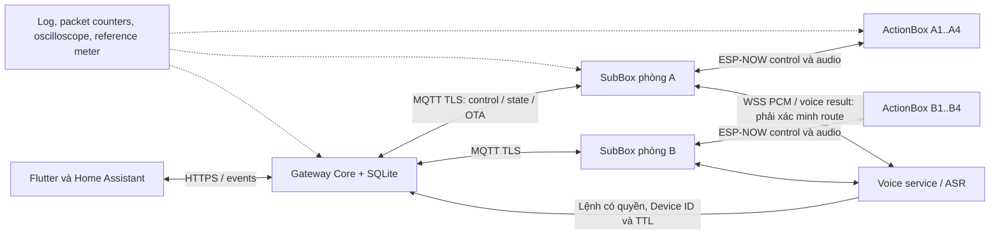

# Home Competition — Kế hoạch kiểm lỗi, kiểm thử và đánh giá toàn diện

Ngày lập: **18/10/2026**. Đối tượng chính: **ActionBox_V2 → SubBox → Gateway → Flutter/Home Assistant** và toàn bộ chuỗi xử lý giọng nói liên quan.

> **Dành cho người/agent thực thi:** Đây là kế hoạch, chưa phải kết quả đánh giá. Khi được yêu cầu triển khai, dùng `superpowers:executing-plans` để thực hiện từng công việc, cập nhật checkbox và lưu bằng chứng. Lỗi cần sửa phải được tái hiện trước, có kiểm thử hồi quy và kiểm tra lại các bên gọi liên quan. Không tự chuyển từ lập kế hoạch sang flash, thay đổi thiết bị đang vận hành hoặc huấn luyện lại model.

**Goal:** Xác định hệ thống thực sự hoạt động đến đâu, sai ở đâu, giới hạn nào đã được đo, và điều kiện nào phải đạt trước khi đưa vào dùng thử có giám sát.

**Architecture:** Đánh giá từ từng module đến giao tiếp giữa các tầng, sau đó chạy toàn bộ luồng trên tiến trình thật và phần cứng thật. Dùng lại kiểm thử/simulator hiện có; chỉ bổ sung công cụ khi thiếu khả năng quan sát hoặc tái hiện lỗi. Mỗi kết luận phải gắn với phiên bản, môi trường, ca thử và bằng chứng.

**Tech Stack:** ESP-IDF/C/C++, ESP-NOW, Wi-Fi, MQTT TLS, WSS/PCM, Python/SQLite, Flutter/Android; WakeNet, Sherpa-ONNX, KWS tự huấn luyện và LLM ở những cấu hình thực sự có sử dụng.

**Spec:** [Core V1 design](../../architecture/core_v1_design.md), [Core V1 plan](../../architecture/core_v1_plan.md), [protocol](../../../protocol/specifications/hc_v1_protocol_spec.md), [provisioning](../../provisioning/provisioning_guide.md), [báo cáo kiểm thử cũ](../../testing/test_plan_and_report.md), yêu cầu đánh giá toàn diện ngày 18/10/2026.

## 1. Phạm vi, bằng chứng ban đầu và giới hạn kết luận

### 1.1 Những gì phải đánh giá

| Lớp | Nội dung |
|---|---|
| ActionBox_V2 | Khởi động, 3 relay chốt, BL0942, nút bấm, bảo vệ, micro/WakeNet, bộ nhớ, NVS, OTA |
| SubBox | Đăng ký, quản lý nhiều ActionBox, định tuyến, Wi-Fi/ESP-NOW đồng thời, gom audio, MQTT/WSS, cache và recovery |
| Gateway | Điểm khởi chạy, registry, danh tính/quyền, SQLite, lệnh/ACK, state, broker, voice/model, OTA, backup/restore |
| App/HA | Điều khiển, trạng thái thật, reconnect, provisioning, lỗi và trạng thái chưa xác định, đồng bộ nhiều client |
| Model/DSP | Dữ liệu, tiền xử lý, model thực sự được nạp, chất lượng nhận dạng, từ chối sai, lượng tử hóa, tốc độ trên thiết bị đích |
| Toàn hệ thống | Lệnh đầu-cuối, audio đầu-cuối, nhiều phòng, mất gói/mất điện, tải cao, chạy bền và khả năng chẩn đoán |

### 1.2 Kết quả cũ chỉ dùng làm mốc so sánh

Báo cáo **15/10/2026** ghi 138 lượt kiểm thử Gateway, 24 Flutter, 7 firmware host và build thành công hai firmware/APK. Gateway có kiểm thử chạy lặp do import/kế thừa: 112 test ID và 99 phương thức riêng. Báo cáo cũng ghi 106 góp ý Dart mức thông tin, chưa có kiểm thử radio/relay/OTA mất điện trên phần cứng.

**Không chuyển các con số này thành PASS cho lần đánh giá mới.** Repository đang có nhiều thay đổi chưa commit và file mới; SHA của HEAD một mình không xác định đủ mã đang chạy.

### 1.3 Điểm cần làm rõ ngay từ đầu

| Quan sát từ source | Việc phải chứng minh |
|---|---|
| Có `core_v1/voice.py`, nhưng điểm chạy `core_v1/__main__.py` được đọc chưa khởi tạo `CoreVoice`; `api.py` chưa thấy đăng ký route của nó | Kiểm tra bằng tiến trình thật rằng WSS của SubBox đi đến đúng handler, đúng registry và cùng hàng đợi lệnh; có class/unit test chưa đủ |
| `ActionBox_V2/src/audio/voice_capture.cpp` dùng WakeNet rồi truyền PCM; không có local ASR/command ở đường này | Không báo KWS tiếng Việt đã tích hợp vào ActionBox_V2 nếu chưa chứng minh bằng build và runtime |
| KWS nằm trong `Firmware/firmware_kws`; script đánh giá còn đường dẫn `d:/KWS/...` | Xác định dữ liệu/artifact thực có, phiên bản, khả năng tái lập; không lấy accuracy trong README làm số đo mới |
| `AI_ENABLED` mặc định false; LLM là cấu hình tùy chọn của luồng Gateway cũ | Kiểm tra chế độ thực tế; đánh giá rule/Core voice và LLM riêng, không cộng chung kết quả |
| ASR có sửa transcript và tính confidence bằng heuristic | Đo cả trước/sau sửa; confidence 0.7 không đồng nghĩa xác suất đúng 70% |
| `Firmware/tools/hil_runner.py` hiện dùng `MockActionBoxTransport`, giao thức v3 và 2 relay | Không dùng kết quả của công cụ này để chứng nhận Core V1/3 relay hoặc HIL thật |
| Simulator dùng C command guard nhưng phần Box/transport còn mô phỏng | Bổ sung kiểm thử C runtime/provisioning và HIL; simulator không chứng minh scheduler, NVS hay radio |

Đây là danh sách ưu tiên kiểm tra, không phải tuyên bố đã audit toàn bộ source hay đã tái hiện mọi lỗi.

## 2. Global Constraints — các điều kiện không được vi phạm

- Lệnh mạng dùng trạng thái đích ON/OFF; không dùng TOGGLE để retry. Packet trùng không được gây thêm tác động relay trong cùng phiên hợp lệ.
- `RECEIVED`/`ACCEPTED` không được trình bày là `APPLIED`. Timeout là chưa biết chắc kết quả. ACK phần mềm không chứng minh tiếp điểm hoặc tải đã hoạt động.
- Gateway quyết định ownership/binding; ActionBox cung cấp trạng thái phần cứng. Dữ liệu boot/revision cũ không được ghi đè trạng thái mới.
- Lệnh hết hạn, sai nhà/phòng/parent/thiết bị, sai khóa hoặc quyền đã thu hồi phải bị từ chối trước tác động.
- Không suy ra W/kWh từ dòng RMS khi không có dữ liệu đo tương ứng; CT/BL0942 lỗi phải thể hiện unknown/invalid, không tạo số 0 giả.
- An toàn relay và nút OFF phải được kiểm tra khi mất mạng, đang OTA, audio tải cao hoặc queue đầy. Tác vụ mạng không được làm mất khả năng cắt tải.
- Không ghi secret/token/audio riêng tư vào báo cáo công khai. Fault injection, packet fuzzing và thử quá tải chỉ chạy trong môi trường test cô lập.
- Phép thử tải điện, quá dòng, nhiệt và cắt nguồn dùng fixture được bảo vệ, trong định mức linh kiện, do người đủ năng lực thực hiện. Bắt đầu bằng tải giả/điện áp thấp; đây không phải quy trình chứng nhận an toàn điện thương mại.
- Không tự burn eFuse, erase NVS, dùng lại dữ liệu production cho fault injection hoặc flash thiết bị chưa xác định đúng model/pin map.
- Không đặt PASS cho tính năng không tồn tại, không được nối vào điểm chạy, thiếu model, thiếu phần cứng hoặc chỉ có mô phỏng.

## 3. Review Focus — năm nhóm lỗi ưu tiên cao nhất

1. **Luồng có code nhưng không nối đầu-cuối:** Core voice, WSS, MQTT topics, identity và config của hai hệ cũ/mới — kiểm bằng `INT-01`, `INT-02`, `VOI-01`.
2. **Reboot/rebind trong lúc ACK hoặc telemetry đang trễ:** không áp dụng lệnh cũ lên thiết bị mới, không khôi phục state cũ — `STA-03`, `STA-05`, `CTL-04`.
3. **Audio/OTA tranh tài nguyên với điều khiển và an toàn:** queue đầy, radio bận, ghi flash, inference chậm — `RAD-07`, `VOI-05`, `HW-05`, `STB-03`.
4. **Thu hồi quyền/khóa khi các bên offline hoặc đang ghép nối:** fail closed, không hồi sinh parent/ownership cũ — `SEC-04`, `PRV-05`, `PRV-06`.
5. **Model nghe nhầm nhưng pipeline vẫn tự tin bật sai tải:** phủ định, TV, nhầm bật/tắt, nhầm phòng, sửa transcript quá mức — `MOD-04`, `MOD-05`, `VOI-06`.

## 4. Mô hình đánh giá và cấu hình bàn thử



Sơ đồ trên là luồng cần chứng minh; không khẳng định mọi mũi tên đang được nối đúng.

| Cấu hình | Thành phần | Chứng minh được |
|---|---|---|
| T0 — Host | Máy phát triển, Python venv, C compiler, Flutter, IDF, DB test riêng | Codec, state machine, API, client, lỗi dữ liệu; không radio/điện |
| T1 — Tích hợp tiến trình thật | Gateway/service thật, broker TLS riêng, client/Box simulator, mạng test | Startup, route, auth, MQTT/WSS thực, restart, migration |
| T2 — HIL tối thiểu | Pi4 đích, 2 SubBox, 4 ActionBox_V2 chia 2 phòng, Android, router chỉnh channel | Định tuyến khác phòng, multi-source, radio, relay/sensor thực |
| T3 — HIL đủ tải V1 | 2 SubBox × 4 ActionBox = 8 Box/24 kênh, thêm 1 Box thử bị từ chối | Dung lượng peer, fairness, nhiễu/lưu lượng thực, soak ở tải thiết kế |

Tạo thêm nhà B bằng tài khoản độc lập để thử cách ly quyền. Ghi số board, revision PCB, định mức relay, nguồn, firmware/model hash, router/channel, vị trí và tải gắn vào từng kênh. Thiếu T3 thì đánh dấu năng lực 4 peer/SubBox trên radio là UNVERIFIED, dù simulator đạt.

Dụng cụ: UART riêng cho mỗi board, nguồn có điều khiển ngắt, logic analyzer/oscilloscope, đồng hồ tham chiếu có thông số hiệu chuẩn, tải thử được bảo vệ, máy phát audio và bộ ghi âm. Không mặc định laptop nhanh hơn Pi4 là bằng chứng hiệu năng Pi4.

## 5. Quy ước kết quả và cách lưu bằng chứng

### 5.1 Trạng thái

- `PASS`: đã chạy và đạt toàn bộ expected của ca đó trong cấu hình ghi rõ.
- `FAIL`: có sai khác tái hiện được, kèm log/trace và lỗi được liên kết.
- `BLOCKED`: không chạy được vì dependency/thiết bị/cấu hình, ghi nguyên nhân và người xử lý.
- `UNVERIFIED`: chưa có phép đo/bằng chứng phù hợp.
- `N/A`: tính năng ngoài cấu hình phát hành đã xác định, ví dụ LLM tắt; không dùng để che chức năng bắt buộc còn thiếu.

Gắn thêm mức bằng chứng `STATIC`, `HOST`, `SIL` (tích hợp mô phỏng), `HIL` (phần cứng), `PILOT`. PASS ở mức thấp không thay thế mức cao. Tất cả ca của kế hoạch này ban đầu là **UNVERIFIED**.

### 5.2 Hồ sơ một lần chạy

Dự kiến lưu `docs/testing/runs/<run-id>/` gồm:

| File | Nội dung |
|---|---|
| `manifest.json` | SHA, trạng thái dirty, digest snapshot source/untracked cần thiết, lockfile, binary/model/dataset hash, toolchain, cấu hình đã che secret, board topology |
| `results.csv` | `case_id, level, topology, seed, repetitions, status, observed, expected, evidence, issue_id` |
| `metrics.json` | Bộ đếm, phân vị latency, loss/retry, bộ nhớ, model metrics và cỡ mẫu |
| `report.md` | Phạm vi, lỗi P0/P1/P2, giới hạn, quyết định đạt/chưa đạt, liên kết dữ liệu |
| `evidence/` | Log đã lọc secret, trace packet, ảnh/CSV oscilloscope, kết quả kiểm thử |

Không thu toàn bộ HOME/env/NVS thô. Snapshot mã phải giữ cả file mới có liên quan; diff tracked đơn thuần bỏ sót nhiều module hiện tại. Dữ liệu âm thanh có sự đồng ý của người nói, lưu riêng có kiểm soát; báo cáo chỉ tham chiếu ID/hash.

### 5.3 Trace đầu-cuối

Theo dõi cùng `command_id`/message ID, node/parent/channel, boot ID, config revision, sequence, generation, lần retry và trạng thái ACK qua các tầng. Voice có request ID, source node, thời điểm nhận audio cuối, bắt đầu/kết thúc inference, kết quả resolve và command ID.

Đo khoảng thời gian bằng clock monotonic trên cùng host. Chỉ tính one-way latency giữa host khác nhau khi biết sai số đồng bộ đồng hồ; nếu không, dùng round-trip hoặc mốc đo logic analyzer. Không log key, token, nội dung credential hay mặc định lưu toàn bộ transcript.

## 6. Ngưỡng nghiệm thu đề xuất

**Các SLO dưới đây là mục tiêu ban đầu, chưa phải kết quả hay bảo đảm sản phẩm.** Chốt chúng trong manifest trước khi chạy; mọi thay đổi sau đo cần ghi lý do và chạy lại. Bất biến an toàn/quyền không được hạ thấp để đạt điểm.

| Chỉ tiêu | Mục tiêu đề xuất và điều kiện đo |
|---|---|
| Sai thiết bị/nhà, lệnh trái quyền, lệnh hết hạn vẫn chạy, báo thành công giả | **0 lần** trong toàn bộ tập thử; một lần là chặn nghiệm thu |
| Điều khiển bình thường | ≥99.5% lệnh hợp lệ hoàn tất trong TTL ở profile không chủ động gây lỗi; timeout tính là thất bại, không bỏ mẫu |
| Độ trễ control | App gửi đến ACK `APPLIED`: p95 ≤1 s, p99 ≤3 s trên LAN/Pi4 đích; đo riêng phần SubBox↔ActionBox với p95 ≤500 ms |
| Đồng bộ trạng thái | Thay đổi local đến snapshot app: p95 ≤3 s; mất kết nối thể hiện stale trong ≤20 s, bao gồm ngưỡng stale thiết kế 15 s |
| Reconnect | Sau khi hạ tầng trở lại: Gateway/MQTT/WSS/state hội tụ ≤30 s; radio đổi channel ≤30 s, đo ít nhất 30 lần mỗi kịch bản |
| Voice end-to-end | Từ kết thúc câu nói đến ACK: p95 ≤4 s, p99 ≤7 s ở 1 phiên hoạt động; báo riêng latency VAD, ASR, resolve, dispatch và phát lời phản hồi |
| ASR/NLU | Bộ câu được hỗ trợ: đúng toàn bộ action + Device ID ≥95% môi trường yên, ≥90% profile nhiễu quy định; câu bị từ chối tính vào mẫu số câu hợp lệ |
| ASR transcript | WER ≤20% yên, ≤35% nhiễu ở bộ holdout; báo thêm CER và lỗi bật/tắt/phòng/thiết bị. Không dùng WER thay cho tỷ lệ điều khiển đúng |
| WakeNet | Recall ≥95% ở profile yên 1 m; ≥90% ở profile nhiễu đã chọn. FAR quan sát ≤0.1 lần/giờ trên ≥100 giờ audio âm tính; kèm khoảng tin cậy |
| KWS riêng nếu được dùng | Macro-F1 ≥0.90, recall từng từ điều khiển ≥0.90; model quant giảm ≤2 điểm phần trăm macro-F1 so với FP32 trên cùng holdout |
| Chạy bền | Không panic, watchdog reset bất thường, deadlock, mất DB/ownership hoặc tác động relay ngoài dự kiến trong 72 giờ |
| Bộ nhớ | Không OOM; heap/RSS không tăng không giới hạn; sau warm-up 30 phút, trung vị 30 phút cuối không tăng >5% so với cửa sổ chuẩn ở cùng workload. Bất kỳ xu hướng tăng còn kéo dài đều cần điều tra |
| Dư địa realtime | Ghi riêng internal heap/PSRAM, largest free block và stack high-water mark. Mục tiêu còn ≥20% RAM pool quan trọng và ≥512 byte stack của task; không đổi stack theo số trung bình |
| Metering | Đo theo dải dòng và BOM/hiệu chuẩn thực. ±2% chỉ là mục tiêu sơ bộ trong dải đã hiệu chuẩn; gần 0 dùng sai số tuyệt đối, không ép tiêu chí phần trăm |

Với mỗi tỷ lệ ghi numerator/denominator, trường hợp reject/timeout, số người/board độc lập và khoảng tin cậy. Không xem “0 lỗi trong mẫu” là bằng chứng rủi ro bằng 0. Không chỉ báo latency của những ca nhanh thành công.

## 7. Công việc 1 — Chốt baseline, cấu hình và khả năng quan sát

**Nguồn:** `docs/architecture/`, hai firmware `sdkconfig*`, `dependencies.lock`, `Gateway/requirements-core.txt`, `App/dtv_energy_flutter/pubspec.lock`, các service/config trong `deployment/`.

**Đầu vào → đầu ra:** working tree và thiết bị dự kiến → manifest có thể tái lập, sơ đồ route thực tế, danh mục model và log schema dùng cho các bước sau.

- [x] **BASE-01:** Lập inventory source, binary, toolchain, môi trường, board và tất cả secret *theo tên/vị trí*, không sao chép giá trị vào báo cáo. Expected: truy được binary đến đúng snapshot.
- [x] **BASE-02:** Xác định mode đang chạy: Core/legacy, voice endpoint, broker/topic, model path/hash, AI_ENABLED/LLM_MODE. Expected: một bảng khai báo rõ mỗi chức năng do service nào chịu trách nhiệm.
- [x] **BASE-03:** Kiểm tra đủ timestamp/correlation ID, reset reason, queue drops, retry, free heap, stack và mức đầy audio buffer. Thiếu chỉ số nào thì bổ sung instrumentation tối thiểu trước test cần chỉ số đó.
- [x] **BASE-04:** Khởi động môi trường test trống bằng các lệnh triển khai thật; tạo home/room/owner test và khởi động lại. Expected: DB integrity tốt, không cần dữ liệu thủ công ngoài hướng dẫn.
- [x] **BASE-05:** Phân loại toàn bộ warning/error/lint hiện có theo ảnh hưởng. Expected: không bỏ qua lỗi compiler; ghi debt style riêng, không lấy số lint làm điểm độ ổn định.

**Cổng qua bước:** xác định được đúng phiên bản và dữ liệu test, không tác động môi trường đang vận hành; các mốc cần đo có phương tiện thu.

## 8. Công việc 2 — Rà soát logic, kiểm thử đơn vị và đường vào thực tế

**Nguồn:** `Gateway/gateway/core_v1/{__main__,api,bridge,registry,database,protocol,voice}.py`, firmware `common/hc_core/`, `ActionBox_V2/src/{device,safety,storage,system}/`, `SubBox/src/{main.cpp,mqtt,audio}/`, Flutter `lib/features/core_v1/`.

**Đầu vào → đầu ra:** manifest → bảng invariant/caller/owner, baseline test mới, danh sách lỗi có reproducer.

- [x] **LOG-01:** Lần theo call graph App/HA/voice → API → queue → MQTT → SubBox → ActionBox → relay → ACK/state. Expected: không có đường điều khiển thứ hai bỏ qua quyền, TTL, revision hoặc an toàn.
- [x] **LOG-02:** Rà state machine registration, connectivity, command, OTA; thử từng transition hợp lệ và sai thứ tự. Expected: trạng thái thất bại/không xác định không tự biến thành thành công.
- [x] **LOG-03:** Tạo ma trận tranh chấp local button/remote/voice/safety. Safety OFF ưu tiên cao nhất; ghi rõ cách phân xử lệnh hợp lệ còn lại trước khi chạy thử cạnh tranh. Expected: kết quả tái lập được, lệnh cũ không lật ngược ý định mới.
- [x] **LOG-04:** Rà khóa, ISR/callback, quyền sở hữu buffer, lifetime object, xử lý exception và công việc blocking. Expected: callback radio chỉ nhận/đẩy queue, không ghi flash/chờ relay/inference.
- [x] **LOG-05:** Chạy toàn bộ test/build ở mục 18; thêm ca sát biên trước khi sửa lỗi. Expected: số lượng test riêng và kết quả thực được lưu, không chỉ dòng “All passed”.
- [x] **INT-01:** Chạy service Core từ CLI/systemd cấu hình test; dùng HTTP/MQTT/WSS thật để kiểm tra health, auth, snapshot, command và voice endpoint mà SubBox cấu hình. Expected: route thực tồn tại, request vào đúng registry và command queue.
- [x] **INT-02:** Chạy Core và legacy cùng lúc trên cổng/topic tách biệt; gửi nhầm phiên bản/topic/token. Expected: từ chối hoặc route rõ ràng, không thực thi hai lần, không cấp ownership từ autodiscovery cũ.

**Cổng qua bước:** lỗi ngăn điểm chạy/route chính phải được xử lý trước benchmark end-to-end. Unit test của handler chưa được mount không được tính là tính năng hoạt động.

## 9. Công việc 3 — Định danh, provisioning, quyền và ràng buộc dữ liệu

**Tái sử dụng:** `test_hc_provisioning.py`, `test_hc_registry.py`, `test_hc_api.py`; bổ sung phía C trong `Firmware/tests/test_hc_runtime.py` nếu chưa có harness. Bản thân tên file mới là đầu ra dự kiến, không phải công cụ đã tồn tại.

| ID | Kịch bản | Expected / bằng chứng |
|---|---|---|
| PRV-01 | Đăng ký SubBox rồi ActionBox; receipt parent/device đổi thứ tự, mất receipt/accept | Chỉ REGISTERED sau đủ bằng chứng; retry không tạo hai assignment; có log 3 tầng |
| PRV-02 | Factory ID trùng, Base MAC khác STA MAC, khóa/code sai, signed envelope sai kind/model hoặc challenge | Sai bị từ chối; identity và routing không bị nhầm; firmware parser thật cũng phải được thử |
| PRV-03 | Cửa sổ vật lý/claim hết hạn; app timeout sau STORED; power loss trước/sau commit NVS | Không success giả; trạng thái có đường recovery đã ghi rõ; không dùng packet cũ để ghép lại |
| PRV-04 | 4 child cùng parent, child thứ 5; đồng thời 2 claim tranh slot cuối; grant đến đảo thứ tự | Không vượt capacity; claim hợp lệ không kẹt vĩnh viễn do generation; lưu toàn bộ revision/grant order |
| PRV-05 | Chuyển phòng/parent lúc có lệnh chờ, target offline, claim hết hạn giữa transfer | Device ID giữ theo thiết kế; route cũ mất quyền; có recovery hoặc trạng thái lỗi rõ, không âm thầm hủy binding |
| PRV-06 | Unpair/revoke khi child hoặc parent offline; sau đó phát lại receipt/grant cũ; reset cục bộ | Không hồi sinh quyền; không nhận lệnh cũ; Factory ID giữ, ownership reset có chủ đích |
| SEC-01 | Owner/Installer/Member/người ngoài truy cập mọi API và WebSocket | Kiểm tra role từng mutation; đọc/ghi khác home bị từ chối trước mutation |
| SEC-02 | MAC đúng nhưng LMK/HMAC sai; peer lạ; frame bị sửa; broadcast control | Không actuate và không admission; đếm reason reject; radio xác minh encryption |
| SEC-03 | CA/hostname sai, cert hết hạn, broker giả, bearer thiếu, HTTP redirect | Không downgrade về plaintext; token không đi đến host khác; secret không xuất log |
| SEC-04 | Thu hồi quyền khi WebSocket đang mở hoặc ASR/OTA đang chạy | Quyền được kiểm tra lại ở điểm mutation; không hoàn tất tác động mới bằng quyền cũ |
| SEC-05 | Flood API, malformed JSON/binary, body vượt giới hạn, file OTA/path bất thường | Giới hạn tài nguyên, mã lỗi đúng, không crash/traversal, tác vụ hợp lệ có cơ chế phục hồi |

**Cổng qua bước:** không còn lỗi trái quyền/cross-home; thử tối thiểu 20 chu kỳ commissioning mỗi loại trên bàn thử, có cả failure/retry, không chỉ happy path.

## 10. Công việc 4 — ActionBox ↔ SubBox: control, audio và radio

**Tái sử dụng:** `hc_protocol.{h,c}`, `hc_runtime.c`, `test_hc_protocol.py`, `test_hc_simulation.py`, firmware ESP-NOW transport/audio transport. Simulator bổ sung fault injection có seed; không thay thế radio bằng kết luận tương đương.

| ID | Thao tác kiểm tra | Expected |
|---|---|---|
| RAD-01 | Round-trip C/Python; length 0/53/54/250/251, payload 0/196/197, endian, version, unknown type/flags, NaN/Inf | Codec đồng nhất, malformed bị từ chối không đọc ngoài buffer; phân biệt lỗi MAC với parser |
| RAD-02 | Loss 1/5/10/30%; duplicate 1/10%; delay 50/250/1000/6000 ms; reorder theo cửa sổ 2/8/32; burst outage 1/5/30 s | Lệnh trong TTL hoặc kết thúc uncertainty/failure rõ; không thực thi hai lần hoặc chạy sau deadline |
| RAD-03 | Mất riêng uplink/downlink/ACK/state; gửi lại sau ACK cache/replay window đầy | Không báo APPLIED từ send callback; lệnh cũ không lọt qua khi cache xoay vòng |
| RAD-04 | Boot ID cũ/mới, sequence gần UINT32_MAX, duplicate cùng ID khác payload, generation giảm | Không tự nhận boot chỉ vì ID mới; không wrap thành phiên hợp lệ; không thay ý định đã xác nhận |
| RAD-05 | Router đổi channel 1→6→11 và quay lại, AP reboot, STA reconnect | Parent/child hội tụ channel theo country config; không reboot vô cớ; đo cả thời gian chờ trước khi bắt đầu dò |
| RAD-06 | Một và bốn child: gần/xa, qua tường, RSSI thực đo, Wi-Fi đồng kênh có lưu lượng | Có bản đồ loss/latency/retry theo điều kiện; không nhận nhầm parent/phòng; không lấy RSSI làm bảo đảm duy nhất |
| RAD-07 | 4 child gửi telemetry + voice + control; một child OTA; queue RX/TX đầy | Safety không bị trì hoãn; có reject/drop counters; child còn lại không starvation; không replay control cũ khi hết tải |
| RAD-08 | Audio START lặp, CHUNK mất/trùng/đảo, END mất, frame hỏng, nguồn đổi giữa câu | Không ghép audio khác người/Box thành một lệnh; utterance không hoàn chỉnh được hủy theo policy rõ |
| RAD-09 | Fragment thiếu/trùng/overlap, nhiều luồng, allocation vượt limit, timeout rồi dùng lại ID | Không lẫn dữ liệu hoặc leak buffer; kiểm tra tính năng fragmentation nào thật sự được runtime sử dụng |

**Cách chạy:** bắt đầu T0/T1 trên actuator giả; mỗi profile lỗi ít nhất 1.000 lệnh với 3 seed và log profile. Trên T2/T3 chọn lại các profile chính, tối thiểu 300 lệnh/profile, phân bố đủ child và kênh; giữ nhịp đóng cắt trong giới hạn fixture/relay. Không dùng 10.000 lệnh tải giả để thay cho tuổi thọ relay thật.

## 11. Công việc 5 — SubBox ↔ Gateway: MQTT, WSS và dữ liệu

**Nguồn:** `bridge.py`, `SubBox/src/mqtt/subbox_mqtt_client.cpp`, `SubBox/src/audio/asr/ws_asr.cpp`, `Gateway/gateway/audio_server.py`, `core_v1/voice.py`, broker ACL trong `deployment/`.

| ID | Kịch bản | Expected |
|---|---|---|
| NET-01 | Topic đúng/sai node, giả parent, đổi broker URI, ACL khác SubBox | Chỉ đúng route/key được xử lý; không nhận nhầm credential/URI USB cũ |
| NET-02 | QoS retransmit, duplicate sau reconnect, retained command/config cũ | Không actuate lại; retained control bị từ chối; cấu hình chỉ áp dụng đúng revision |
| NET-03 | Broker restart, mất DNS/router, TLS reconnect, tài khoản broker đổi | Backoff có giới hạn; không vòng lặp CPU, không mất control plane vĩnh viễn; snapshot hội tụ |
| NET-04 | MQTT data chia nhiều callback; payload bị cắt, byte rác, frame dài | Không xử lý phần đầu như thông điệp hoàn chỉnh; không giả ACK thành công |
| NET-05 | WSS mở/ngắt nhanh, socket half-open, ping/pong thiếu, client đọc chậm | Phát hiện mất kết nối, giải phóng phiên/buffer; auth lại; không phát lại câu cũ |
| NET-06 | Mạng chậm, băng thông thấp, packet loss/burst; OTA/PCM cạnh tranh | Đo queue residence, throughput, control latency; quá tải phải fail rõ, không tích lũy vô hạn |
| NET-07 | Đồng hồ Gateway nhảy tiến/lùi, NTP sửa giờ; uptime firmware qua restart | Kiểm tra TTL/liveness không gia hạn ngoài ý muốn; không so boot khác bằng uptime đơn thuần |
| NET-08 | Broker/WebSocket mất nhưng radio còn; Gateway chết nhưng SubBox sống | Relay local/safety vẫn đúng; không tự chế transcript hay success; phục hồi không phát lệnh cũ |

Trên mạng test dùng proxy hoặc traffic shaping để gây lỗi TCP/Wi-Fi. TCP shaping không mô phỏng được ESP-NOW; kết quả phải ghi đúng tầng. Các thay đổi qdisc/firewall chỉ áp dụng interface/network namespace test, có bước hoàn nguyên.

## 12. Công việc 6 — State, lệnh và tính nhất quán đầu-cuối

**Nguồn:** `registry.py`, `database.py`, `bridge.py`, `ha.py`, Flutter `core_client.dart` và `core_app.dart`; tái sử dụng test API/registry/HA/client và bổ sung `Gateway/tests/test_hc_service_integration.py` cho tiến trình thật.

| ID | Kịch bản | Expected |
|---|---|---|
| CTL-01 | Mỗi Device ID điều khiển ON/OFF trên tất cả 12 kênh T2 hoặc 24 kênh T3 | Đúng Box/kênh; có trace từ app đến GPIO/tiếp điểm và trở lại; state không optimistic |
| CTL-02 | App timeout sau Gateway nhận, retry cùng idempotency key; response rỗng/sai schema/sai command ID | Giữ uncertainty; không tạo lệnh mới trái ý định; polling không nhận kết quả lệnh khác |
| CTL-03 | Hai app + HA + voice cùng điều khiển; nhấn nút local xen kẽ | Policy LOG-03 được giữ; last intent hợp lệ và ACK/state có giải thích, không chọn kết quả theo arrival ngẫu nhiên |
| CTL-04 | Gateway/SubBox/ActionBox restart tại trước gửi, sau relay đổi, trước ACK, sau ACK trước state | Không success giả; trạng thái được reconcile sau phiên mới; không hứa exactly-once qua mất điện nếu chưa chứng minh |
| STA-01 | Mất telemetry, CT invalid, chậm heartbeat | ONLINE→STALE/OFFLINE đúng ngưỡng; app/HA không giữ số đo cũ như mới hoặc biến null thành 0 |
| STA-02 | App reconnect, chuyển home, REST snapshot cũ về sau WebSocket snapshot mới | Không lẫn home/ghi đè state mới; cursor/revision/boot được dùng theo hợp đồng thống nhất |
| STA-03 | Rebind Device ID khi còn command/ACK cũ; đổi tên/kind; thay Box | Device ID giữ, binding duy nhất, command cũ bị vô hiệu, HA entity không nhân bản |
| STA-04 | DB locked, disk full, permission denied, mất điện giữa transaction, restore backup | Không commit một nửa, integrity/foreign key đúng; lỗi trả rõ; không đánh dấu APPLIED khi chưa có ACK |
| STA-05 | Config revision lệch, report cũ đến sau snapshot mới, reconnect nhận boot đã nghỉ | Không ghi đè state mới; node cần resync được thể hiện rõ |
| STA-06 | Audit/event journal/outbox lớn, cache đầy; reboot và đọc lại | Dữ liệu/tài nguyên bị giới hạn theo thiết kế; chưa biết kết quả không biến thành thành công khi khởi động |

**Cổng qua bước:** mọi thiết bị/kênh đã được kiểm tra đúng route; không lỗi identity/state P0/P1; có thử E2E bằng tiến trình và phần cứng, không chỉ gọi trực tiếp hàm registry.

## 13. Công việc 7 — Giọng nói và chất lượng model

### 13.1 Inventory model trước khi benchmark

| Thành phần | Source tham chiếu | Nội dung bắt buộc ghi |
|---|---|---|
| WakeNet | `ActionBox_V2/src/audio/voice_capture.cpp`, model partition/ESP-SR lock | Tên model được runtime nạp, hash srmodels, sample rate, DSP, sensitivity và fallback nút bấm |
| ASR | `Gateway/gateway/asr_engine.py`, `config.py` | Encoder/decoder/joiner/tokens, hash, decode mode, hotwords, post-correction, thread count và máy chạy |
| Core voice/rule | `Gateway/gateway/core_v1/voice.py`, `intent_engine.py` | Bộ cú pháp được hỗ trợ của từng luồng, threshold, resolve room/Device ID, giới hạn tuổi audio |
| KWS tự huấn luyện | `Firmware/firmware_kws/scripts/`, `firmware/src/mfcc.cpp`, `firmware/include/` | Train/split manifest, labels/order, normalization, input tensor, model format thực, FP32/quant/exported header hash |
| LLM tùy chọn | `intent_engine.py`, `config.py`, `Gateway/benchmark/` | Provider/model thực tế, prompt/grammar hash, temperature, quantization, context, timeout, fallback và chế độ AI bật/tắt |
| TTS | `Gateway/gateway/tts_engine.py`, SubBox output | Provider/voice/config, cache, offline/failure behavior và thời gian đến âm thanh đầu |

Model không nạp được hoặc không nằm trong runtime phát hành phải ghi rõ `BLOCKED` hoặc `N/A` có lý do. Không đồng nhất model ONNX INT8 trên PC với model nhúng chỉ vì tên file giống nhau.

### 13.2 Dataset và chống kết quả đẹp giả

- [ ] **MOD-01:** Lập manifest dataset; phát hiện file trùng/hash trùng và audio gần trùng; thống kê lớp, người nói, phiên thu, mic, khoảng cách, tiếng ồn, clipping/silence. Expected: biết rõ số mẫu và nguồn.
- [ ] **MOD-02:** Tách train/validation/calibration/test theo **người nói và phiên thu**; bản augment của cùng bản gốc không xuất hiện ở split khác. Normalization fit trên train; calibration không lấy test. Expected: test được khóa trước chọn threshold/model.
- [ ] **MOD-03:** Dùng WAV chuẩn đối chiếu DSP Python↔firmware: sample rate, endian, gain/DC removal, FFT/window/hop, Mel/MFCC, normalization, layout, label order, scale/zero-point. Expected: sai số số học được định lượng và không đổi lớp/lệnh ngoài tolerance đã khóa.

Bộ đánh giá ban đầu đề xuất: ≥20 người nói độc lập, gồm giọng Bắc/Trung/Nam, ≥3.000 câu lệnh hợp lệ và ≥3.000 câu phủ định/mơ hồ/không phải lệnh; phân bố đều thiết bị/phòng/action. KWS cần ≥100 mẫu holdout/lớp, từ người nói/phiên khác train. Nếu dữ liệu không đủ, chạy pilot dataset nhỏ để phát hiện lỗi nhưng không kết luận chất lượng rộng.

Thu các profile: yên; quạt/điều hòa; TV/nhạc có hội thoại; dội âm; hai người nói; mic gần/clipping và xa/nhỏ. Khoảng cách 0.5/1/3/5 m khi phù hợp phòng; SNR offline 20/10/0 dB, kèm phương pháp tính/mix cố định. Đánh giá điều kiện riêng, không chỉ lấy trung bình.

### 13.3 Ca đánh giá model

| ID | Nội dung | Expected / số đo |
|---|---|---|
| MOD-04 | “bật”/“tắt”, “đừng bật”, “không tắt”, trích lời người khác, TV đọc câu lệnh, tên gần giống | Confusion matrix action/device/room; sai tác động là hard fail, không được che bằng accuracy tổng |
| MOD-05 | Chạy ASR raw và sau phonetic correction trên cùng âm thanh, có câu không phải lệnh | WER/CER riêng và số non-command bị sửa thành command; threshold confidence đo bằng acceptance/error tradeoff, không coi heuristic là xác suất |
| MOD-06 | WakeNet positive/negative; missing/corrupt model partition | Recall, miss, wake latency, FAR/giờ; fallback nút bấm hoạt động; không tự điều khiển từ wake event |
| MOD-07 | FP32 vs quant vs binary/header trên thiết bị với cùng holdout | Macro-F1/per-class precision/recall, nhầm dangerous, p50/p95/p99 inference, RSS/arena/stack; ghi dynamic/weight-only fallback nếu có |
| MOD-08 | Bộ đúng/ngoài cú pháp Core và bộ legacy NLU/LLM; thiết bị trùng tên, room thiếu, context cũ | Câu ngoài phạm vi phải reject/clarify theo policy; model không tự đặt node ID/channel hoặc chọn phòng không có quyền |
| MOD-09 | LLM local/cloud nếu bật: timeout, invalid JSON, prompt injection trong transcript, hallucinated device, context dài | Output đi qua schema/allowlist/registry/quyền; không raw output nào điều khiển relay trực tiếp; đo chi phí và latency riêng |
| MOD-10 | Model thiếu/hỏng, input NaN/Inf/PCM sai rate, thread bận, inference treo hoặc bị hủy | Fail rõ, không dùng transcript cũ; tài nguyên không bị giữ vô hạn; không chạy inference chồng ngoài giới hạn |

Đo inference trên Pi4 và ESP32 đích, có warm/cold runs; không gộp network latency vào model latency. Kết quả model bao gồm confidence interval theo nhóm người nói, không chỉ bootstrap từng file gần trùng. Chưa đạt thì phân tích lỗi và đề xuất thay đổi; **không tự huấn luyện lại trước khi có baseline đáng tin cậy**.

### 13.4 Voice đầu-cuối

| ID | Kịch bản | Expected |
|---|---|---|
| VOI-01 | Wake/nút → PCM ActionBox → SubBox → WSS thật → ASR → Device ID → command → ACK → lời phản hồi | Một request ID xuyên suốt; đúng thiết bị; lời báo thành công chỉ sau ACK phù hợp, không tuyên bố tải đã chạy chỉ từ ACK |
| VOI-02 | 4 Box cùng phòng cùng thức; 2 phòng cùng nói, overlap một phần | Ghi policy chọn nguồn/busy/reject, không ghép câu giữa nguồn; đo fairness, accepted/rejected và starvation |
| VOI-03 | ASR chậm hơn TTL/MAX_AGE, người dùng ngắt/kết nối lại, gửi lại request | Audio cũ không được tác động muộn; retry không tạo lệnh mới; khóa inference được giải phóng đúng |
| VOI-04 | VAD cắt mất từ đầu/cuối, câu dài, silence/no speech, rate/byte-length sai | Không biến câu cụt thành lệnh khác; duration/format limit được thực thi nhất quán qua các tầng |
| VOI-05 | Voice khi telemetry/OTA/relay đang hoạt động, loa TTS lọt vào mic | Không tự wake-command loop, không suy giảm safety; báo tỉ lệ mất audio và latency từng stage |
| VOI-06 | Câu nghe nhầm hoặc confidence thấp, target mơ hồ, token/source node không hợp lệ | Không actuation; trả lỗi/clarification rõ; không chạy lại qua luồng legacy như fallback |

## 14. Công việc 8 — Relay, cảm biến và thời gian thực

**Nguồn:** `ActionBox_V2/src/drivers/`, `safety/safety_supervisor.cpp`, `config/app_config.h`, `system/task_manager.cpp`; tái sử dụng `Firmware/tests/test_actionbox_v2.py`, sau đó xác nhận bằng thiết bị đo.

| ID | Kịch bản | Expected / phép đo |
|---|---|---|
| HW-01 | ON/OFF từng kênh, boot/power restore, command trùng | Đúng pin SET/RESET theo board; xung danh định 50 ms, dung sai bench đề xuất ±5 ms; hai coil không cùng ON; số xung khớp lệnh được chấp nhận |
| HW-02 | Relay ở ON khi reboot, nguồn chập chờn, nút giữ lúc boot | Startup/reset đúng policy; đo tiếp điểm thật, không chỉ biến RAM; không chatter/actuation ngoài dự kiến |
| HW-03 | 3 BL0942 có dòng khác nhau; đổi tải một kênh, UART mất/hỏng/out-of-range | Không tráo kênh; validity/fault đúng; invalid không thành 0 và không giữ giá trị cũ như mới |
| HW-04 | Inject quá dòng/sensor stale tại sát ngưỡng; recovery và clear fault | Thử dưới/ngay/trên ngưỡng; đo thời gian phát hiện đến RESET/tiếp điểm. Timeout sensor hiện cấu hình 2 s, persistence quá dòng 300 ms: phải cộng thời gian lấy mẫu/lịch task/xung khi đặt giới hạn tổng |
| HW-05 | Queue đầy, flash đang ghi, CPU/audio tải cao, Gateway chết | Nút OFF/safety cắt vẫn được phục vụ trong deadline đã khóa; watchdog không bị vô hiệu để làm test qua |
| HW-06 | Chạy tải đại diện đúng định mức lâu; đo điện áp nguồn, nhiệt, reset reason | Không brownout/thermal drift vượt giới hạn BOM; có log nhiệt/nguồn, không suy luận từ test logic |

Test lỗi tiếp điểm kẹt, không tải và BL0942 lỗi cần phân biệt: “relay đã nhận lệnh”, “có dòng”, “tải đã thực hiện chức năng” là ba kết luận khác nhau. Phép thử phá hủy/tuổi thọ dài hạn nằm ngoài vòng nghiệm thu lab này và phải có chương trình riêng.

## 15. Công việc 9 — OTA, backup và recovery

**Nguồn:** `core_v1/ota.py`, `release.py`, `common/hc_core/hc_ota.c`, partitions/bootloader, `test_hc_ota.py`, `test_hc_release.py`.

| ID | Kịch bản | Expected |
|---|---|---|
| OTA-01 | Manifest sai model/version/size, hash/signature sai, wrong key, image không hợp lệ | Từ chối trước chọn boot slot; firmware đang chạy giữ nguyên; error reason có bằng chứng |
| OTA-02 | Chunk mất/trùng/đảo/offset sai/ACK chậm; duplicate chunk khác nội dung | Không ghi sai image; retry bounded; không tăng progress sai từ ACK cũ |
| OTA-03 | Ngắt nguồn ở 10/50/95% transfer, lúc verify, lúc chọn slot và lần boot đầu | Khởi động lại vào image hợp lệ hoặc rollback; không brick; ownership/binding không mất |
| OTA-04 | Image boot nhưng health fail/không kết nối được Gateway; RESULT/ACK bị mất | Không SUCCEEDED chỉ vì gửi đủ byte; đúng hash/version/new boot và health mới kết thúc; retry kết quả idempotent |
| OTA-05 | Gateway/broker restart giữa transfer, parent update khi child đang update, lệnh mới trong OTA | Recovery đúng policy hiện hành; nếu restart phải fail/restart job thì thể hiện rõ, không hứa resume chưa có; safety local vẫn chạy |
| OTA-06 | Backup DB lúc có traffic; restore sang thư mục trống; wrong/missing recovery key; migration fail | Integrity, ownership, bindings đúng; không chấp nhận key sai; không ghi đè backup/production ngoài ý muốn |
| OTA-07 | Gateway release stage/health fail, rollback, artifact bị thay sau verify, disk full | Không chuyển sang release hỏng; dữ liệu khôi phục được; thao tác có log và bản backup được kiểm tra restore |

Thực hiện fault injection host trước. Trên phần cứng: tối thiểu 3 lần mỗi điểm cắt nguồn/chủng board, trên bộ test riêng; 10 chu kỳ cập nhật bình thường mỗi loại. Không suy ra anti-rollback phần cứng/Secure Boot đã bật chỉ từ kiểm chữ ký ứng dụng; kiểm trạng thái bảo vệ bằng đọc cấu hình, không tự burn eFuse.

## 16. Công việc 10 — Stress, soak và giới hạn mở rộng

### 16.1 Profile tải

| ID | Profile | Cách chạy và tiêu chí |
|---|---|---|
| STB-01 | Smoke 2 giờ T2 | Chạy tất cả chức năng chính, đo baseline warm-up; không crash/leak và không lỗi safety/state |
| STB-02 | Soak 24 giờ T3 | 8 child, telemetry theo chu kỳ sản phẩm, 2 app + HA; voice mỗi phút luân phiên nguồn; lưu metrics mỗi 10 s |
| STB-03 | Soak 72 giờ T3 | Xen voice/OTA có kiểm soát, disconnect/reconnect, reset một tầng; thiết bị còn lại phải tiếp tục đúng; sau lỗi phải hội tụ về baseline |
| STB-04 | Stress trên simulator/T1 | 1×/2×/5× rate baseline; tăng client/room đến limit rồi thêm một; đo điểm đầu tiên SLO bị phá và cách reject/backpressure |
| STB-05 | Churn | 100 reconnect MQTT/WSS, 100 restart tiến trình Gateway; board reboot 30 vòng/loại; provisioning/rebind lặp trên thiết bị test |
| STB-06 | Mở rộng simulator | 1/2/4 SubBox × tối đa 4 child; không nâng giới hạn peer để làm test qua; kết quả scale simulator không chứng nhận scale radio |

Trong soak thật, mỗi relay chỉ đóng cắt theo chu kỳ fixture/BOM cho phép, mặc định không nhanh hơn 30 s/relay; phần traffic cao hơn dùng command không đổi trạng thái, query hoặc actuator giả. Chạy 7 ngày pilot chỉ sau khi 72 giờ đạt và các lỗi quan trọng đã xử lý.

### 16.2 Chỉ số bắt buộc

- ESP32: reset reason, uptime, free/min/largest-block internal heap, PSRAM riêng, stack high-water, queue size/drops, watchdog, CPU/task latency, lỗi NVS/flash và số lần ghi.
- Gateway/Pi4: RSS/CPU/thread/FD, event-loop lag, ASR queue/latency, DB/WAL/disk growth, nhiệt/throttling, swap/OOM, reconnect và lượng log.
- Network: offered/sent/received/accepted/rejected/expired, retry, duplicate, CRC/MAC reject, airtime/throughput nếu đo được, tuổi mẫu state.
- User flow: tỉ lệ điều khiển đúng, timeout, false-success, reconnect state, voice acceptance và đúng Device ID.

Sau mỗi đợt tải lớn, giảm về baseline ít nhất 30 phút: các tài nguyên tạm phải trở về mức tương đương, backlog không phát sinh lệnh đã hết hạn. Kiểm tra xu hướng qua nhiều cửa sổ, không kết luận leak chỉ từ một peak hoặc bỏ qua leak chậm vì chưa OOM.

## 17. Công việc 11 — Giao diện, vận hành và báo cáo đánh giá

- [ ] **UX-01:** Người dùng mới hoàn tất chọn Gateway/home/room, provisioning Android, bind 3 kênh, điều khiển và xem lỗi; ghi bước phải dùng USB hoặc chuyển mạng. Expected: giao diện không nói thành công khi mới STORED/ACCEPTED.
- [ ] **UX-02:** App background/resume, mạng đổi, token hết hiệu lực, chọn home khác, nhiều app và HA. Expected: không lẫn dữ liệu/quyền; có trạng thái stale/uncertain và đường thử lại rõ.
- [ ] **OPS-01:** Kỹ thuật viên khác làm theo tài liệu trên môi trường trống: cài, init, import identity, chạy TLS, backup/restore, xem log. Expected: không cần kiến thức ngầm, không công khai secret.
- [ ] **OPS-02:** Giả lập báo lỗi người dùng; từ command ID tìm được tầng lỗi. Expected: phân biệt app/API/broker/SubBox/radio/ActionBox/sensor/model, có reset reason và thời gian.
- [ ] **REP-01:** Tổng hợp ma trận requirement → case → evidence → issue. Expected: không bỏ các FAIL/BLOCKED/UNVERIFIED khỏi mẫu số/phạm vi báo cáo.
- [ ] **REP-02:** Review cuối đối chiếu báo cáo với artifact; kiểm tra test kế thừa chạy lặp và các model ngoài runtime. Expected: mức sẵn sàng không cao hơn mức bằng chứng.

## 18. Các lệnh có thể dùng khi thực thi

**Không chạy trong lượt chỉ lập kế hoạch.** Các lệnh dưới đây có sẵn trong repository/môi trường đã ghi nhận; lần thực thi phải kiểm tra dependency và ghi stdout/stderr/exit code. Không cài lại phiên bản mới nhất thay lockfile để né lỗi.

```bash
# Từ repository root; dùng venv đã cài đủ dependency dự án.
PYTHONPATH=Gateway /home/tuan/.venv/bin/python -m unittest discover -s Gateway/tests -v
PYTHONPATH=Gateway /home/tuan/.venv/bin/python -m gateway.core_v1.simulator
python3 -m unittest discover -s Firmware/tests -p 'test*.py' -v

# Sau khi đã nạp ESP-IDF đúng phiên bản, chạy trong từng thư mục target.
# Firmware/firmware_esp/SubBox và Firmware/firmware_esp/ActionBox_V2:
idf.py build

# Trong App/dtv_energy_flutter:
/home/tuan/snap/flutter/common/flutter/bin/flutter test --reporter expanded
/home/tuan/snap/flutter/common/flutter/bin/flutter analyze
/home/tuan/snap/flutter/common/flutter/bin/flutter build apk --debug

# Từ root, chỉ cho cấu hình LLM local đã xác nhận có endpoint/model:
PYTHONPATH=Gateway /home/tuan/.venv/bin/python Gateway/benchmark/run_benchmark.py --mode local --quick
PYTHONPATH=Gateway /home/tuan/.venv/bin/python Gateway/benchmark/run_benchmark.py --mode local --category Negation
```

Benchmark NLU hiện có là điểm bắt đầu cho luồng liên quan, không thay kiểm thử resolver Core hay audio thật. Không chạy cloud benchmark khi chưa xác định quyền dùng dịch vụ/dữ liệu và ngân sách. Script KWS còn đường dẫn cố định: sửa khả năng chọn đường dẫn và xác minh dataset/artifact trước, không ghi lệnh giả định script đã có `--data-dir`.

## 19. Thứ tự thực hiện, người phụ trách và đầu ra

| Chặng | Công việc | Phụ trách chính | Dự toán ban đầu | Điều kiện chuyển bước |
|---|---|---|---|---|
| A | 1–2: baseline, audit, startup, test/build | Người tích hợp + firmware/backend | 1–2 ngày công | Reproducible baseline, route quan trọng rõ |
| B | 3–6: quyền, giao tiếp, state, E2E | Firmware + backend/QA | 3–5 ngày công | P0/P1 của control được xử lý; T1 đạt |
| C | 7: dataset/model/voice | Người phụ trách model + QA | 2–4 ngày công nếu có corpus | Holdout hợp lệ, số đo model và voice thật |
| D | 8–9: HIL/safety/OTA/recovery | Firmware + kỹ thuật bàn thử | 2–4 ngày công | Fixture an toàn, HIL không lỗi nghiêm trọng |
| E | 10–11: soak, vận hành, tổng hợp | QA + người tích hợp | 1–2 ngày công và ≥72 giờ chạy | Dữ liệu đủ, lỗi/giới hạn công khai |

Ước lượng **9–17 ngày công**, cộng thời gian thu dataset còn thiếu, sửa lỗi và ít nhất 72 giờ soak; không phải cam kết hoàn thành trong khoảng đó. C và phần chuẩn bị D có thể làm song song với B khi baseline đã khóa. Thay firmware/model/cấu hình có ảnh hưởng thì chạy lại các ca phụ thuộc và khởi động lại soak tương ứng; không nối hai phiên bản vào một báo cáo “72 giờ đạt”.

Đợt đầu ưu tiên `BASE-01..04`, `LOG-01..05`, `INT-01..02`, `CTL-01/04`, `PRV-01/04/05`, `RAD-02/05/07`, `VOI-01/06`, `HW-01/04/05`. Mục tiêu là tìm lỗi ngăn hệ thống hoạt động thật trước khi tốn thời gian tối ưu model hoặc chạy bền dài ngày.

## 20. Phân loại lỗi và tiêu chí kết thúc

| Mức | Ví dụ | Cách xử lý |
|---|---|---|
| P0 | Relay ngoài ý muốn, trái quyền/cross-home, mất bảo vệ, lệnh hết hạn vẫn actuate, dữ liệu bí mật lộ | Dừng ca có tải thật, giữ evidence, sửa và chạy hồi quy trước khi tiếp tục |
| P1 | Route voice không hoạt động, không recover, state sai, mất binding, OTA brick/false-success, leak dẫn tới crash | Chặn nghiệm thu chức năng/phát hành; cần reproducer, fix và kiểm lại các tầng liên quan |
| P2 | Chậm hơn SLO, UI lỗi có workaround, chẩn đoán thiếu, false reject cao | Ghi tác động, ưu tiên và owner; không ghi PASS cho tiêu chí bị vi phạm |
| P3 | Style/lint/doc polish không thay đổi hành vi | Debt riêng; không để dọn style che việc chưa kiểm hardware |

Điều kiện kết thúc đánh giá:

- [ ] Tất cả ca P0/P1 bắt buộc đã chạy hoặc nêu rõ BLOCKED; không còn P0/P1 mở nếu đề nghị dùng thử có giám sát.
- [ ] Đủ bằng chứng T0/T1/T2 và T3 cho capacity công bố; mỗi API/route/thiết bị/kênh có traceability.
- [ ] Model đang phát hành có artifact hash, holdout hợp lệ, metric theo nhóm và số đo trên phần cứng đích; model không tích hợp được ghi riêng.
- [ ] Có báo cáo loss/latency/recovery, kiểm relay/sensor và OTA mất điện, restore backup thành công.
- [ ] Soak 72 giờ trên cùng phiên bản đạt; mọi reset/drop/timeout được tính và giải thích, không bỏ log bất lợi.
- [ ] Có hướng dẫn tái hiện top lỗi, danh sách rủi ro còn lại và phạm vi chưa kiểm.

Kết luận cuối dùng một trong: **Chưa đủ bằng chứng**, **Chưa đạt**, **Đạt kiểm thử phần mềm**, **Đạt HIL lab trong cấu hình đã đo**, **Đủ điều kiện pilot có giám sát**. Không tự kết luận sẵn sàng thương mại hóa từ một đợt test lab.

Nếu cần điểm để so sánh phiên bản: control/state 25%, giao tiếp 20%, safety/security 20%, model/voice 15%, recovery/OTA/soak 15%, UX/operations 5%. Mỗi điểm phải truy về tiêu chí đã đo; công bố tỷ lệ phạm vi được kiểm riêng. Bất kỳ P0/P1 hay phần bắt buộc UNVERIFIED vẫn chặn kết luận đạt, bất kể điểm trung bình.

## 21. Đầu ra của kế hoạch này

Lượt ngày 18/10/2026 chỉ tạo tài liệu kế hoạch này và đối chiếu nguồn liên quan. Chưa chạy đợt đánh giá mới, chưa sửa code, chưa flash, chưa benchmark model, chưa đo phần cứng.

Khi thực thi xong cần bàn giao: manifest tái lập, ma trận ca thử và trạng thái, evidence đã lọc secret, defect ledger có mức độ/owner, báo cáo model riêng, bảng hiệu năng/độ ổn định, báo cáo HIL và kết luận phạm vi được phép dùng thử. Các thiếu hụt phải còn nhìn thấy trong báo cáo cuối, không biến thành checklist đã tích chỉ vì có code.
