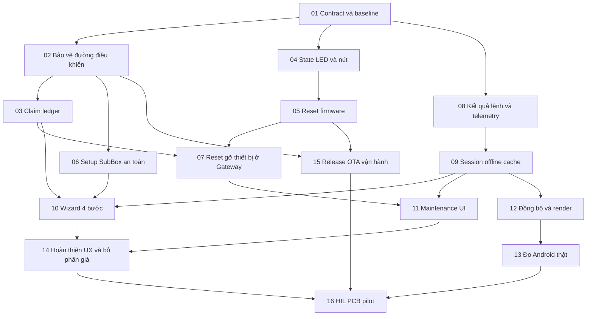

# Kế hoạch triển khai vòng đời thiết bị và tối ưu Android

> **For agentic workers:** REQUIRED SUB-SKILL: Use superpowers:executing-plans to implement this plan task-by-task. Nếu người dùng chọn giao việc theo subagent, dùng superpowers:subagent-driven-development. Các checkbox dưới đây là việc cần làm, không phải việc đã hoàn tất.

**Goal:** Người dùng tự thêm, nhận diện, khôi phục và gỡ thiết bị an toàn; app Android phản hồi nhanh và phản ánh đúng trạng thái, tạo nền tảng phát hành thương mại.

**Architecture:** Giữ Flutter/Riverpod/GoRouter, Gateway Python/SQLite/MQTT và firmware SubBox/ActionBox. Bổ sung lifecycle/operation ledger và hợp đồng cấu hình có xác nhận; sửa state/data flow hiện tại, không xây backend/app mới.

**Tech Stack:** Flutter 3.44.8/Dart 3.12.2 đang có ở máy audit; Python 3.12; ESP-IDF 6.0.2 theo lockfile; SQLite, MQTT TLS, ESP-NOW có khóa theo peer. Khóa toolchain/dependency trước release; nâng SDK là thay đổi riêng có compatibility test.

**Spec:** [Thiết kế và 12 phát hiện bổ sung](/home/tuan/.codex/worktrees/d283/Home-Assistant-IoT-/docs/superpowers/specs/2026-10-19-device-lifecycle-android-design.md). Đọc cùng [audit thương mại ban đầu](/home/tuan/.codex/worktrees/d283/Home-Assistant-IoT-/docs/commercial-code-audit-2026-10-18.md).

**Phạm vi của lần làm việc này:** chỉ rà soát, kiểm chứng và lập kế hoạch. Đã tái hiện 4 ca Gateway + 4 ca Flutter; chưa áp dụng các thay đổi dưới đây vào sản phẩm.

## Global Constraints

- Một nhà/Gateway, tối đa 10 SubBox × 4 ActionBox, tối đa 120 kênh, 5 tài khoản; đây là tải nghiệm thu đề xuất.
- Hai giai đoạn nút: pilot dùng nhấn giữ BUT1; bản thương mại thêm CONFIG riêng, theo lựa chọn người dùng ngày 19/10/2026.
- Giữ riêng UID/board/calibration/khóa setup nhà máy với dữ liệu owner, mạng, peer và rule người dùng; factory reset không xóa calibration/eFuse/anti-rollback.
- Setup window 180 s; candidate TTL 30 s; claim deadline 120 s; identify tối đa 15 s; xác nhận nút reset trong 5 s.
- Remote factory reset: admin, re-auth trong 5 phút, hiện diện vật lý trong 30 s. Destructive command chưa dispatch hết hạn sau 30 s, không tự chờ online vô hạn.
- Debounce 40 ms; giữ 3–<5 s reboot, 5–<10 s network reset/setup, ≥10 s factory reset; thực thi theo hành động được chọn khi thả; reset phá hủy cần nhấn ngắn xác nhận.
- Mỗi lệnh/ACK phải gắn UID, ownership epoch, operation/command ID và revision thích hợp; HTTP 200/202 hoặc MQTT publish thành công không thay thế ACK thiết bị.
- Không đưa secret vào log, query URL, discovery, SSE, snapshot, export hoặc QR telemetry; setup proof chỉ xử lý trong phạm vi commissioning đã xác thực.
- Không bật tải để identify/onboarding; không dùng trạng thái suy đoán làm confirmed state; không làm yếu safety/watchdog đang có.
- Không thêm cloud, microservice, state framework, message broker hay database mới. Thư viện provisioning chính thức chỉ thêm sau xác nhận build/size/license trên IDF/Android mục tiêu.
- Không flash, reset thiết bị thật, thay đổi Wi-Fi đang sử dụng, phát hành hoặc đốt eFuse chỉ vì đã chạy qua test offline; các bước đó thuộc phiên triển khai/fixture được chỉ định.

## Review Focus

1. Mất nguồn đúng giữa ghi NVS/reset và boot: không bật tải hoặc quay lại quyền cũ — test T05/T16.
2. Hai admin nhận cùng một thiết bị, retry khi ACK mất: chỉ một owner/operation có hiệu lực, không mất pending — test T03.
3. Đổi tài khoản/Gateway hoặc ON→OFF liên tiếp trong lúc response cũ còn về: không ghi sang scope mới, trạng thái cuối theo xác nhận mới nhất — test T09.
4. Android đổi sang SoftAP không Internet, mobile data/VPN còn bật hoặc quyền bị từ chối: request đúng Network, không rò credential, có đường quay về — test T06/T10/T13.
5. Factory reset/gỡ SubBox còn 4 ActionBox con và member cũ: app nói rõ ảnh hưởng, tải an toàn, quyền đã thu hồi không sống lại — test T07/T16.

## 1. Bản đồ thay đổi

Các đường dẫn dưới đây tương đối với repository hiện tại; file “tạo” là đề xuất mới.

| Vùng | File chính | Vai trò sau thay đổi |
|---|---|---|
| Contract | Tạo `docs/contracts/device-lifecycle-v1.md`, `tests/fixtures/device_lifecycle/` | Schema và fixture chung cho 3 tầng; không sinh framework RPC |
| Gateway lifecycle | Tạo `Gateway/gateway/device_lifecycle.py`; sửa `main.py`, `registry_manager.py`, `auth_manager.py`, `mqtt_handler.py`, `web_server.py` | Claim/operation, quyền, persistence và route; main chỉ nối các thành phần |
| Firmware state | Tạo `Firmware/firmware_esp/common/device_lifecycle.h`; sửa `common/connection_status.h` | Enum/contract trạng thái và logic pure dùng được trong host test |
| ActionBox V1/V2 | `src/drivers/button`, `drivers/led`, `device/device_manager.cpp`, `storage/nvs_storage.*`, `network/espnow_transport.*`, `protocol/actionbox_protocol.*`, `system/task_manager.cpp` | Nút, LED, reset, migration, secure peer và cấu hình có ACK |
| SubBox | `src/system/wifi_provisioning.*`, `subbox_led.*`, `dev_console.cpp`, `task_manager.cpp`, `storage/{nvs_manager,security_config}.*`, `audio/audio_transport/espnow_audio_transport.*`, `mqtt/subbox_mqtt_client.*`, `main.cpp` | Provisioning, CONFIG handler, reset, trusted peers và routing |
| App models/state | Sửa `lib/models/device.dart`, `models/action_box.dart`, `services/gateway_client.dart`, `repositories/smart_home_repository.dart`, `providers/smart_home_providers.dart` | Model đúng capability, trạng thái xác nhận, diff snapshot, session scope |
| App lifecycle | Tạo `lib/models/device_lifecycle.dart`, `lib/services/device_lifecycle_client.dart`, `lib/services/gateway_event_stream.dart` | DTO và operation/SSE; dùng chung transport/session, không tạo auth client thứ hai |
| App UX | Sửa `features/actionbox/add_device_flow.dart`, `action_box_detail_screen.dart`, `features/settings/settings_screen.dart`, `app/smart_home_app.dart`, `app/app_router.dart`, `widgets/device_card.dart` | Wizard 4 bước, maintenance, offline, control đúng capability |
| Android bridge | Sửa `MainActivity.kt`, `AndroidManifest.xml`; tạo `DeviceProvisioningBridge.kt` cùng package hiện tại | Kết nối SoftAP/request network và SDK provisioning qua MethodChannel tách khỏi session vault |
| Kiểm thử | Thêm test lifecycle/operation/contract Gateway, firmware host, Flutter production adapter và `integration_test/` | Các ca lỗi đã có và performance/HIL |

Không gom driver pinout V1/V2 trước khi đã có test cho cả hai. Không xóa `lib/screens/` toàn bộ: `LoginScreen` vẫn dùng ở app chính; một số test còn dùng shell cũ.

## 2. Thứ tự và phụ thuộc

T04 cung cấp state/nút/LED; T05 mới thực thi reset. T03 và T06 có thể kiểm bằng fake transport trước khi firmware hoàn tất nhưng chỉ nghiệm thu tích hợp sau T04–T06. Không nối UI reset production khi firmware chưa báo capability và chưa có ACK operation.

## 3. Công việc triển khai

### T01 — Khóa hợp đồng vòng đời, fixture và baseline

**Sửa/tạo:** contract/fixtures nêu trên; `Gateway/tests/test_device_lifecycle_contract.py`, `App/dtv_energy_flutter/test/device_lifecycle_contract_test.dart`, `Firmware/tests/test_device_lifecycle.py`.

**Interfaces:** DTO `DeviceDescriptor(device_uid, board_model, board_revision, protocol_version, capabilities, home_id, owner_epoch, boot_id, config_revision)`; `Operation(kind, operation_id, device_uid, state, error_code, expires_at)` với enum ở spec. Hàm pure firmware chuyển lifecycle/connectivity/fault → LED pattern.

- [ ] Ghi fixture cho V1 2 kênh, V2 3 kênh, SubBox 0 relay; thêm unknown model, protocol không hỗ trợ, epoch cũ, duplicate UID và timestamp cũ.
- [ ] Định nghĩa wire v2 trong giới hạn frame receiver đang dùng: tối đa 250 byte/frame. Cấu hình lớn dùng begin/chunk/commit, chunk tối đa 160 byte, config tối đa 4096 byte, reassembly timeout 10 s, tối đa 1 operation cấu hình/ActionBox và 2/SubBox; kiểm đủ size/hash trước commit.
- [ ] Viết test consumer cho ba tầng: `unknown_model_rejected`, `v2_exposes_three_channels`, `old_epoch_rejected`, `oversize_fragment_rejected`; chạy để xác nhận thiếu hành vi hiện tại.
- [ ] Ghi baseline từ audit vào ledger; thêm instrumentation đếm stream emissions, rebuild card, HTTP bytes, boot/frame timing. Chưa gán số FPS/pin từ host test.
- [ ] Chạy contract tests khi DTO/parser tối thiểu có đủ; review schema/field names và commit contract cùng test, không thay hành vi relay trong task này.

**Nghiệm thu:** cùng fixture đọc được ở Python/Dart/C++; magic lưu trữ khác config revision; UID ổn định không phụ thuộc tên phòng. Không phát hành giao thức v2 trước khi T02 bảo vệ transport.

### T02 — Bảo vệ các đường điều khiển trước khi mở chức năng lifecycle

**Sửa:** `audio_server.py`, `config.py`, `web_server.py`, `MQTT_Server/mosquitto/config/mosquitto.conf`, `MQTT_Server/docker-compose.yml`, firmware ESP-NOW transports và `SecurityConfig`.

**Consumes:** identity/capability của T01. **Produces:** danh tính đã xác thực gắn socket/peer/credential; router chỉ được gửi đúng UID/owner epoch.

- [ ] Chuyển R1/R2 và các trường hợp peer chưa pair thành regression từ chối: token thiếu/sai node, ACK giả, broadcast command, Wi-Fi connect ngoài setup, replay packet/owner epoch cũ.
- [ ] Áp dụng WSS/token hoặc proxy được đóng gói; backend bind phù hợp, MQTT TLS/ACL theo thiết bị, secret riêng, không broker anonymous hay DB/Adminer public mặc định.
- [ ] Cài bootstrap key riêng từng ActionBox trong fixture sản xuất, chỉ mở encrypted claim khi có cửa sổ vật lý; cấp LMK vận hành qua kênh đã xác thực. Ghép cặp ở cả hai đầu, không trust khi peer list rỗng.
- [ ] Lọc `/api/voice/vocabulary` theo quyền; operation/candidate admin-only, command vẫn theo quyền node. Không giảm bảo mật để firmware cũ kết nối được; firmware thiếu capability ở trạng thái cần nâng cấp/nhận lại.
- [ ] Kiểm ca âm tính không làm thay relay/route/Wi-Fi/registry; chạy các test auth/relay hiện có. Review thay đổi cấu hình triển khai cùng hướng dẫn cấp khóa; commit.

**Nghiệm thu:** đóng P0 #1/#2 và nhóm #3/#4/#12/#18 của audit trước trên test, sau đó chứng minh trên fixture khi T16. Không coi chỉ bật TLS flag là đủ.

### T03 — Claim có transaction trạng thái và xác nhận đầu-cuối

**Sửa/tạo:** `device_lifecycle.py`, registry/main/web/MQTT/discovery; `Gateway/tests/test_commissioning.py`.

**Interfaces:** `start_claim(user, request, now) -> Operation`; `on_device_applied(device_uid, owner_epoch, operation_id, config_revision) -> None`; API candidates/claims/operations ở spec; ledger bền vững SQLite.

- [ ] Viết test với kỳ vọng ngược G1/G2: unseen candidate bị từ chối, publish false chưa success, đầy SubBox giữ candidate và dữ liệu nhập. Thêm hai admin claim đồng thời, request lặp cùng idempotency key, mất ACK sau device commit.
- [ ] Validate proof/TTL/capability/route/slot trước mutation; bỏ manual fake descriptor; ràng buộc uniqueness UID và claim đang chạy. Slot tính theo SubBox, không chỉ room string.
- [ ] Lưu trạng thái pending operation trước dispatch; gửi config qua command topic đúng SubBox và wire contract T01; chờ APPLIED cùng version, đối soát nếu ACK mất.
- [ ] Chỉ chuyển claimed/publish HA discovery sau xác nhận; version và device ID do server trả, không tự dựng trong app. Giữ thông báo lỗi/operation để tiếp tục sau app restart.
- [ ] Chạy `python -m unittest discover -s Gateway/tests -p test_commissioning.py -v`, kiểm các test PASS; chạy auth/relay regression; review và commit.

**Nghiệm thu:** thêm cùng một UID nhiều lần không tạo bản sao; mất mạng không xuất hiện thiết bị online giả; failure không làm mất candidate; không cấp quyền trước khi ownership được xác minh.

### T04 — State firmware, LED và nút không chồng hành động

**Sửa/tạo:** common lifecycle/status headers; button/LED/device/task_manager của cả ActionBox; SubBox CONFIG handler, `subbox_led.*`, `security_config.cpp`; host test.

**Interfaces:** `ButtonAction classify_release(held_ms, armed_kind)`; `LedPattern resolve_status(lifecycle, connection, faults, operation)`; callbacks `on_user_action(action)` chỉ phát một action, chưa gọi erase trực tiếp.

- [ ] Test pure với biên 699/700/2999/3000/4999/5000/9999/10000/20000 ms, bounce, boot đang giữ nút, timeout xác nhận; tổng action phá hủy bằng 0 khi chưa xác nhận.
- [ ] Thực hiện bảng cử chỉ trong spec. Pilot BUT1 là nút dài chức năng, short vẫn như cũ khi claimed; bỏ voice 1,2 s trên BUT1, bỏ factory reset trên BUT2.
- [ ] Thêm ownership state vào NVS và LED resolver; unclaimed nháy 1 Hz tới khi claim xong, READY không nháy nhanh liên tục; identify không điều khiển tải.
- [ ] Duyệt đủ mọi relay khi tổng hợp fault, đưa fault ch3 vào LED1; LED2 một chủ thể voice; nối CONFIG SubBox theo board config thay GPIO0 hardcode.
- [ ] Host test cả V1/V2/SubBox, ghi lại trace LED theo thời gian; build đúng board; review và commit.

**Nghiệm thu:** một lần giữ 10 s không gọi voice/reboot/reset network trước factory action; nút xác nhận không toggle relay; trạng thái unclaimed khác offline. Thời gian/độ dễ hiểu cuối cùng kiểm lại ở T16.

### T05 — Reset firmware an toàn và migration NVS

**Sửa/tạo:** storage, relay safety coordinator, network transport và task manager; tạo `system/device_reset.*` ở board tương ứng khi cần; `Firmware/tests/test_device_reset.py`.

**Interfaces:** `prepare_reset(kind, operation_id, owner_epoch)`; `confirm_reset(operation_id)`; `resume_interrupted_reset()`; trả progress/error qua operation ACK contract. Factory data và lifecycle monotonic epoch lưu riêng user data.

- [ ] Viết test reset giữ calibration/UID/factory key, xóa đúng Wi-Fi/owner/peer theo loại; thử lỗi commit và mất nguồn ở mỗi bước; latching relay phải OFF trước erase/reboot.
- [ ] Tách/migrate blob hiện tại sang factory calibration + user config + lifecycle metadata, có version/CRC và đường rollback migration. Không fallback về calibration mặc định rồi báo reset thành công.
- [ ] Lưu reset intent, khóa lệnh mới, dừng audio/rule, đưa mọi tải OFF, xóa chọn lọc state flash lẫn peer RAM, commit rồi reboot. Lỗi actuation/NVS trả failed với nguyên nhân.
- [ ] SubBox reset xóa cả namespace/credential người dùng đúng ma trận; factory reset không xóa eFuse hoặc bản firmware. Reboot/network reset không được tự clear fault an toàn.
- [ ] Kiểm host failure injection và fixture reset không tải nguy hiểm; test `power_cut_resume`, `calibration_survives_factory_reset`, `peer_runtime_cleared`, `channel3_off_before_reset`; review và commit.

**Nghiệm thu:** state sau boot phù hợp loại reset; cấu hình không “sống lại” từ RAM; owner epoch tăng khi factory reset và lệnh epoch cũ bị từ chối.

### T06 — Setup SubBox có bảo vệ và bridge Android

**Sửa/tạo:** SubBox Wi-Fi provisioning/main/security storage; Android bridge + Manifest; Flutter provisioning service; test lifecycle mạng.

**Interfaces:** MethodChannel `sic/provisioning`: `connectSetupNetwork(descriptor)`, `provisionSubBox(settings)`, `cancelProvisioning()`; event stream progress có operation/session ID. Native service không nhận token người dùng Gateway làm credential thiết bị.

- [ ] Build một fixture tối thiểu với component provisioning chính thức trên IDF 6.0.2, ghi flash/RAM và license/dependency; chốt phiên bản vào lockfile. Security 2 hoặc phương án chính thức tương đương đã kiểm chứng; không dùng security mode 0.
- [ ] Test mất Wi-Fi 5 lần không tự mở AP; chỉ physical/first-setup window hợp lệ mở 180 s; setup sai proof/quá hạn bị từ chối.
- [ ] Đồng bộ Wi-Fi và MQTT/WSS/CA/credential riêng vào storage nhất quán. Đổi mạng bình thường có staged config/rollback; network reset xóa Wi-Fi theo ma trận, vẫn giữ owner.
- [ ] Tích hợp Android Wi-Fi Network Request API/SDK provisioning có user consent, permission theo SDK, request gắn đúng Network; hủy giải phóng callback/network. Từ chối quyền hoặc không Internet phải trả trạng thái xử lý được.
- [ ] Kiểm sai Wi-Fi password, AP mất giữa chừng, mobile data/VPN, app background/process death; quay về mạng nhà đối soát UID/operation; commit bridge và firmware khi test đồng bộ PASS.

**Nghiệm thu:** không cần USB console để khách hàng hoàn tất setup; không credential chung mặc định, không mở AP do sự cố mạng thông thường. Đây là bổ sung thư viện có lý do cụ thể, không mở rộng sang BLE trong MVP.

### T07 — Gateway quản lý reboot/reset/remove và thu hồi quyền

**Sửa:** lifecycle/registry/auth/main/MQTT/web; `Gateway/tests/test_device_operations.py`, `test_device_removal.py`.

**Interfaces:** `start_operation(user, device_uid, kind, idempotency_key, confirmation) -> Operation`; `reconcile_operation(operation_id) -> Operation`; `revoke_device_grants(device_uid)`. Không tái dùng delete row làm factory reset.

- [ ] Chuyển G3/G4 thành test từ chối auto-relink thiếu proof và thu hồi hết quyền; thêm offline remove, online reset, duplicate confirmation, expired operation, 4 child devices khi reset SubBox.
- [ ] Enforce admin/re-auth/physical confirmation/TTL, loại firmware không hỗ trợ; `identify` tự hết 15 s, không gửi relay command.
- [ ] Trước remove, lưu tombstone và bước thu hồi trong ledger; revoke auth DB, broker/device credential, SubBox peer và liên kết rule; retry/reconcile khi DB/broker lỗi. Không bỏ qua lỗi DB bằng `except: pass`.
- [ ] Offline remove thành công ở phần thu hồi Nhà nhưng đánh dấu device erase chưa xác nhận; không queue factory reset vô hạn. Hello cũ không tự phục hồi ownership hoặc membership.
- [ ] Chạy operation/removal tests + auth scope regression; review dữ liệu bị xóa/giữ ở từng action; commit.

**Nghiệm thu:** người cũ không điều khiển được UID được thêm lại; app luôn phân biệt “đã gỡ khỏi Nhà” với “đã xóa trên thiết bị”; mất ACK có đường đối soát.

### T08 — Chuẩn hóa kết quả lệnh, ba kênh và telemetry

**Sửa:** `verify_engine.py`, `main.py`, MQTT/registry; firmware config/LOAD_REPORT; Flutter `Device`/repository/client/cards; tests ở cả ba tầng.

**Interfaces:** `CommandResult(command_id, requested_state, confirmed_state, verification, error)`; `ChannelTelemetry(channel_id, sample_time, validity, power_w, voltage_v, current_a, energy_wh)`. Load type tách capability control.

- [ ] Chuyển các R3/R5/R10/R12/R14 của audit trước thành regression đúng; thêm ack-only, wrong-channel, stale sample, fault, sample vắng mặt và ch3 riêng.
- [ ] Chuẩn hóa caller HTTP/voice/bulk/scene: ACK_ONLY khác LOAD_CONFIRMED; timeout/failure không stamp requested thành confirmed; scene trả kết quả từng thiết bị.
- [ ] LOAD_REPORT phải khớp request/session/boot/channel, độ mới và ngưỡng hiệu chuẩn; chờ report theo deadline riêng sau ACK, không trả confirmed chỉ vì `valid=true`.
- [ ] Capability quyết định số kênh; telemetry đi vào snapshot/history đúng kênh; tổng board không cộng lại nhiều lần. Relay gắn điều hòa không tự có điều chỉnh nhiệt độ; bỏ value đa nghĩa.
- [ ] Chạy regression Gateway/Flutter/firmware liên quan; test câu trả lời tiếng Việt và trạng thái card; commit theo từng thay đổi contract tương thích.

**Nghiệm thu:** UI, voice và thiết bị không mâu thuẫn; không mất ch3; không hiển thị W thành %/°C; lỗi không biến thành success.

### T09 — Session isolation, cold start và offline cache

**Sửa/tạo:** client, `smart_home_app.dart`, provider/session model, cache service và Keystore helper; `test/gateway_session_lifecycle_test.dart`, `test/offline_startup_test.dart`.

**Interfaces:** scope `(gateway_identity, user_id, generation)`; `restoreLocalSession()` không đợi mạng; `revalidateSession()`; `CachedSnapshot(scope, revision, captured_at, data)`; pending command key gồm scope/node/channel/command ID.

- [ ] Chuyển F3/F4 thành test kỳ vọng đúng; thêm logout khi request đang chờ, đổi Gateway trùng node ID, ON→OFF đảo response, auth 401 và cold start không mạng.
- [ ] Clear/cancel pending scope khi đổi phiên; mọi mutation sau await kiểm generation; response cũ không rollback/stamp dữ liệu mới. Per-channel chỉ một lệnh đang dispatch, ý định tiếp theo được coalesce hoặc xếp hàng hữu hạn.
- [ ] Dựng shell/local state trước, revalidate nền; cache chỉ đọc khi offline, đánh dấu last seen/stale và khóa lệnh không thể xác thực. Cached session không là bằng chứng quyền mới.
- [ ] Snapshot riêng theo Gateway/user, mã hóa bằng Keystore trong app-private storage, ghi có debounce; xóa scope khi logout; preference không nhạy cảm dùng SharedPreferences đang có.
- [ ] Test process restart, cache hỏng, đổi certificate/Gateway identity, session hết hạn; đo first-frame riêng thời gian connect; review và commit.

**Nghiệm thu:** UI không bị giữ ở spinner toàn màn bởi network timeout; pending không sống qua session khác; offline không hiện online giả.

### T10 — Làm lại wizard thêm thiết bị thành 4 bước thật

**Sửa/tạo:** `add_device_flow.dart`, lifecycle client/model, routing; `test/commissioning_flow_test.dart`; fixture native bridge của T06.

**Consumes:** candidate/claim operation T03, secure provisioning T06, session T09, capability T08. **Produces:** thiết bị claimed đã xác nhận hoặc lỗi có thể retry với dữ liệu nhập còn nguyên.

- [ ] Chuyển F1 thành regression: nút tiếp disabled khi chưa chọn candidate; success không hiện trước device APPLIED. Test candidate hết hạn/biến mất, tên tiếng Việt, duplicate tap và tên/alias update thất bại.
- [ ] Thay 9 trang bằng chuẩn bị → tìm/identify → đặt tên/phòng/kênh → lưu/xác nhận; tách SubBox và ActionBox; không có SubBox thì hướng dẫn thêm trước.
- [ ] Tích hợp QR/manual setup code, model/serial ngắn và identify 15 s; hỗ trợ V1/V2 theo capability; dùng device ID server trả, không fallback tự tạo.
- [ ] Lưu metadata cùng claim hoặc hiển thị lỗi từng phần minh bạch; cho tiếp tục operation sau quay lại app; ẩn thông tin GPIO/MQTT/IP khỏi luồng thường, đưa vào chẩn đoán.
- [ ] Widget test production adapter ở text scale 200%, lỗi mạng/quyền, window hết hạn; chạy fixture end-to-end trước khi mở tính năng; review và commit.

**Nghiệm thu:** chỉ có một màn “Đã thêm” sau ACK đúng UID/version; người dùng không phải hiểu MAC/GPIO; chỉ thị đèn trên app khớp firmware.

### T11 — Trang bộ điều khiển và chức năng khôi phục trên app

**Sửa/tạo:** `action_box_detail_screen.dart`, maintenance section/widget, settings/router, operation progress view; `test/device_maintenance_test.dart`.

**Interfaces:** UI gọi lifecycle client dùng T07; capability map cho từng kind; widget chỉ hiển thị operation state, không tự suy ra success khi socket đóng.

- [ ] Test phân quyền admin/member, unknown firmware, device offline, SubBox có con, timeout sau request; confirm copy phải có tên/model và số kênh bị ảnh hưởng.
- [ ] Thêm identify, reboot, đổi mạng/khôi phục tuyến, network reset, factory reset, gỡ khỏi Nhà; ActionBox không có nhãn Wi-Fi; đặt toàn bộ ở cấp board.
- [ ] Hướng dẫn 3/5/10 s và nhấn xác nhận bằng hình/nhịp chữ đơn giản; chỉ dẫn CONFIG thương mại khác BUT1 pilot theo board capability, không nói “BOOT bất kỳ”.
- [ ] Theo dõi progress, trạng thái chưa rõ kết quả và thao tác kiểm tra lại; hủy UI không hứa hủy reset đã commit. Export chẩn đoán loại credential, audio và dữ liệu riêng tư không cần thiết.
- [ ] Widget tests + accessibility/TalkBack/manual test; review luồng nguy hiểm với danh sách dữ liệu giữ/xóa; commit.

**Nghiệm thu:** không thể reset nhầm cả board từ công tắc một kênh; app nói đúng khi thiết bị offline hoặc chưa xác nhận xóa.

### T12 — Loại cập nhật thừa, bổ sung SSE và render theo thay đổi

**Sửa/tạo:** repository/provider/client; `gateway_event_stream.dart`; Gateway SSE; Home/Devices/Room/detail lists; `test/snapshot_diff_test.dart`, `test/event_stream_test.dart`.

**Interfaces:** `applySnapshot(snapshot, revision) -> ChangedResources`; `applyEvent(event) -> ChangedResources`; map ổn định theo device UID/channel; immutable object chỉ đổi khi trường có ý nghĩa đổi.

- [ ] Chuyển F2 thành test: snapshot giống nhau phát 0 data events; một kênh đổi không đổi identity card khác; loading/error không tái tạo scenes/vocabulary.
- [ ] Tách dữ liệu và transport status; dùng select cho auth/theme/card, map lookup thay quét list ở từng card, giữ danh sách ID khi cấu trúc không đổi.
- [ ] Dùng SSE hiện có với authenticated scoped events, revision và resync khi gap/queue overflow; không âm thầm drop rồi giữ stale. Một subscription foreground; background đóng; fallback poll 5 s khi màn điều khiển hoạt động, 15 s màn khác, backoff khi lỗi.
- [ ] Coalesce telemetry tối đa 4 lần/s, không coalesce mất fault/command/operation. Dựng room header + SliverGrid lazy; dừng animation khi hidden/reduced motion; không xóa hiệu ứng chỉ vì sở thích.
- [ ] Test fragmented SSE UTF-8, event trùng/đảo thứ tự, token hết hạn, quyền đổi giữa stream, queue đầy và app resume; chạy rebuild counter/HTTP byte comparison; review và commit.

**Nghiệm thu:** baseline 12 emissions/no-op refresh về 0 data emissions; không có double subscriptions hoặc background polling; các card không liên quan không rebuild do telemetry khác.

### T13 — Đo và tối ưu Android trên điện thoại thật

**Tạo:** `integration_test/android_performance_test.dart`, `docs/performance/android-baseline.md`, artifact trace/build metadata. Không mặc định thay dependency hoặc thêm isolate.

**Consumes:** T09/T12; dataset 0, 12, 120 kênh và chậm/mất mạng. **Produces:** bảng before/after, trace DevTools/Perfetto, memory/network/battery evidence trên cùng thiết bị.

- [ ] Chọn một máy 4 GB/60 Hz ở phân khúc thấp được hỗ trợ và một máy phổ biến mới hơn; ghi OS, build hash, nhiệt độ/trạng thái nguồn/mạng, hủy app nền không liên quan để phép đo lặp lại được.
- [ ] Đo startup release 30 lần; profile scroll/toggle/search/tab/onboarding; heap sau 100 vòng mở/đóng và reconnect; A/B foreground/background 30 phút mỗi phần. Không dùng debug/emulator để tuyên bố đạt hiệu năng release.
- [ ] Sửa đúng điểm trace cho thấy: JSON parsing quá ngân sách mới cân nhắc isolate; GPU quá tải mới giảm clipping/shadow; main-thread native I/O mới chuyển worker. Mỗi thay đổi gắn một số đo.
- [ ] Đối chiếu ngân sách spec: first frame P95 ≤1 s, cached shell ≤1,5 s, visual pending ≤100 ms, ≥99% frame UI/raster mỗi phần ≤16,7 ms, heap drift <10%, 0 background poll sau 30 s.
- [ ] So sánh Play crash/ANR khi pilot có mẫu; ghi cả test không đạt và máy không đạt, không chỉ trung bình; review report và commit benchmark ổn định.

**Nghiệm thu:** có số đo thật, không chỉ cảm giác nhanh hơn. Hiện chưa có điện thoại ADB kết nối; task này là công việc phải thực hiện khi có máy, không đánh dấu hoàn tất bằng host test.

### T14 — Hoàn thiện UX trung thực và dọn phần không phục vụ bản đầu

**Sửa:** models/cards/settings/provider; `main.dart` và shell legacy sau kiểm caller/test; docs hướng dẫn; preference tests.

**Interfaces:** preference scope theo user/Gateway; home metadata chung; `controls` quyết định widget thao tác.

- [ ] Test lưu theme/favorite/tên nhà qua restart và đổi user; test relay thuần không có slider dim/speed/temperature; string “chưa có dữ liệu” khi sample thiếu.
- [ ] Lưu preference thật; ẩn toggle cảnh báo nền chưa có delivery, automation RAM và capability chưa hỗ trợ. Giữ banner lỗi/operation trong app; scheduler thật là mục riêng cho bản sau nếu cần bán automation.
- [ ] Chuyển test/feature còn cần từ `DTVEnergyApp`/legacy screens sang app chính, rồi xóa phần không còn caller; giữ LoginScreen và chức năng engineering còn dùng. Không giữ hai nguồn theme/router trùng trách nhiệm.
- [ ] Rà tiếng Việt, chữ dài, text scale 200%, TalkBack, nút 48 dp, empty/offline/permission denied/partial state; giảm bước chạm cho điều khiển hằng ngày, không thêm tầng menu không cần thiết.
- [ ] Chạy widget/regression và kiểm smoke build release; review danh sách bỏ/ẩn với phạm vi sản phẩm đã ghi, commit.

**Nghiệm thu:** không có nút bán một hành vi chưa thực hiện; lựa chọn người dùng còn sau mở app lại; chưa xóa mock repository phục vụ test nhưng release không bật mock.

### T15 — Khép kín OTA, release và vận hành từ audit trước

**Sửa:** OTA manager/routes/firmware updater, Gradle/signing/deploy config, registry writer/retention, CI manifest; test liên quan audit #9–#11/#16–#20.

**Interfaces:** signed release manifest có model/board/protocol/version/hash; operation OTA có trạng thái riêng và dùng cùng lifecycle identity; snapshot schema có version/migration.

- [ ] Viết regression sai target/board/hash/signature, publish false, URL thiếu quyền/hết hạn, mất điện OTA; bỏ fallback sang socket khác. Model chưa có updater không quảng bá OTA.
- [ ] Cấp vé tải theo thiết bị/TTL, xác minh firmware trên thiết bị, boot self-test/rollback; không đồng thời factory reset khi flash chưa hoàn tất.
- [ ] Dùng release/upload key riêng và applicationId đã chốt, build lại được từ lockfile; test nâng cấp giữ dữ liệu/Keystore, downgrade/migration có chính sách rõ. Không ký production bằng debug key.
- [ ] Worker SQLite/queue hữu hạn/retention theo audit, backup/restore và runbook; CI dựng dependency cJSON đúng lock, build cả V1/V2/SubBox và test production adapters.
- [ ] Chỉ gom module firmware trùng sau regression; ưu tiên xóa dead code đã chứng minh trước khi thêm abstraction. Review release checklist và commit artifact manifest.

**Nghiệm thu:** OTA không cập nhật sai board, release có nguồn gốc, restore được cấu hình, không còn P0/P1 mở trong phạm vi tính năng sẽ bán. Task này có thể tách thành PR OTA, release và storage theo review gate riêng.

### T16 — Nghiệm thu HIL, PCB và pilot người dùng

**Tạo:** fixture HIL/scripts, `docs/release/pilot-acceptance.md`, hướng dẫn nút/LED theo board và biên bản review PCB. Chủ trì firmware/QA, có người phụ trách phần cứng.

**Consumes:** toàn bộ task trước; phần cứng thật, release candidate. **Produces:** quyết định go/no-go có bằng chứng, không tự suy ra từ test xanh.

- [ ] Pilot PCB cũ: kiểm BUT1 dài/ngắn không nhầm voice/reset, mọi relay OFF khi reset/reboot, chỉ báo ch3 fault; thử 100 chu kỳ add/remove/reset và power cut ở từng checkpoint với fixture phù hợp.
- [ ] Khóa PCB thương mại: CONFIG riêng, nhãn/vị trí an toàn, LED system/voice rõ, chốt điều khiển vật lý kênh 3, review strapping/GPIO/xung relay/nhiệt và linh kiện; không tự chọn GPIO từ chỗ trống trong code.
- [ ] Soak 7 ngày ở 40 node/120 kênh/5 client; mất broker/Gateway/AP/SubBox từng phần, queue đầy, đổi mạng và khôi phục không Internet. Đo reconnect/memory/latency/packet loss, kiểm quyền cũ đã mất.
- [ ] Cho 10 người chưa biết hệ thống tự thêm và khôi phục: mục tiêu ≥9/10 thêm trong 3 phút, khôi phục trong 5 phút, 0 reset nhầm; ghi điểm kẹt, chỉnh copy/nhịp/nút nếu cần rồi thử lại phần thay đổi.
- [ ] Chỉ cho phát hành sau review P0/P1, signing/OTA/restore, security, điện/PCB và số đo Android. Lưu hạn chế còn lại, hỗ trợ/cập nhật và rollback plan; ký biên bản nghiệm thu.

**Nghiệm thu:** người dùng thực hiểu thiết bị chưa thêm/đang lỗi/đang reset; khả năng khôi phục không phụ thuộc lập trình viên hoặc USB console.

## 4. Cách kiểm chứng và tổ chức PR

Mỗi task có một chu kỳ test lỗi → thay đổi nhỏ nhất → test đạt → review → commit. Các ca audit đang assert hành vi lỗi phải đổi kỳ vọng, không đưa nguyên trạng vào CI rồi gọi đó là regression đã sửa. Fixture/source compatibility được review trước khi đổi API đồng thời ở nhiều tầng.

| Nhóm | Lệnh/kiểm tra dự kiến |
|---|---|
| Gateway | `python -m unittest discover -s Gateway/tests -p 'test_commissioning.py' -v`; tương tự file operation/removal/contract mới; sau đó bộ auth/relay/voice hiện có với DB tạm |
| Flutter | `flutter test --no-pub test/commissioning_flow_test.dart`; các test session/diff/maintenance mới; `flutter analyze --no-pub` và suite hiện có |
| Firmware host | `python -m unittest discover -s Firmware/tests -v`, dependency cJSON chuẩn bị từ lockfile; không fake mất semantics timer/relay trong safety test |
| Firmware build | `idf.py build` riêng trong ActionBox, ActionBox_V2, SubBox với đúng target/sdkconfig; kiểm size/partition, không chỉ compile host |
| Android thực | Profile integration tests/DevTools trên máy chuẩn; release startup/upgrade signing; HIL thao tác app tới thiết bị thật |

Các lệnh cho file mới chỉ chạy sau khi task tương ứng đã tạo file. Không chạy `test_clean_gateway.py` lên dữ liệu/Gateway đang vận hành; muốn đưa vào CI phải tách đầy đủ side effects trước.

Nhóm PR đề xuất: contract; transport security; claim; firmware status/button; reset/migration; secure setup; Gateway removal; command/telemetry correctness; app session/cache; onboarding; maintenance; sync/render; measured performance; UX cleanup; OTA/release/storage; HIL/pilot evidence. Không gom đổi UI lớn với thay safety hoặc NVS để reviewer dễ đánh giá.

## 5. Lộ trình và chi phí dự kiến

Ước lượng là **ngày công**, chưa phải cam kết lịch. Giả định hai người kỹ thuật: Gateway/app và firmware, có QA/phần cứng hỗ trợ; các task có phụ thuộc được thực hiện theo sơ đồ. Cần 2–3 ngày đầu để build board và chốt sai khác phần cứng/môi trường.

| Mốc | Nội dung | Khoảng công dự kiến | Sản phẩm bàn giao |
|---|---|---|---|
| M0 | T01 + baseline/build triage | 2–3 ngày công | Contract, fixtures, scope board và baseline |
| M1 | T02–T05 + T07 | 12–18 ngày công | Đường điều khiển được bảo vệ, claim/reset/LED/nút có thể kiểm end-to-end |
| M2 | T06 + T08–T11 | 14–22 ngày công | Secure setup, wizard thật, reset từ app, trạng thái/telemetry/session đúng |
| M3 | T12–T14 | 8–12 ngày công | Đồng bộ nhẹ, số đo Android, UI/preference trung thực |
| M4 | T15–T16 | 12–20 ngày công | Release/OTA/storage, HIL/soak/pilot và quyết định phát hành |

Tổng khoảng **48–75 ngày công**, thường tương đương **8–12 tuần lịch** cho cấu hình nhóm trên nếu không phát sinh lỗi PCB hoặc phải đổi thiết kế provisioning. Có thể có bản pilot dùng nút hiện tại sớm hơn khi M1–M2 đạt; lịch PCB/linh kiện/chứng nhận điện/EMC tách riêng và có thể kéo dài. Ước lượng này mở rộng so với audit 18/10 vì thêm secure onboarding, reset vòng đời, bridge Android và nghiệm thu người dùng.

**Ba việc nên làm đầu tiên:** chốt contract/capability theo board; sửa false success và session scope; xây lifecycle claim/reset với LED/nút thật. Đừng bắt đầu bằng đổi giao diện hoặc tăng tốc animation khi kết quả điều khiển vẫn sai.

## 6. Definition of Done và phần hoãn

- [ ] B01–B12 và audit trước được ánh xạ tới task/test hoặc quyết định ẩn tính năng; không “đóng lỗi” chỉ bằng thay chữ.
- [ ] New/unclaimed nháy đèn rõ, app discovery đúng điều kiện, claim đúng UID có ACK; không ghost devices, không mất candidate khi lỗi.
- [ ] Nút/app cùng semantics reset, không chồng gesture, không mất calibration, không hồi sinh quyền cũ, có khôi phục khi offline/mất điện.
- [ ] App Android có bằng chứng startup/frame/memory/network trên máy thật; snapshot không đổi không phát lại dữ liệu; không trạng thái sai khi đổi session.
- [ ] Release signing/OTA/backup/rollback và build cả board đã kiểm; không còn P0/P1 trong phạm vi bán; HIL và pilot đạt.

**Hoãn khỏi bản đầu:** cloud/đa nhà, BLE song song với SoftAP, notifications nền chưa có delivery đáng tin cậy, automation phức tạp, tái thiết kế mỹ thuật toàn app, gộp toàn firmware thành một framework. Nếu muốn bán automation ngay bản đầu, bổ sung một workstream scheduler Gateway có persistence/timezone/execution log và nghiệm thu khi app tắt; không coi `_automations` trong RAM là đã có tính năng.

**Giới hạn tại thời điểm lập kế hoạch:** chưa sửa code sản phẩm, chưa reset/flash board, chưa đo Android thật; chưa chọn GPIO/PCB mới. Các task trên là chương trình triển khai và nghiệm thu, không phải tuyên bố hệ thống đã thương mại hóa được.
