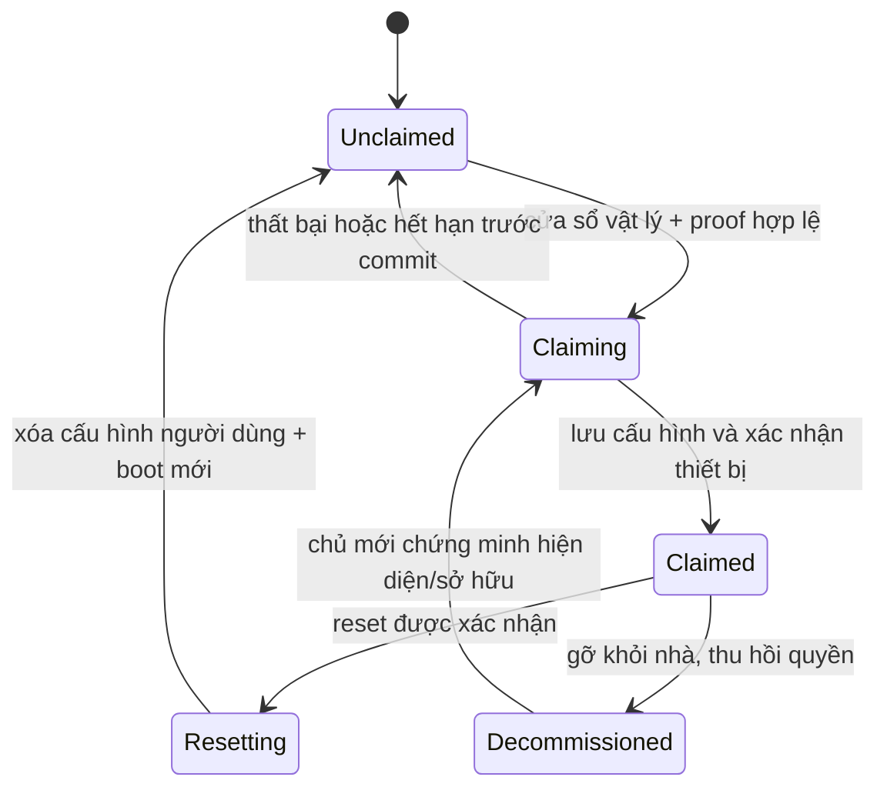

# Rà soát bổ sung và thiết kế vòng đời thiết bị, trải nghiệm Android

**Ngày:** 19/10/2026 — Asia/Bangkok. **Revision:** `8d9d5ada848d05c136054ac5070b21a8235f0573`.

**Trạng thái:** đề xuất thiết kế và cơ sở cho kế hoạch; chưa triển khai thay đổi sản phẩm. Tiếp nối [audit thương mại ngày 18/10](/home/tuan/.codex/worktrees/d283/Home-Assistant-IoT-/docs/commercial-code-audit-2026-10-18.md), không thay thế các P0/P1 ở đó.

## 1. Mục tiêu và quyết định đã có

Người dùng cần sản phẩm tự giải thích trạng thái, tự thêm thiết bị, có nút khôi phục vật lý và chức năng tương ứng trong app; app Android phản hồi nhanh, báo đúng kết quả, hỗ trợ sử dụng và bảo trì như sản phẩm thương mại.

**Đã thống nhất với người dùng:** triển khai phần cứng hai giai đoạn: bản thử nghiệm dùng nhấn giữ nút hiện có; bản thương mại bổ sung nút CONFIG riêng. Các thời gian nhấn và nhịp LED dưới đây là đề xuất thiết kế để triển khai/kiểm thử, chưa phải yêu cầu đã thử với người dùng cuối.

Giả định phạm vi bản đầu: một nhà, một Gateway, tối đa 10 SubBox × 4 ActionBox, tối đa 120 kênh relay, 5 tài khoản hoạt động; Android dùng trong LAN. Chưa thêm cloud, điều khiển từ Internet, đa nhà, thanh toán hay trợ lý AI mới. Không đổi framework hoặc viết lại toàn bộ app.

Phân biệt ba loại sản phẩm:

| Loại | Kết nối thật | Chức năng khôi phục phù hợp |
|---|---|---|
| Gateway | Ethernet/Wi-Fi, chạy Python/broker | Đổi mạng Gateway, restart dịch vụ, backup/restore; factory reset Gateway là quy trình bảo trì riêng |
| SubBox | Wi-Fi tới Gateway + ESP-NOW tới ActionBox | Đặt lại Wi-Fi, cấu hình Gateway, khởi động lại, xóa cấu hình người dùng |
| ActionBox V1/V2 | ESP-NOW tới SubBox; không join router Wi-Fi như SubBox | Khôi phục liên kết SubBox, khởi động lại, xóa cấu hình người dùng; không hiển thị “Reset Wi-Fi” gây hiểu nhầm |

## 2. Phát hiện bổ sung trong code hiện tại

Các ca G1–G4/F1–F4 có [log và mã tái hiện](/home/tuan/.codex/worktrees/d283/Home-Assistant-IoT-/docs/audit-evidence-2026-10-19/README.md). Các mục chỉ đọc code được ghi rõ; chưa đo hiệu năng điện thoại hay thử reset/RF trên board.

### B01 — P1: Wizard báo kết nối thành công trước khi đăng ký

- **Hiện có:** [add_device_flow.dart:76](/home/tuan/.codex/worktrees/d283/Home-Assistant-IoT-/App/dtv_energy_flutter/lib/features/actionbox/add_device_flow.dart:76) là wizard 9 trang; API chỉ gọi ở trang cuối, dòng 145.
- **Lỗi:** guard cho đi tiếp nếu có bất kỳ pending nào dù chưa chọn thiết bị; trang “kết nối an toàn” và “thành công” chỉ là trang tĩnh. F1 xác nhận success screen với 0 POST. Fallback tự tạo ID ở dòng 140; lỗi cập nhật tên/alias bị nuốt ở dòng 170.
- **Sửa:** wizard 4 bước dựa trên trạng thái operation thật, bắt buộc chọn UID/nhận diện vật lý, dùng ID server trả về và chỉ hoàn tất sau ACK cấu hình đã lưu.
- **Tác động nếu giữ:** người dùng thêm nhầm hoặc tưởng đã thêm thiết bị; mô tả PZEM/2 relay/GPIO/WPA-TLS không khớp model thật.

### B02 — P1: Gateway tạo thiết bị “online” khi chưa có thiết bị hoặc gửi cấu hình thất bại

- **Hiện có:** [registry_manager.py:567](/home/tuan/.codex/worktrees/d283/Home-Assistant-IoT-/Gateway/gateway/registry_manager.py:567), [main.py:646](/home/tuan/.codex/worktrees/d283/Home-Assistant-IoT-/Gateway/gateway/main.py:646).
- **Lỗi:** fallback tạo descriptor giả và đặt `online`; `provision_pending()` bỏ qua kết quả `send_cfg`. G1 tái hiện không discovery + gửi false vẫn success. G2: xóa pending trước khi kiểm tra giới hạn phòng khiến candidate biến mất khi đăng ký bị từ chối.
- **Sửa:** bỏ fallback trong production, kiểm tra trước khi thay đổi dữ liệu, giữ candidate và lỗi để retry; claim có trạng thái bền vững và ACK thiết bị, không đổi trạng thái chỉ vì đã ghi DB.
- **Tác động nếu giữ:** xuất hiện thiết bị không tồn tại, mất khả năng thử lại và hệ thống không biết cấu hình thực đã tới đâu.

### B03 — P1: Đường provisioning chưa khớp firmware ba tầng

- **Hiện có:** [mqtt_handler.py:176](/home/tuan/.codex/worktrees/d283/Home-Assistant-IoT-/Gateway/gateway/mqtt_handler.py:176) gửi compact cfg tới `smarthome/cfg/...`; [SubBox MQTT:130](/home/tuan/.codex/worktrees/d283/Home-Assistant-IoT-/Firmware/firmware_esp/SubBox/src/mqtt/subbox_mqtt_client.cpp:130) chỉ subscribe command/voice_response của SubBox.
- **Lỗi:** không có đường hoàn chỉnh chuyển compact cfg này thành cấu hình ActionBox và trả kết quả lưu. NVS ActionBox dùng `config_version` làm magic kiểm tra blob trong [nvs_storage.cpp:53](/home/tuan/.codex/worktrees/d283/Home-Assistant-IoT-/Firmware/firmware_esp/ActionBox_V2/src/storage/nvs_storage.cpp:53), còn Gateway dùng version cấu hình tăng dần.
- **Sửa:** một hợp đồng claim/config qua Gateway → đúng SubBox → đúng ActionBox → ACK báo UID/version/op_id; tách storage schema magic khỏi config revision. Giữ adapter legacy có capability rõ ràng.
- **Tác động nếu giữ:** UI và SQLite có cấu hình nhưng firmware không nhận hoặc không đồng thuận version. Đây là kết luận đường code, chưa có thử nghiệm broker/board thật.

### B04 — P1: Reset vật lý chưa là một quy trình khôi phục hoàn chỉnh

- **Hiện có:** [button_driver.cpp:132](/home/tuan/.codex/worktrees/d283/Home-Assistant-IoT-/Firmware/firmware_esp/ActionBox_V2/src/drivers/button/button_driver.cpp:132), [device_manager.cpp:232](/home/tuan/.codex/worktrees/d283/Home-Assistant-IoT-/Firmware/firmware_esp/ActionBox_V2/src/device/device_manager.cpp:232), [nvs_storage.cpp:148](/home/tuan/.codex/worktrees/d283/Home-Assistant-IoT-/Firmware/firmware_esp/ActionBox_V2/src/storage/nvs_storage.cpp:148).
- **Lỗi:** giữ nút đi qua ngưỡng 1,2 s sẽ gọi voice trước khi tới reset 10 s; reset chỉ ghi defaults, không chủ động đưa mọi relay OFF, hủy peer trong RAM hay reboot. Defaults cũng ghi đè calibration. SubBox khai báo nút CONFIG GPIO1 nhưng chưa có handler sử dụng; `factoryReset()` chỉ xóa `subbox_cfg`, không xóa `subbox_sec` và peer keys.
- **Sửa:** một state machine nút và một reset executor có thứ tự an toàn; tách factory identity/calibration khỏi user config; kiểm tra lỗi NVS, xóa runtime trust, reboot và xác nhận boot mới.
- **Tác động nếu giữ:** người dùng nghe voice hoặc vẫn thấy tải hoạt động trong lúc tưởng đã reset; trạng thái flash/RAM/Gateway không đồng nhất. Chưa thực hiện reset thật trong audit.

### B05 — P1: LED chưa thể hiện “chưa đăng ký”; lỗi relay 3 không nằm trong chỉ báo lỗi hệ thống

- **Hiện có:** [connection_status.h:5](/home/tuan/.codex/worktrees/d283/Home-Assistant-IoT-/Firmware/firmware_esp/common/connection_status.h:5), [task_manager.cpp:229](/home/tuan/.codex/worktrees/d283/Home-Assistant-IoT-/Firmware/firmware_esp/ActionBox_V2/src/system/task_manager.cpp:229).
- **Lỗi:** READY lại nháy nhanh liên tục; quyết định đèn dựa trên kết nối, không có trạng thái đã được chủ nhà nhận hay chưa. V2 kiểm fault kênh 1/2, bỏ kênh 3. LED2 được voice và logic kênh dùng chung.
- **Sửa:** LED1 theo vòng đời + connectivity + fault, ưu tiên thống nhất; duyệt đủ số kênh. Chọn một chủ thể điều khiển LED2 để tránh ghi đè.
- **Tác động nếu giữ:** thiết bị chưa được thêm vẫn có thể nhìn như sẵn sàng; người dùng không biết cần thao tác gì, và không nhìn thấy một số lỗi.

### B06 — P1: SubBox tự mở AP không mật khẩu khi mất mạng; portal chưa cấp đủ cấu hình bảo mật

- **Hiện có:** [main.cpp:68](/home/tuan/.codex/worktrees/d283/Home-Assistant-IoT-/Firmware/firmware_esp/SubBox/src/main.cpp:68), [wifi_provisioning.cpp:199](/home/tuan/.codex/worktrees/d283/Home-Assistant-IoT-/Firmware/firmware_esp/SubBox/src/system/wifi_provisioning.cpp:199), [wifi_provisioning.cpp:365](/home/tuan/.codex/worktrees/d283/Home-Assistant-IoT-/Firmware/firmware_esp/SubBox/src/system/wifi_provisioning.cpp:365).
- **Lỗi:** 5 lần mất Wi-Fi mở AP `WIFI_AUTH_OPEN`, endpoint save không kiểm proof sở hữu. Portal lưu vào `subbox_cfg`, còn MQTT lấy CA/user/password/URI từ `subbox_sec`; đi hết portal chưa bảo đảm SubBox kết nối Gateway.
- **Sửa:** chỉ mở trong cửa sổ setup có hiện diện vật lý; dùng mật khẩu riêng + phiên provisioning được bảo vệ, cấp Wi-Fi và credential Gateway cùng quy trình; lỗi mạng thường chỉ reconnect/backoff.
- **Tác động nếu giữ:** mất Wi-Fi vô tình mở giao diện cấu hình cho người gần đó; người dùng hoàn thành setup nhưng thiết bị vẫn không dùng được. Chưa thử truy cập AP thật.

### B07 — P1: Xóa/reset không thu hồi đầy đủ quyền và có thể bị tự nối lại

- **Hiện có:** [delete_device:844](/home/tuan/.codex/worktrees/d283/Home-Assistant-IoT-/Gateway/gateway/main.py:844), [delete_node:521](/home/tuan/.codex/worktrees/d283/Home-Assistant-IoT-/Gateway/gateway/registry_manager.py:521), [on_hello:375](/home/tuan/.codex/worktrees/d283/Home-Assistant-IoT-/Gateway/gateway/registry_manager.py:375).
- **Lỗi:** G4 chứng minh quyền member còn trong auth DB riêng sau khi xóa registry; nếu UID đó được thêm lại, grant cũ có thể còn hiệu lực. G3 chứng minh `FACTORY_NEW` với ID cũ được tự relink; chưa có bằng chứng reset generation/ownership mới.
- **Sửa:** thu hồi grants/credential/peer theo UID, lưu tombstone trước khi xóa; không tự nhận lại thiết bị reset chỉ vì trùng MAC. Nếu vẫn giữ hai DB, dùng workflow bền vững, có retry/reconciliation.
- **Tác động nếu giữ:** thao tác “xóa khỏi nhà” không thực sự kết thúc quyền cũ; reset và chuyển chủ có hành vi khó dự đoán.

### B08 — P2: Snapshot không đổi vẫn tạo lại dữ liệu và phát cập nhật toàn app

- **Hiện có:** [gateway_client.dart:218](/home/tuan/.codex/worktrees/d283/Home-Assistant-IoT-/App/dtv_energy_flutter/lib/services/gateway_client.dart:218), [repository:96](/home/tuan/.codex/worktrees/d283/Home-Assistant-IoT-/App/dtv_energy_flutter/lib/repositories/smart_home_repository.dart:96), [providers:123](/home/tuan/.codex/worktrees/d283/Home-Assistant-IoT-/App/dtv_energy_flutter/lib/providers/smart_home_providers.dart:123).
- **Vấn đề đo được:** F2: một refresh không đổi tạo 2 lượt ở mỗi 6 stream, tổng 12; toàn bộ Device đổi identity. Family provider vẫn quét list; list ID mới cũng bị tạo lại. Root app watch toàn bộ client và dựng lại theme.
- **Sửa:** tách transport/loading khỏi snapshot; chuẩn hóa map theo ID, giữ object không đổi, chỉ phát phần thay đổi và select state cụ thể. Dùng lại Riverpod, không thêm state framework.
- **Tác động nếu giữ:** có công việc thừa ở mỗi poll/thao tác và các tab giữ trong indexed stack. Chưa có bằng chứng định lượng FPS, CPU hay mức pin giảm sau tối ưu.

### B09 — P1/P2: Offline và cold start chưa phản ánh tình trạng thật

- **Hiện có:** [smart_home_app.dart:32](/home/tuan/.codex/worktrees/d283/Home-Assistant-IoT-/App/dtv_energy_flutter/lib/app/smart_home_app.dart:32), [GatewayClient.restore:72](/home/tuan/.codex/worktrees/d283/Home-Assistant-IoT-/App/dtv_energy_flutter/lib/services/gateway_client.dart:72).
- **Lỗi:** app giữ màn chờ tới khi auth/refresh mạng hoàn tất; mỗi request timeout mặc định 10 s. F4: refresh thất bại đặt Gateway disconnected nhưng Device từ snapshot cũ vẫn online. Chưa có snapshot bền vững để khởi động ngoại tuyến.
- **Sửa:** mở shell từ session/local cache trước; dữ liệu cũ có timestamp, trạng thái không rõ/mất kết nối, khóa lệnh khi không thể xác thực/định tuyến; revalidate phía sau. Giữ cơ chế dừng polling khi app background đang có.
- **Tác động nếu giữ:** người dùng thấy app “treo” khi mất mạng hoặc tưởng tải vẫn đang kết nối.

### B10 — P1: Lệnh cũ có thể ghi trạng thái sang phiên/Gateway mới

- **Hiện có:** [relay:267](/home/tuan/.codex/worktrees/d283/Home-Assistant-IoT-/App/dtv_energy_flutter/lib/services/gateway_client.dart:267), [_clearSession:480](/home/tuan/.codex/worktrees/d283/Home-Assistant-IoT-/App/dtv_energy_flutter/lib/services/gateway_client.dart:480).
- **Lỗi:** generation guard có ở refresh, chưa có ở toàn bộ vòng đời relay; pending map không được xóa/định phạm vi khi đổi session. F3 dùng cùng node ID ở hai Gateway, phản hồi A khiến B hiển thị ON dù snapshot B là OFF.
- **Sửa:** operation gắn session generation + Gateway identity + node/channel + command ID; bỏ kết quả cũ, xóa pending khi đổi phiên; tuần tự hoặc hợp nhất ý định lệnh theo từng kênh.
- **Tác động nếu giữ:** trạng thái sai sau logout/login/chuyển Gateway hoặc phản hồi đảo thứ tự. Hủy chờ trong app không bảo đảm lệnh đã gửi chưa được thiết bị thực thi; phải đối soát trạng thái mới.

### B11 — P1: Kiểu tải đang bị dùng như capability điều khiển và đơn vị đo

- **Hiện có:** [repository:151](/home/tuan/.codex/worktrees/d283/Home-Assistant-IoT-/App/dtv_energy_flutter/lib/repositories/smart_home_repository.dart:151), [Device.stateText](/home/tuan/.codex/worktrees/d283/Home-Assistant-IoT-/App/dtv_energy_flutter/lib/models/device.dart:94).
- **Lỗi:** production đặt `Device.value = powerWatts`, nhưng stateText diễn giải value thành % đèn, cấp quạt hoặc °C điều hòa theo loại tải. `setDeviceValue()` thực tế chỉ đổi ON/OFF.
- **Sửa:** tách `load_type`, `controls`, `power_w`, `temperature_c`, `brightness_pct`; relay gắn đèn/quạt/điều hòa vẫn chỉ có công tắc nếu firmware không có capability tương ứng.
- **Tác động nếu giữ:** app có thể hiện công suất như độ sáng/nhiệt độ hoặc tạo kỳ vọng điều chỉnh phần cứng không hỗ trợ. Đây là đường code xác định, chưa thêm ca runtime riêng.

### B12 — P2: Một số tùy chọn người dùng không bền vững hoặc chưa có bộ thực thi

- **Hiện có:** [settings_screen.dart:17](/home/tuan/.codex/worktrees/d283/Home-Assistant-IoT-/App/dtv_energy_flutter/lib/features/settings/settings_screen.dart:17), [favorite:344](/home/tuan/.codex/worktrees/d283/Home-Assistant-IoT-/App/dtv_energy_flutter/lib/repositories/smart_home_repository.dart:344), [theme:114](/home/tuan/.codex/worktrees/d283/Home-Assistant-IoT-/App/dtv_energy_flutter/lib/providers/smart_home_providers.dart:114).
- **Lỗi:** tên nhà, tùy chọn cảnh báo, theme/favorite chỉ nằm trong state/RAM tương ứng; toggle cảnh báo chưa nối với dịch vụ gửi thông báo. Automation RAM đã được audit trước.
- **Sửa:** preference thật lưu theo tài khoản/Gateway; tên nhà dùng metadata chung. Ẩn cài đặt cảnh báo nền/automation cho tới khi có hành vi thật; thông báo lỗi trong app vẫn phải hoạt động.
- **Tác động nếu giữ:** mất lựa chọn khi mở lại app, hoặc người dùng tin sẽ nhận cảnh báo nhưng không có đường gửi.

## 3. Giữ, tối ưu, bỏ, thêm, làm lại

| Quyết định | Thành phần | Hành động cụ thể |
|---|---|---|
| **Giữ** | Flutter/Riverpod/GoRouter, Gateway Python/SQLite, MQTT, phân tầng SubBox/ActionBox | Giữ HTTP client dùng lại, lifecycle dừng polling nền, Keystore, auth HTTP, fail-safe relay và host test hiện có. |
| **Tối ưu** | Đồng bộ app, truy vấn theo ID, render danh sách, SQLite writes | Diff snapshot, update riêng từng resource, lazy sliver, cache có giới hạn, writer queue/retention theo audit trước; đo trước/sau. |
| **Bỏ** | Thành công tĩnh, descriptor giả, capability đoán, tự relink bằng MAC | Bỏ khỏi đường production; bỏ PZEM/GPIO/“Bluetooth đang quét” khi flow không làm việc đó; bỏ factory reset trên mọi nút relay. |
| **Bỏ/ẩn đến khi có thật** | Slider không hỗ trợ, notification toggle chưa thực thi, automation RAM | Chỉ mở tính năng theo capability thật; không thay bằng dữ liệu giả. |
| **Thêm** | Vòng đời sở hữu, LED trạng thái, identify, nút CONFIG, reset an toàn | Operation API có kết quả xác nhận, commissioning có proof riêng, hỗ trợ khôi phục ngoại tuyến, lịch sử lỗi ngắn gọn. |
| **Làm lại có giới hạn** | Luồng đăng ký đầu-cuối, reset/delete, mô hình trạng thái app | Thay phần hợp đồng và điều phối sai; tái dùng màn hình, component, storage và transport phù hợp. |
| **Gom sau** | Hai app shell và module firmware trùng | Chuyển test/feature còn được dùng trước khi xóa legacy; gom module dùng chung sau regression cả V1/V2, không gộp pinout. |

## 4. Phương án triển khai được chọn

| Phương án | Ưu/nhược | Quyết định |
|---|---|---|
| Vá LED và thêm vài nút reset trên UI | Nhanh, nhưng tiếp tục sai ownership/ACK và vẫn có reset không hoàn tất | Không đủ cho mục tiêu thương mại |
| **Hoàn thiện vòng đời trên kiến trúc hiện có** | Có thể giao từng phần, giữ phần điều khiển/safety tốt, xử lý đúng nguồn lỗi | **Đề xuất chính** |
| Viết lại app/backend hoặc chuyển ngay sang hệ sinh thái/cloud mới | Chi phí migration và kiểm chứng cao; không tự giải quyết bảo mật radio/reset | Ngoài phạm vi bản đầu |

Provisioning SubBox bản đầu dùng **SoftAP có bảo vệ và giao thức provisioning chuẩn** để tận dụng phần Wi-Fi hiện có. Cần proof/mã thiết lập riêng từng thiết bị, không chỉ WPA2 chung cho mọi máy. Ưu tiên component `network_provisioning`/protocomm của Espressif và Security 2 sau khi build xác nhận trên IDF 6.0.2; không tự viết mật mã. BLE là bước nâng cấp sau nếu thử nghiệm người dùng cho thấy chuyển mạng gây tỷ lệ thất bại cao; chưa đưa thêm cả hai transport vào MVP.

ActionBox giữ ESP-NOW. Discovery broadcast chỉ mang định danh/capability tối thiểu, không có quyền điều khiển. Cửa sổ claim có thao tác vật lý; mã QR chứa UID/model và mã thiết lập riêng. Gateway đã xác thực chuyển bootstrap credential cho SubBox qua TLS; dùng unicast ESP-NOW có khóa riêng cho thiết bị để cấp và chuyển sang LMK vận hành. Không phát LMK qua broadcast/plaintext; phải có kiểm thử cấp khóa từ nhà máy và vòng đời xoay/thu hồi khóa trước khi bật claim production.

## 5. Trạng thái chuẩn và đèn báo

Không dùng một cờ `online` thay thế mọi trạng thái. Tách:

- **Vòng đời:** `unclaimed`, `claiming`, `claimed`, `resetting`, `decommissioned`.
- **Kết nối:** `unknown`, `connecting`, `online`, `offline`; kèm lỗi chặng `wifi`, `mqtt`, `subbox`, `gateway` và `last_seen`.
- **Cấu hình:** `desired_revision`, `reported_revision`; chỉ sẵn sàng điều khiển khi đã xác nhận revision/capability đúng.
- **Lệnh:** `pending`, `acknowledged`, `load_confirmed`, `failed`, `timed_out`; requested state độc lập confirmed state.
- **An toàn:** fault từng kênh; không bị reset kết nối hoặc cập nhật UI xóa mất.

Mất mạng không đổi `claimed` thành `unclaimed`. Với commit đã lưu nhưng mất ACK, giữ operation chưa rõ kết quả và truy vấn lại, không tự rollback/xóa quyền một cách mù quáng.

**Đề xuất LED1/system:** hoạt động bằng nhịp kể cả LED đơn màu; không giả định PCB hiện tại có RGB. Không nháy tải điện để làm dấu nhận diện.

| Trạng thái | Mẫu đèn | App diễn giải |
|---|---|---|
| Chưa đăng ký | 500 ms sáng / 500 ms tắt, lặp liên tục tới khi được thêm | “Chưa được thêm vào Nhà” |
| Đang mở setup/claim | 250 ms sáng / 250 ms tắt, tối đa 180 s | “Sẵn sàng thêm — còn … giây” |
| Đang cấu hình | Hai nhịp 200 ms sáng/200 ms tắt, nghỉ thêm 800 ms | “Đang lưu cấu hình trên thiết bị” |
| Đã đăng ký và kết nối | Sáng 2 s khi vào trạng thái, sau đó tắt; nhấn CONFIG ngắn để xem trạng thái | “Đang hoạt động”; không nháy nhanh liên tục trong phòng ngủ |
| Đã đăng ký nhưng mất kết nối | Hai nhịp 200 ms sáng/200 ms tắt, nghỉ 2 s | Chỉ rõ mất Wi-Fi/SubBox/Gateway; không yêu cầu thêm lại |
| Nhận diện đúng thiết bị | Ba nhịp 200 ms sáng/200 ms tắt, nghỉ 1,8 s; tự dừng sau 15 s | “Thiết bị này đang nháy đèn” |
| Chờ xác nhận network reset / factory reset | Ba / năm nhịp 200 ms, nghỉ 1 s, tối đa 5 s | Nói rõ thao tác nào sẽ xảy ra và dữ liệu bị xóa |
| Lỗi an toàn | Bốn nhịp 200 ms sáng/200 ms tắt, nghỉ 2 s | Fault cụ thể và kênh, kể cả kênh 3 |

Ưu tiên hiển thị: fault → reset đang chờ → setup/claim → identify → connectivity → ready. LED2 chỉ do voice sử dụng trên board hiện tại; nếu cần chỉ báo từng relay, đưa vào thay đổi PCB. Khi unclaimed/claiming/resetting, không nhận lệnh ON từ mạng; bản đề xuất còn khóa ON tại nút relay trước khi hoàn tất cài đặt, chỉ cho phép OFF/test nhà máy qua fixture riêng.

## 6. Một nút chức năng, các thao tác không chồng nhau

### Bản thử nghiệm

ActionBox dùng BUT1 hiện có (V2 GPIO13 theo code), giữ nhấn ngắn điều khiển kênh 1 khi đã đăng ký. Giữ BUT2 điều khiển kênh 2/voice như hiện tại nhưng bỏ factory reset trên BUT2. **Bỏ kích hoạt voice 1,2 s trên BUT1** để một lần giữ dài không vừa gọi voice vừa reset. Chỉ chọn đúng một hành động khi thả nút; ngưỡng đang giữ chỉ đổi tín hiệu, chưa thực thi hành động phá hủy.

| Cử chỉ sau debounce 40 ms | Hành động |
|---|---|
| Nhấn <700 ms | Bản thử nghiệm: thao tác ngắn cũ của BUT1; CONFIG riêng: hiển thị/identify trạng thái 15 s |
| 700 ms đến <3 s | Không thao tác; tránh hiểu nhầm thao tác dở dang |
| Giữ 3 s đến <5 s rồi thả | Khởi động lại có kiểm soát: đưa tải OFF, hủy việc đang chạy, reboot; giữ cấu hình |
| Giữ 5 s đến <10 s rồi thả | Nếu chưa đăng ký: mở setup 180 s. Nếu đã đăng ký: chuẩn bị reset kết nối, nhấn ngắn thêm trong 5 s để xác nhận |
| Giữ ≥10 s rồi thả | Chuẩn bị factory reset; nhấn ngắn thêm trong 5 s để xác nhận; hết hạn tự hủy |

Nút xác nhận khi đang armed được reset controller tiêu thụ, không toggle relay. Giữ ≥20 s/hỏng nút tại boot không được tự lặp reset; yêu cầu thả rồi nhấn lại. Các thao tác không cần Internet hoặc Gateway đang online.

### Bản phần cứng thương mại

Thêm CONFIG riêng, có nhãn và vị trí người dùng tiếp cận an toàn; GPIO chọn sau review schematic, tránh chân boot/strapping và ngoại vi đã dùng. Không hướng dẫn người dùng mở hộp điện hoặc chạm BOOT trên PCB có điện lưới. SubBox đã có khai báo CONFIG GPIO1 nhưng phải xác minh đúng đường mạch/nút lắp thực tế; `SecurityConfig::physicalPresence()` đang đọc GPIO0 cần đổi sang abstraction chung.

V2 có 3 relay nhưng chỉ 2 nút điều khiển trong code. **Thêm CONFIG không tự giải quyết thao tác tại chỗ cho kênh 3.** Trước khóa PCB/BOM, chốt có cam kết mỗi kênh có nút riêng không; đề xuất thêm BUT3 nếu sản phẩm quảng bá điều khiển tại chỗ đầy đủ. Chưa chọn GPIO hay sửa PCB trong kế hoạch phần mềm.

## 7. Phân biệt reset, đổi mạng và gỡ khỏi nhà

Trên UI dùng tên rõ: **Khởi động lại**, **Đổi mạng/Khôi phục liên kết**, **Đặt lại kết nối**, **Khôi phục cài đặt gốc**, **Gỡ khỏi Nhà**. Không dùng một nút “Hard reset” mơ hồ; nhấn EN/mất nguồn chỉ reboot, không phải factory reset.

| Thao tác | Xóa/thay gì | Phải giữ | Hoàn tất khi nào |
|---|---|---|---|
| Reboot | Không xóa cấu hình; hủy công việc tạm | UID, owner, network, calibration, firmware | Boot ID mới và kết nối đã xác nhận |
| Đổi mạng bình thường | Thử cấu hình mạng mới, commit khi kết nối được; thất bại rollback cấu hình cũ | Owner, tên/phòng, quyền, calibration | Gateway xác nhận thiết bị trở lại đúng nhà |
| Network reset SubBox | Xóa Wi-Fi người dùng, mở setup bảo vệ 180 s | Owner, peer list, tên/phòng, calibration, credential Gateway vẫn hợp lệ | Boot/setup được xác nhận; không báo “đã nối lại” khi mới xóa Wi-Fi |
| Network reset ActionBox | Xóa peer/link vận hành để thiết lập lại tuyến | Owner binding và metadata; không cho nhà khác claim nếu chưa factory reset | Tái ghép với SubBox thuộc cùng nhà, nhận revision đúng |
| Factory reset | Xóa Wi-Fi, owner binding, khóa vận hành, peer, rule và cấu hình do người dùng tạo | UID/serial, model/board, khóa gốc dùng setup, calibration nhà máy, giới hạn phần cứng, secure boot/anti-rollback | Thiết bị vào unclaimed với reset generation mới; mọi relay OFF |
| Gỡ khỏi Nhà | Thu hồi grants/credential, loại khỏi UI và rule; online thì phối hợp factory reset | Lịch sử cần giữ theo chính sách; factory identity trên thiết bị | Thu hồi quyền hoàn tất; nếu offline, ghi rõ “Đã gỡ khỏi Nhà, chưa xác nhận xóa trên thiết bị” |

**Thứ tự factory reset:** nhận và xác thực yêu cầu → lưu operation/reset intent → đưa tất cả relay OFF, chặn lệnh mới, dừng audio/rule → xóa chọn lọc user config/peer/key vận hành → commit → reboot → phát trạng thái unclaimed → Gateway đối soát, thu hồi quyền. Nếu không thể xác nhận OFF/ghi NVS, báo lỗi; không hiển thị thành công. Phục hồi sau mất điện phải tiếp tục reset intent đã lưu.

Không `erase_all` phân vùng chứa calibration/identity nhà máy. Không xóa eFuse/secure boot hay hạ firmware khi factory reset. Với firmware cũ chứa calibration trong blob user, phải migrate có CRC/version và kiểm tra lại calibration trước khi bật reset mới.

Factory reset SubBox ảnh hưởng các ActionBox con: app liệt kê số thiết bị, đưa chúng OFF và đánh dấu cần khôi phục tuyến; không âm thầm factory reset tất cả ActionBox. UID ActionBox vẫn thuộc nhà cũ đến khi chủ nhà chọn chuyển/reset riêng. Gỡ thiết bị phải xử lý quyền ở auth DB, tombstone và peer ở SubBox, không chỉ xóa một row registry.

Remote reset cần admin, session vừa xác thực trong 5 phút, xác nhận UI có tên/model/vị trí/số tải; factory reset yêu cầu thêm hiện diện vật lý trong 30 s. Reboot không cần thêm hiện diện vật lý nhưng phải cảnh báo ngắt tải. Không xếp hàng reset phá hủy vô thời hạn để tự chạy khi thiết bị bất ngờ online sau nhiều giờ. Offline thì hướng dẫn nút vật lý và giữ trạng thái chưa xác nhận.

## 8. Luồng app được đề xuất

### Thêm thiết bị — 4 bước chính

1. **Chọn loại và chuẩn bị:** SubBox hay ActionBox; kiểm tra Gateway đang kết nối và quyền admin. Nếu thêm ActionBox khi chưa có SubBox phù hợp, dẫn tới thêm SubBox trước. Chỉ mô tả LED/nút đúng board; không yêu cầu nhập IP/MAC ở luồng thường.
2. **Tìm và nhận diện:** quét QR hoặc nhập mã thiết lập; chỉ hiện candidate còn sống trong 30 s và có cửa sổ setup. Hiện model, số kênh, mã ngắn cuối serial, SubBox dự kiến. Bấm “Nháy đèn nhận diện” 15 s; bắt buộc chọn đúng thiết bị, không tự tạo ID.
3. **Đặt phòng/tên/kênh:** lấy capability thật (V1=2, V2=3); đặt tên tải mặc định có thể sửa. Giới hạn 4 ActionBox tính theo SubBox thực, không chỉ chuỗi tên phòng. Voice alias là tùy chọn sau, tránh bắt người dùng đi qua nhiều trang.
4. **Lưu và kiểm tra:** hiển thị bước đang chạy; đợi cấu hình được lưu, UID/version đúng và tuyến hoạt động. Chỉ lúc đó báo thành công; lỗi giữ dữ liệu đã nhập và có retry đúng bước. Thử ON tải là thao tác chủ động riêng có cảnh báo, không tự bật khi onboarding.

SubBox chưa có Wi-Fi: app lấy cấu hình Gateway/credential riêng trước khi chuyển sang mạng setup; kết nối SoftAP qua API Android có xác nhận người dùng, ràng buộc request setup vào đúng Network, không rò token Gateway sang AP. Sau cấu hình trả về mạng nhà và đối soát. Không có Internet trên SoftAP là trạng thái dự kiến; không coi đó là lỗi Gateway. Từ chối quyền/mật khẩu sai/chỉ thấy Wi-Fi 5 GHz/đổi mạng dở chừng đều có thông báo và đường retry cụ thể.

Thiết bị chưa được thêm phải nháy LED trên thiết bị liên tục, kể cả app chưa mở. App chỉ có thể hiển thị “Phát hiện thiết bị mới” khi Gateway/SubBox/app đã thực sự discovery được; không hứa phát hiện thiết bị chưa vào bất kỳ kênh liên lạc nào. Banner cho admin, không popup chặn lặp đi lặp lại; thành viên thường không thấy secret/candidate toàn nhà.

### Chi tiết thiết bị và phần khôi phục

Tách **bộ điều khiển vật lý** (UID/model/firmware/kết nối/nút reset) khỏi **tải/kênh** (đèn, quạt, ổ cắm). Reset phải đặt trong trang bộ điều khiển, không trong card “đèn phòng ngủ” khiến người dùng vô tình reset cả board.

Trang bộ điều khiển có: trạng thái kết nối + lần thấy gần nhất; các kênh; nhận diện bằng LED; đổi/khôi phục kết nối; reboot; factory reset; gỡ khỏi nhà; chẩn đoán/export đã loại secret. Menu theo capability và quyền. Với firmware chưa hỗ trợ: ghi rõ cần cập nhật hoặc hướng dẫn vật lý, không gửi lệnh giả rồi báo success.

Home giữ thao tác bật/tắt nhanh; pending hiện “Đang gửi…” và giữ confirmed state riêng. Thiếu mẫu đo hiển thị “Chưa có dữ liệu”, không 0 W. Không hiển thị %/cấp/°C cho relay thuần. Lỗi ngắn gọn kèm hành động khắc phục, không dump MQTT/GPIO/stack trace cho khách hàng.

Giữ độ tương phản, vùng chạm tối thiểu 48 dp, font hệ thống, TalkBack, text scale 200%, reduced motion; ý nghĩa LED và lỗi phải có chữ, không chỉ màu. Ưu tiên trạng thái empty/loading/offline/partial/permission denied trước trang trí thêm.

## 9. Kiến trúc API tối thiểu cần bổ sung

Giữ Gateway hiện tại; thêm module lifecycle/operation để không tiếp tục nhồi mọi logic vào `main.py`. Các API dưới là đề xuất mới, không phải endpoint đang có:

| API | Trách nhiệm |
|---|---|
| `GET /api/commissioning/candidates` | Admin; candidate đã xác minh/TTL, loại/model/channel và route; không trả setup secret |
| `POST /api/commissioning/claims` | `{candidate_id, setup_proof, room_id, channels, idempotency_key}`; trả HTTP 202 + operation_id |
| `POST /api/devices/{uid}/operations` | `identify`, `reboot`, `network_reset`, `factory_reset`, `remove_from_home`; idempotency key, TTL, capability và quyền |
| `GET /api/operations/{id}` | Trạng thái và lỗi cụ thể, kiểm tra quyền theo resource; không lấy success HTTP thay kết quả thiết bị |
| `GET /api/events` | Dùng lại SSE hiện có, bổ sung operation/device revision và resync khi mất sự kiện |

Operation state thống nhất: `accepted`, `awaiting_confirmation`, `running`, `awaiting_reconnect`, `succeeded`, `failed`, `timed_out`. “Timed out” nghĩa chưa xác nhận được, không có nghĩa thiết bị chắc chắn không thực hiện. `identify` tối đa 15 s; setup window 180 s; claim deadline 120 s; destructive command chưa dispatch hết hạn sau 30 s; chờ reconnect tối đa 120 s rồi cho đối soát lại chủ động.

Identity/cấu hình: `device_uid` ổn định, `board_model`, `board_revision`, `protocol_version`, `capabilities`, `home_id`, `owner_epoch`, `boot_id`, `config_revision`. `owner_epoch` tăng khi factory reset/chuyển chủ và không quay về 0; giữ trong vùng lifecycle bền vững để loại lệnh cũ. Tên/phòng không phải khóa định danh. SubBox route không được chọn bằng “socket duy nhất” hay node bất kỳ. Mỗi ACK phải khớp UID/epoch/op_id và revision mong đợi.

DB cần operation ledger và tombstone, unique claim theo UID. Chuỗi nhiều DB/thiết bị không phải một transaction SQL: lưu từng bước và retry có idempotency. Không xóa candidate cho đến khi validate xong; không công bố Home Assistant discovery trước khi claimed đã xác nhận.

## 10. Tối ưu Android theo tác động thực tế

| Thứ tự | Thay đổi | Cách chứng minh |
|---|---|---|
| 1 | Sửa pending/confirmed và session isolation; shell không chờ mạng | F3/F4 trở thành regression đúng; cached shell mở cả khi Gateway không tới được |
| 2 | Chặn phát lại snapshot giống nhau, giữ identity object, map theo ID | Refresh không đổi: 0 device/room/scene/vocabulary emissions; loading/connection chỉ cập nhật nơi dùng |
| 3 | Provider select theo resource; cache ThemeData; gom cập nhật telemetry tối đa 4 lần/s | Một kênh đổi không rebuild các card không liên quan; command/fault không bị trì hoãn bởi coalescing |
| 4 | Dùng SSE đã có, polling dự phòng theo lifecycle | Foreground chỉ một subscription; reconnect backoff 2/4/8/16/30 s + jitter; resync khi gap/overflow; background không polling |
| 5 | Cache snapshot có timestamp và ràng buộc tài khoản/Gateway | Cache không chứa token/secret, dữ liệu nhạy cảm mã hóa bằng Keystore; logout xóa scope; không dùng cache để cấp quyền điều khiển |
| 6 | Grid theo sliver lazy, giảm dựng toàn bộ grid trong room; dừng animation ngoài màn | DevTools cho số widget tạo theo vùng nhìn thấy; không bỏ shadow/animation hàng loạt khi chưa đo raster cost |
| 7 | Profile cold start, frame, heap, network, pin trên máy thật | Baseline/after cùng điện thoại, build/profile, dataset và kịch bản; không lấy desktop widget test làm FPS Android |

Không thêm isolate cho mọi JSON; chỉ tách parsing khi trace cho thấy nó vượt ngân sách UI. Không thêm service chạy nền chỉ để polling thiết bị; chưa hứa cảnh báo push khi đóng app nếu chưa có hệ thống gửi đáng tin cậy. Các màn legacy còn được test phải được chuyển test/feature trước khi xóa.

**Ngân sách nghiệm thu đề xuất, chưa phải số đo đã đạt:**

| Chỉ số | Mục tiêu ban đầu |
|---|---|
| Máy chuẩn | Một Android 4 GB RAM/60 Hz thuộc nhóm thấp được hỗ trợ và một máy phổ biến mới hơn; ghi model/OS/thermal/network trong log |
| Cold start | P95 first frame ≤1 s; cached shell có thể tương tác ≤1,5 s; đo 30 lần release; offline không khóa toàn UI để đợi timeout mạng |
| Phản hồi thao tác | Pending visual ≤100 ms; trạng thái đã xác nhận theo SLO Gateway; không dùng animation che ACK thiếu |
| Cuộn/chuyển tab, 120 kênh | Trong profile, ít nhất 99% frame của kịch bản có UI và raster mỗi phần ≤16,7 ms trên màn 60 Hz; ghi riêng tỷ lệ jank và frame >100 ms |
| Cập nhật sự kiện | P95 thay đổi thiết bị → hiển thị ≤1 s trong LAN khi SSE khỏe; fallback polling có nhãn stale và mục tiêu ≤5 s lúc màn điều khiển đang mở |
| Dữ liệu không đổi | 0 data stream emissions/rebuild card do poll giống nhau; HTTP 304/revision hoặc SSE không tải full snapshot 5 s một lần |
| RAM | Sau warm-up và 100 vòng mở/đóng chi tiết + reconnect, retained heap sau GC tăng <10% và không có xu hướng tăng liên tục; theo dõi riêng RSS/bitmap |
| Background | 0 poll/animation do app tự tạo sau 30 s background; không giữ wake lock cho màn dashboard |
| Pin | Đo A/B 30 phút dashboard + 30 phút background cùng điều kiện; yêu cầu không tăng tiêu hao >10% so baseline, rồi đặt ngưỡng tuyệt đối theo máy chuẩn |
| Độ tin cậy | 0 crash/ANR trong regression/soak; theo dõi pilot đủ mẫu, không coi 0 lỗi trên vài máy là bằng chứng tỷ lệ dài hạn |

Flutter khuyến nghị đo UI bằng profile mode trên thiết bị vật lý. Các ngưỡng thương mại ở đây là mục tiêu dự án; ngưỡng Google Play về crash/ANR là mức cần tránh vượt, không phải mức chất lượng mong muốn.

## 11. Điều kiện trước khi đưa sản phẩm ra bán

1. Đóng P0/P1 của audit 18/10 cùng B01–B07/B09/B10/B11 có ảnh hưởng chức năng; phạm vi tính năng chưa hoàn tất phải ẩn rõ ràng.
2. Thêm/xóa/thêm lại, đổi router, đổi SubBox, mất nguồn giữa reset/claim, khôi phục không Internet đều có test hardware và runbook.
3. 10 người dùng thử không phải lập trình viên: ≥9/10 tự thêm thiết bị trong ≤3 phút và khôi phục kết nối trong ≤5 phút theo hướng dẫn; không ai reset nhầm board/kênh. Đây là ngưỡng pilot đề xuất.
4. PCB/nút/LED có vị trí an toàn, kiểm chứng mọi kênh và latching relay khi reboot/mất điện; fault không mất sau reset kết nối.
5. Firmware/App có release signing, OTA đúng model và rollback, migration DB/NVS được thử; không flash ký/đốt eFuse trước khi quy trình đã được review riêng.
6. Có thông tin phiên bản, chính sách cập nhật/hỗ trợ, kênh nhận báo lỗi và export chẩn đoán không chứa credential; không cần thêm nền tảng observability phức tạp cho MVP.

## 12. Nguồn tham chiếu kỹ thuật

- [Flutter performance best practices](https://docs.flutter.dev/perf/best-practices): giảm công việc trong build, dựng danh sách lazy và xác định phần tốn chi phí thay vì tối ưu theo cảm giác.
- [Flutter performance profiling](https://docs.flutter.dev/perf/ui-performance): dùng máy thật/profile mode và theo dõi UI/raster timing.
- [Android Wi-Fi Network Request API](https://developer.android.com/develop/connectivity/wifi/wifi-bootstrap): kết nối peer/IoT có sự chấp thuận của người dùng, không đồng nhất với kết nối Internet thông thường. Phải đối chiếu permission với target SDK thực khi tích hợp.
- [Espressif provisioning](https://developer.espressif.com/blog/2026/05/simple-provisioning/): component provisioning và các security scheme có sẵn. Khóa dependency sau khi xác nhận tương thích IDF 6.0.2 của repo; tài liệu mới không tự chứng minh API/build trên revision cũ.
- [Android vitals](https://developer.android.com/google/play/vitals): theo dõi crash/ANR và các chỉ số vận hành. Tại ngày tra cứu, ngưỡng tổng thể crash người dùng nhận thấy là 1,09%, ANR là 0,47%; không dùng các mức này làm mục tiêu chất lượng nội bộ.

**Giới hạn:** đây là rà soát source và kiểm chứng offline. Chưa có số đo Android thật, RF, bảo mật provisioning thật, NVS power-cut, nút/LED hoặc an toàn tải điện trên board. Các lựa chọn PCB/GPIO và chất lượng điều khiển điện phải được nghiệm thu riêng.
