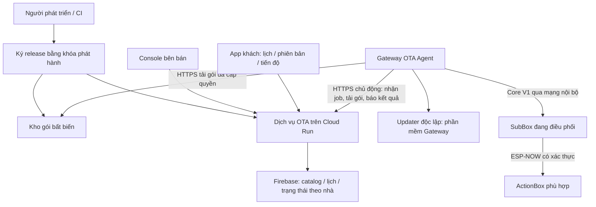

# HomeCompetition — OTA thương mại cho Gateway và các Box

Ngày: 2026-10-27. Trạng thái: thiết kế để duyệt, chưa triển khai.

## 1. Mục tiêu và quyết định đã chốt

Bên bán phát hành tính năng từ xa cho các nhà khách hàng. Gateway, SubBox,
ActionBox chỉ nhận bản phù hợp với phần cứng và phần mềm đang chạy; khách không
cần cắm USB cho các đợt nâng cấp thông thường. Cập nhật thất bại phải giữ lại
khả năng chạy bản ổn định và không tạo thao tác đóng/cắt tải ngoài ý muốn.

Người dùng đã chọn:
- Firebase + một dịch vụ OTA nhỏ.
- Tải nền, tự cài trong lịch bảo trì mà khách cho phép.

Các lựa chọn được cân nhắc: server riêng toàn bộ làm tăng công vận hành; OTA
hoàn toàn do bên bán quyết định không đáp ứng quyền chọn lịch của khách. Không
mở rộng phạm vi huấn luyện KWS hoặc thay luồng nhận dạng giọng nói.

Quyết định thiết kế của người viết:
- Cloud Run chạy dịch vụ Python/aiohttp; Firebase Auth cho tài khoản người dùng,
  RTDB cho cấu hình/trạng thái hiển thị; kho Cloud Storage riêng cho gói bất biến.
- Gateway chủ động kết nối HTTPS ra Internet; không mở port trên modem khách.
- Gateway điều phối OTA trong nhà, dùng lại nền Core V1 đã có. App là nơi xem và
  chọn lịch, không phải máy vận chuyển firmware hoặc nơi giữ khóa ký.
- Một Gateway xử lý một cập nhật phần cứng tại một thời điểm trong bản đầu.
- Cập nhật ứng dụng Gateway/firmware app là phạm vi đầu; OS/kernel, bootloader,
  bảng phân vùng và model dữ liệu riêng là các loại nâng cấp khác, chưa tự động.

## 2. Hiện trạng kiểm tra trực tiếp trong repo

| Thành phần | Đã có trong mã | Khoảng trống cần hoàn thiện |
| --- | --- | --- |
| `Gateway/gateway/core_v1/ota.py` | Chữ ký P-256, SHA-256, đối chiếu model, job trong SQLite, truyền chunk, chờ boot mới và hash/version | Chưa có cloud fleet, nhóm phát hành, lịch khách; manifest hiện chỉ model/version/size/hash |
| `Firmware/firmware_esp/common/hc_core/hc_ota.c` | Kiểm tra chữ ký trên thiết bị, ghi slot khác, hash, kết quả boot, timeout | Chỉ bật khi đã có enrollment/khóa OTA; cần nâng health check, chính sách tương thích và phục hồi job |
| `Gateway/gateway/core_v1/release.py` | Kiểm tra gói ký, giải nén hạn chế, backup SQLite, đổi symlink, health/rollback callbacks | Chưa phải dịch vụ updater độc lập, chưa bảo đảm phục hồi mọi điểm mất điện |
| SubBox/ActionBox_V2 | Hai slot app và otadata, cấu hình build bật rollback | Không phải bằng chứng bootloader trên mọi bo ngoài thực tế đã có cấu hình đó |
| HomeCompetition | Firebase Auth/RTDB, màn hình thiết bị | OTA cloud chưa có worker; không dùng các API local cũ làm đường phát hành thương mại |
| `Gateway/gateway/ota_manager.py` cũ | Upload/download ticket và một số kiểm tra image | Nhận diện board qua tên file không đủ để quyết định OTA thương mại |

`hc_runtime_init` bỏ qua runtime nếu chưa enrollment; `hc_ota_init` bỏ qua OTA nếu
không có public key hợp lệ. Không suy ra “đã hỗ trợ OTA” chỉ từ việc biên dịch mã.
Secure Boot và anti-rollback eFuse hiện chưa bật trong sdkconfig được đọc. File
`docs/ota/ota_guide.md`/runbook cũ mô tả mục tiêu; không coi đó là nghiệm thu HIL.

### Ranh giới tích hợp với Gateway đang dùng

Không đổi dịch vụ Gateway đang chạy sang `core_v1/__main__.py` chỉ để có OTA.
Bản nền OTA thêm một agent/coordinator riêng, dùng thư viện OTA Core và adapter
registry/transport, không chạy thêm một full Gateway điều khiển cạnh tranh.
Enrollment Core cho Box là điều kiện bootstrap; adapter ánh xạ identity vào
registry đang có, không đổi ngầm ID/room/calibration hoặc đường xử lý giọng nói.

`core_v1/release.py` hiện yêu cầu entrypoint Core và schema DB 1, nên không dùng
nguyên trạng để cập nhật `gateway/main.py`. Tách phần verifier/extractor/atomic
switch đã có và thêm profile package rõ ràng cho runtime thực tế. Backup bao gồm
mọi DB/config của service đang chạy (registry/lifecycle/auth và store khác do
inventory phát hiện), không chỉ `core.db`; credential/master key giữ nguyên.
Với pilot ban đầu, hỗ trợ đúng runtime `gateway/main.py` hiện dùng; máy chạy
Core-only là một compatibility profile riêng, chỉ nhận artifact khi đã có test.

## 3. Kiến trúc

Firebase project phục vụ vận hành phải do doanh nghiệp kiểm soát hoặc được bàn
giao quyền lâu dài bằng tài khoản tổ chức. Đăng nhập được vào app không đồng
nghĩa được quyền phát hành OTA. Có thể dùng project hiện tại sau khi xác nhận
quyền kiểm soát; không tự ý dùng credential/quyền của người tạo project khác.

Thiết bị tiếp tục điều khiển cục bộ khi cloud mất mạng. Cloud OTA không được trở
thành điều kiện bắt buộc để nút bấm, relay và lịch cục bộ hiện có hoạt động.

## 4. Tài khoản, định danh và quyền

- Tách quyền `vendor_release_operator` và `vendor_release_approver` khỏi khách
  `home_owner`/`home_member`; không tái sử dụng một cờ admin cho mọi nhà.
- Console phát hành chỉ dành cho tài khoản được cấp quyền phía server. Đăng ký
  tài khoản Firebase thông thường không tạo quyền quản trị.
- Mỗi Gateway có identity/khóa riêng, chỉ được nhận job/báo kết quả cho đúng
  `tenant_id/home_id/gateway_id`. Gateway không mang service-account toàn hệ thống.
- Đăng ký Gateway bằng proof-of-possession của khóa thiết bị và bước gắn nhà có
  thẩm quyền. Dịch vụ cấp token sống ngắn, audience riêng cho OTA, có thu hồi.
  Khóa thiết bị sinh trên Gateway, lưu mode0600; khóa nhà máy/khóa phát hành không
  được nhúng trong app khách hoặc image chung cho tất cả Gateway.
- Box dùng factory identity đã provision + node ID/route/owner epoch hiện có.
  Inventory ánh xạ được factory identity, MAC, ID Core và ID hiển thị cũ; không
  suy luận identity từ tên phòng/tên thiết bị.
- Chuyển chủ/thay Gateway: tăng ownership epoch, thu hồi credentials cũ và hủy
  job chưa cài của nhà cũ. Không cho một thiết bị thuộc đồng thời hai nhà.
- RTDB Rules cho phép khách đọc đúng nhà; ghi lịch/yêu cầu thông qua API kiểm
  tra quyền. Khách và Gateway không được ghi release catalog hoặc sửa SUCCESS.
- Backend dùng Admin SDK vẫn tự kiểm tra quyền ở mọi endpoint; Admin SDK không
  bị Rules bảo vệ thay cho code server.

## 5. Release bất biến và xác thực gói

Một release là nhóm artifact, không phải một file `.bin` áp cho toàn bộ thiết bị.

Ví dụ: release HomeCompetition2.0.0 có thể gồm gateway-linux-aarch64,
subbox-v1-revB và actionbox-v2-revC. Mỗi artifact có version/digest riêng, release
bundle ghi tương thích và thứ tự. Board khác revision chỉ được chọn khi có
artifact phù hợp hoặc xác nhận cùng compatibility class đã kiểm thử.

Manifest có chữ ký bao gồm:
- release/artifact ID, schema version, component role và loại artifact;
- model/SKU, hardware revision/class, chip, flash/partition layout ID;
- OS/CPU/Python ABI cho Gateway; bootloader/update-agent tối thiểu cho Box;
- firmware/app version, protocol min/max, config/schema/model-data compatibility;
- size, SHA-256, signing key ID, release counter và security epoch;
- dependency DAG, feature gates, thời hạn metadata và release notes.

Kho dùng đường dẫn content-addressed theo digest; cấm ghi đè gói đã publish.
Download URL sống ngắn có thể cấp lại mà không thay nội dung/chữ ký artifact.
Thiết bị luôn xác thực gói; URL/HTTPS hoặc quyền Firebase không thay chữ ký.
Gateway từ chối URL ngoài host allowlist, redirect sai đích, hash/size sai,
manifest quá hạn hoặc thời gian hệ thống chưa đủ tin cậy để kiểm tra metadata.
Clock lỗi chỉ chặn cập nhật mới, không chặn vận hành hiện tại.

Dùng lại P-256 cho manifest thiết bị để tương thích phần xác minh hiện có; không
thêm một thuật toán mới chỉ cho OTA. Khóa ký nằm ngoài app/Gateway/Box, có backup
ngoại tuyến; quyền upload gói không đồng nghĩa quyền ký hay phê duyệt release.
Production release cần approval có audit trước khi promotion; cùng một người
có thể kiêm hai vai trò ở pilot, nhưng không bỏ bước kiểm tra.

### Metadata gọn trên đường Core V1

Manifest JSON đầy đủ được Gateway kiểm tra. Box cũng tự kiểm tra một target
header được ký, không chỉ tin kết luận của Gateway. Nâng protocol có phiên bản,
không nhét JSON dài vào payload196 byte và không dùng lại parser132 byte cũ.

Target header v2 có tổng176 byte. Định dạng đề xuất được chốt như sau (little-endian, packed): schema/role/artifact-type/flags4 B;
compatibility ID32 B; version16 B; image size4 B; SHA-25632 B; minimum agent2 B;
minimum bootloader API2 B; protocol min2 B/max2 B; release counter8 B; security epoch4 B;
key ID4 B. Tổng112 B dữ liệu +64 B chữ ký P-256 =176 B, nhỏ hơn196 B.

Compatibility ID là SHA-256 của tuple chuẩn hóa đã provision/biên dịch gồm model,
hardware class/revision, chip, layout và security profile. Mỗi artifact nhắm đúng
class; manifest cloud ánh xạ tuple này rõ ràng. Khóa/chữ ký bao phủ toàn bộ112 B.
Test vector Python/C xác nhận byte layout, endian, chữ ký và thay từng trường
đều bị phát hiện. Version ASCII tối đa15 ký tự +NUL theo quy ước Core hiện có;
release counter64 bit là thứ tự phát hành, không suy từ chuỗi SemVer.

Board không có clock tin cậy kiểm tra signature, compatibility, security epoch,
monotonic counter và admission boot/session/owner epoch; freshness thời gian do
Gateway kiểm tra với metadata ký. Counter xác nhận chỉ tăng khi bản mới đã qua
health check; không chặn boot về slot trước trong giai đoạn pending.

Manifest v1 chỉ dùng để nâng nền bằng artifact đúng một hardware class đã audit;
không cho client cũ tự bỏ qua trường v2 chưa hiểu. Cloud đánh dấu cần nâng nền nếu
agent hiện tại không đủ khả năng xác minh. Không downgrade tự do: cứu hộ về code
cũ cần một recovery release được ký, counter mới, vẫn đáp ứng security epoch.

## 6. Các tác vụ và dữ liệu tối thiểu

Service có nhóm endpoint (tên cuối cùng để builder chốt theo convention hiện có):
- Vendor: upload/stage artifact, publish release, tạo/pause/resume/cancel campaign.
- Customer: đọc cập nhật của nhà, đổi lịch/opt-in, hoãn, yêu cầu cài trong cửa sổ.
- Device: báo inventory, nhận desired deployment, xin download URL, báo trạng thái.

Bản đầu Gateway poll có jitter mỗi 5 phút; có notification RTDB để rút ngắn chờ
nhưng polling vẫn là nguồn phục hồi khi mất thông báo. Không cần broker Internet
mới. Rate limit/backoff theo Gateway; query catalog không tải toàn bộ fleet.
Token và URL download được làm mới qua identity của chính Gateway.

Các thực thể:
- `artifacts`: immutable manifest/hash/target compatibility/signature/storage key.
- `releases`: bundle, dependency DAG, channel, notes, approval, rollback policy.
- `campaigns`: cohort cố định theo home/gateway ID, promotion gates và trạng thái.
- `deployments`: release + Gateway + assignment generation; desired state.
- `targets`: từng component/factory identity, observed boot/version/hash/result.
- `home_policies`: consent, IANA timezone, maintenance window, excluded devices.
- `audit`: ai publish/chọn lịch/hủy, lý do, kết quả; không ghi credential/audio.

Trạng thái job được lưu SQLite trên Gateway và đối soát với cloud. Một worker
lease/generation cho mỗi Gateway; fencing token chặn hai agent cùng thực hiện.
Báo cáo trùng phải idempotent; server chỉ chấp nhận transition hợp lệ của đúng
job/target/generation. Khách không ghi trực tiếp bản ghi kết quả.

## 7. Luồng trong một nhà

1. Gateway báo inventory thật: firmware/build hash, hardware/layout, boot state,
   agent/protocol/config versions, dung lượng trống, route và khả năng rollback.
2. Service chọn artifact đủ tương thích và policy, tạo deployment có ID ổn định.
3. Gateway tải nền, giới hạn bandwidth, hỗ trợ HTTP range; kiểm chữ ký/hash/size.
   Cache dùng chung digest trong nhà; không tải lại cho từng Box cùng loại.
4. Chờ lịch khách đã bật. Mặc định trên nhà chưa consent là thông báo, chưa cài.
   Gợi ý02:00–04:00 theo timezone nhà; không coi đây là lịch khách đã chấp thuận.
5. Preflight: firmware không pending-verify, đủ slot/disk, nguồn/route ổn, không
   đang điều khiển relay/thu giọng; local diagnostics sẵn sàng. Thiết bị/circuit
   bị khách đánh dấu thiết yếu phải có lịch riêng hoặc loại trừ.
6. Staging toàn bundle trước, thực thi dependency DAG; mỗi lần chỉ một phần cứng.
   Gateways/SubBox đang chuyển firmware cho con không được restart.
7. Khởi động bản mới, tự kiểm tra cục bộ, giữ kết quả bền vững rồi báo Gateway/cloud.
8. Chỉ đi bước kế khi có boot/version/hash/health đúng; giữ slot/gói trước để cứu.

Ví dụ nâng protocol: nâng Gateway bridge tương thích cả cũ/mới trước; cập nhật
ActionBox lần lượt khi SubBox cũ đã hỗ trợ packet mới, rồi SubBox; cuối cùng bật
feature mới. Nếu SubBox cũ chưa hỗ trợ, phải có bản cầu nối cho SubBox trước.
DAG kiểm tra mọi trạng thái trung gian; không áp một thứ tự cố định cho mọi release.
Không có đường tương thích từng bước thì block bundle, không thử nạp đại.

### Quyền bắt đầu cài và trường hợp mất Internet

Quyết định của người viết: gói đã stage không tự cho phép cài khi offline. Trước
mỗi target mới, Gateway phải lấy một install grant từ cloud, sau khi service kiểm
tra campaign chưa pause/revoke, consent/lịch hiện tại và đúng policy revision.
Grant có chữ ký dịch vụ, chỉ dùng một lần, TTL120 giây cho thời điểm bắt đầu; ràng
buộc home/gateway/target identity, artifact hash, deployment generation, owner
epoch và nonce. Gateway kiểm clock và ghi journal consumed trước bước cài.
Grant cũ không được dùng cho target tiếp theo hoặc tự mở một lần retry.

Không lấy được grant hoặc không xác minh được thời gian: DEFERRED_OFFLINE, tiếp
tục vận hành phiên bản hiện tại. Mỗi retry cũng xin grant mới. Policy cached chỉ
phục vụ hiển thị/tính lịch dự kiến, không phải quyền activation. Một grant đã cấp
có thể còn dùng được tối đa120 giây sau khi cloud vừa đổi policy; đó là độ trễ thu
hồi tối đa trước khi target bắt đầu, không hứa cancel tức thời trên máy offline.

Grant cho phép hoàn thành một target đã bắt đầu: mất cloud/qua giờ trong lúc ghi
không ép abort hoặc ngăn local health/rollback. Kết quả lưu để đối soát sau; không
khởi công target khác cho đến khi có grant mới. Agent thu hồi lease/generation
phải đối soát journal và trạng thái target trước khi cho worker khác retry, tránh
hai worker chồng lên một OTA đang hoàn tất ngoài cửa sổ cloud lease.

Hết cửa sổ bảo trì: không khởi công target tiếp theo; target đã bắt đầu ghi/boot
được hoàn thành hoặc rollback, không cắt ngang thao tác quan trọng. Pause campaign
ngăn công việc mới; không có nghĩa giật nguồn một thiết bị đang ghi flash.

## 8. Cập nhật Gateway

Tạo OTA Agent và updater systemd độc lập với service Gateway được cập nhật:
- Agent tải/đối soát cloud; updater chỉ có quyền cần để stage, đổi current và
  restart một allowlist service. Không nhận câu lệnh shell từ cloud/manifest.
- Gói runtime theo Linux architecture/Python ABI đã biết, dependency khóa phiên
  bản hoặc runtime đi kèm; không chạy `git pull`, `pip install latest` trong nhà.
- Thư mục releases/version bất biến, venv riêng từng release, current/previous là
  symlink; dữ liệu/config/secrets ở thư mục riêng, không nằm trong release tree.
- Dùng lại verifier/extractor/backup trong `core_v1/release.py`, bổ sung journal
  activation fsync và recovery handler chạy lúc boot, trước Gateway chính.
- Ghi journal trước mọi bước: PREPARED → STOPPED → SWITCHED → VERIFYING → COMMITTED.
  Khi mất điện và journal chưa COMMITTED: khôi phục previous đã xác minh, bật lại
  service và báo recovery; không đoán rằng symlink mới đã chạy ổn.
- Health cục bộ: load config/DB, HTTP127.0.0.1, event loop, local transport/worker,
  không crash vòng lặp. Không bắt buộc cloud hoặc một Box đang offline phải online.
- DB nâng theo expand/contract, phiên bản trước đọc được trong thời gian rollback.
  Chưa hỗ trợ migration phá tương thích trong OTA tự động bản đầu. Backup bằng
  SQLite API trước activation; không tự restore snapshot làm mất dữ liệu mới.
- Nếu new health fail: đổi previous và kiểm health lại. Nếu previous cũng fail:
  giữ updater/recovery chạy, đánh dấu NEEDS_SERVICE, không reset dữ liệu khách.
- Agent/updater tự nâng bằng campaign riêng, có recovery; không tự thay cả updater
  và ứng dụng cùng một giao dịch. OS/kernel/boot firmware Pi nằm ngoài gói này.

## 9. Cập nhật SubBox và ActionBox

- Dùng `hc_core` cho transport, admission, chữ ký, chunk và kết quả; bổ sung layer
  policy/recovery, không xây một đường OTA không xác thực bên cạnh.
- Không yêu cầu ActionBox có Wi-Fi Internet riêng. Gateway ↔ SubBox ↔ ESP-NOW tới
  ActionBox là đường mặc định. Chia chunk tối đa theo payload Core thực tế;
  profile hiện tại cho data chunk192 B + offset4 B. Có ACK/offset/retry bị chặn số lần.
- ACK chunk chỉ là tiến độ truyền, không phải cập nhật thành công. Mất ACK gửi lại
  cùng offset chỉ được chấp nhận nếu dữ liệu khớp; ngoài biên/sai hash thì abort.
- Đứt radio cùng boot có thể tiếp tục theo offset; mất điện/reset giữa truyền bản
  đầu cho phép bắt đầu lại từ0 ở slot không hoạt động. Chưa hứa resume bền vững
  qua reset khi firmware hiện tại không có checkpoint an toàn. Gateway giữ cache.
- Không ghi slot đang chạy, otadata/partition table/bootloader/NVS calibration theo
  một gói app thông thường. Image phải vừa slot nhỏ nhất/layout của chính target.
- Control/nút bấm và watchdog được ưu tiên hơn OTA; giới hạn hàng đợi/rate để OTA
  không chặn đường điều khiển/âm thanh. Đo thông lượng thật rồi mới công bố ETA.
- Relay latching: không phát pulse SET/RESET vì OTA. Preflight và self-test không
  được đóng tải để kiểm thử. Phải nghiệm thu GPIO khi boot và state reconciliation;
  không cam kết “giữ tải” chỉ từ ACK hay giá trị relay lưu trong DB.
- Sau boot: NVS/calibration hợp lệ, GPIO khởi tạo an toàn, task/radio/sensor theo
  capability hoạt động, watchdog ổn; hạn kiểm tra cục bộ do hardware profile quy
  định (mục tiêu30–120 giây, phải đo). Fail thì đánh dấu invalid và rollback.
- Local health đủ điều kiện mark valid không phụ thuộc Internet; báo cáo cloud
  chưa gửi được thì lưu và gửi lại. Gateway chưa nhận boot-result giữ trạng thái
  UNKNOWN/REPORT_PENDING và không triển khai target kế tiếp trong cùng bundle.
- Gói model ở partition dùng chung hiện chưa A/B: app release chỉ được tham chiếu
  model đã có và tương thích. Model thay đổi cần thiết kế atomic riêng trước khi
  nhận loại artifact đó; không ghi đè partition model rồi hứa rollback app là đủ.

## 10. An toàn phát hành và khóa

- Factory provisioning chuẩn phải cài update agent, public key/trust root,
  compatibility identity, device credentials, layout A/B và recovery baseline.
- Bo thử nghiệm hiện có phải audit enrollment/bootloader/layout; có thể cần nạp
  nền một lần trước khi chuyển sang OTA thường xuyên. Không đòi khách làm bước này
  sau khi đã bán máy; làm tại nhà máy hoặc trong đợt chuyển đổi có kiểm soát.
- Commercial factory security profile yêu cầu Secure Boot/credential protection
  phù hợp phần cứng. Bật eFuse/flash encryption là quy trình sản xuất riêng cần
  test/backup, không tự bật trên bo đang dùng chỉ để trình diễn OTA.
- Có current/next signing keys và root metadata ký ngoại tuyến; key rotation phải
  đưa trust update ký bằng root hiện hành trước release dùng khóa mới, kiểm chứng
  bootstrapping cho máy lâu không online. Không thay public key từ RTDB không ký.
- Metadata/counters chống replay và downgrade. Hardware security epoch chỉ tăng
  trong campaign bảo mật riêng; không tăng eFuse mỗi bản thêm tính năng. Nếu tăng
  epoch loại bỏ slot cũ thì phải chuẩn bị recovery cùng epoch trước, không tiếp
  tục quảng cáo có thể rollback về image bị anti-rollback chặn.
- Revocation/pause chỉ chặn cài tiếp; không giả rằng có thể thu hồi firmware đang
  chạy trên một thiết bị offline. Rollback sau khi bản đã mark-valid cần release
  cứu hộ được ký, kiểm tương thích dữ liệu và policy security epoch.

## 11. Triển khai theo đợt và vận hành

Stable cohort cố định bằng hash home/gateway ID và campaign seed, không random
lại mỗi lần poll. Đơn vị cohort là nhà, không phát hành lệch ngẫu nhiên từng Box.

Luồng đề xuất: lab → pilot nội bộ ít nhất 5 nhà (hoặc toàn bộ pilot nếu chưa đủ5)
→1% →10% →50% →100%. Promotion do operator sau tối thiểu24 giờ quan sát mỗi đợt;
pilot mục tiêu48 giờ. Chưa có đủ mẫu thì báo “chưa đủ dữ liệu”, không báo100% tốt
chỉ vì một máy thành công. Các con số này là mặc định thiết kế, chưa là SLA đo.

Tự pause ngay khi có brick/relay ngoài ý muốn, vi phạm chữ ký/tương thích hoặc
rollback do health trong canary. Với đợt lớn, mặc định pause khi lỗi cài/rollback
vượt1% trên tối thiểu 20 target có kết quả; offline/khách hoãn thống kê riêng.
Có một cảnh báo nghiêm trọng thì không chờ đủ mẫu hoặc đủ24 giờ mới dừng.

Console bên bán: version theo SKU/revision, ai đang nhận gói nào, fail/rollback,
nhà offline, staged/waiting-window, nút pause/cancel, log nguyên nhân có audit.
App khách: “đã tải, chờ lịch”, release notes, thời gian ngừng dự kiến đã đo,
chọn lịch/hoãn, bản đã cài và kết quả; không chỉ hiển thị thanh100% download.
Thông báo lỗi hướng tới hành động rõ ràng, không bắt khách đọc mã protocol.

Retry tối đa 3 lần tự động mỗi target/campaign; cách nhau15 phút,1 giờ và cửa sổ kế
sau; không tạo vòng reboot vô hạn. Thiết bị offline nhận lại desired deployment
khi trở lại, kiểm lại policy/compatibility/campaign revocation thay vì chạy lệnh cũ.
Theo dõi băng thông/lưu trữ/log với quota; catalog và event theo nhà để tránh
listener đọc toàn bộ fleet. Artifact còn được tham chiếu bởi current/recovery
hoặc job chưa kết thúc không được GC. Bản đầu giữ artifact ít nhất90 ngày và tối
thiểu2 release ổn định/compatibility class; log vận hành90 ngày, audit1năm.

## 12. Trạng thái đúng nghĩa

`OFFERED → WAITING_WINDOW → PRECHECK → DOWNLOADING → STAGED → INSTALLING →
REBOOTING → LOCAL_VALIDATING → SUCCEEDED`

Nhánh khác: DEFERRED_OFFLINE, BLOCKED_INCOMPATIBLE, BLOCKED_POLICY,
REPORT_PENDING, FAILED, ROLLED_BACK, CANCELLED, NEEDS_SERVICE.
SUCCEEDED đòi đúng artifact/version/hash, boot ID mới và health hợp lệ của target.
Gateway/cloud mất liên lạc không đủ bằng chứng kết luận target FAILED hoặc đã
rollback; agent đối soát trạng thái đã chạy và counter trước khi thử lại.
Lịch cài và lúc hoàn thành được lưu UTC kèm timezone/policy revision đã dùng.

## 13. Điều kiện nghiệm thu trước bán thương mại

| Nhóm | Bắt buộc chứng minh |
| --- | --- |
| Quyền | Khách khác nhà, Gateway khác, token bị thu hồi không tạo/đọc/sửa job được; client không tự ghi SUCCESS |
| Gói | Sai chữ ký/hash/size/model/revision/layout/ABI/protocol/agent/counter/clock bị chặn trước activation |
| Gateway | Mất điện tại từng journal phase; new/old health fail; thiếu disk; archive path traversal; DB migration rollback-compatible |
| Box | Mất điện lúc erase/write/end/chuyển slot/self-test; lỗi app mới phải trở lại bản cũ; ACK trùng/mất/offset sai |
| Tải thật | Relay không pulse ngoài ý muốn trong download/reboot/rollback; nút bấm và cảm biến không bị đói bởi OTA |
| Internet | Download ngắt/URL hết hạn/cache hỏng/cloud chết vẫn chạy cục bộ và đối soát đúng khi về mạng |
| Fleet | Hai worker cạnh tranh; thay chủ giữa job; stop campaign; thiết bị lỡ nhiều release; hết lịch; dependency không thể chuyển an toàn |
| Khóa | Rotation, khóa bị thu hồi, máy offline dài ngày; không lộ private key trong app/firmware/log |
| Thực tế | Một Gateway +SubBox +ActionBox đủ3 kênh, sau đó nhiều nhà pilot; restart/power-cut có bằng chứng serial/boot-slot/hash |

Host tests/build không thay bằng chứng mất điện, radio, relay và rollback trên
phần cứng. Không công bố tốc độ/tỷ lệ thành công/SLA trước khi có số đo pilot.

## 14. Ranh giới bàn giao và quyết định còn mở

Đã đủ để viết implementation plan theo các phần: inventory/bootstrap → cloud
catalog/identity/jobs → Gateway updater → Core OTA v2/health → app/console → HIL
và pilot. Đây là thứ tự phụ thuộc, chưa là kế hoạch commit được phê duyệt.

Trước triển khai cloud thật cần xác nhận project do bên bán kiểm soát, region,
ngân sách/quota và danh sách tài khoản operator. Builder có thể phát triển/test
bằng emulator/mock trước; không chặn thiết kế vì chưa có credential production.
SKU/revision thực tế và mapping identity phải lấy từ registry/bo; không đoán.
Ranh giới nhận health, root trust và hành vi tải thật là gate phải nghiệm thu.

Không đổi firmware, Firebase Rules, quyền IAM, eFuse, dịch vụ Pi hay phiên đăng
nhập điện thoại trong công việc thiết kế này. Thiết kế không hứa OTA sửa được
phần cứng hỏng hoặc một bootloader/layout không có đường phục hồi an toàn.

## 15. Nguồn và cơ sở

Mã nguồn được đọc trực tiếp: các file ở bảng hiện trạng, `hc_runtime.c`, partition
CSV/sdkconfig của SubBox và ActionBox_V2; mã App/HomeCompetition hiện tại.

- ESP-IDF OTA, slot và xác nhận boot:
  https://docs.espressif.com/projects/esp-idf/en/stable/esp32s3/api-reference/system/ota.html
- ESP32-S3 Secure Boot v2:
  https://docs.espressif.com/projects/esp-idf/en/stable/esp32s3/security/secure-boot-v2.html
- TUF metadata/rotation/freshness, tham khảo nguyên tắc; chưa tuyên bố hệ thống
  này là một implementation TUF-compliant:
  https://theupdateframework.io/docs/metadata/
- Firebase custom claims/quyền backend:
  https://firebase.google.com/docs/auth/admin/custom-claims

Tài liệu hãng dùng URL stable lúc tra cứu; khi build pin vào phiên bản ESP-IDF
thực tế của repo và kiểm API/layout bằng test, không tự nâng SDK theo URL stable.

## 16. Rà soát khả năng triển khai

Một reviewer độc lập đã rà thiết kế và mã liên quan. Hai câu hỏi ảnh hưởng kế
hoạch được giải quyết trong tài liệu: giữ runtime gateway/main.py bằng adapter
thay vì chuyển sang Core-only; yêu cầu grant mới trước từng target, offline thì
hoãn activation. Đây là các quyết định của người viết để người dùng duyệt cùng
thiết kế, không coi là người dùng đã xác nhận từng chi tiết.

Rà soát cuối sau khi bổ sung: reviewer không còn câu hỏi quan trọng để lập kế hoạch.
