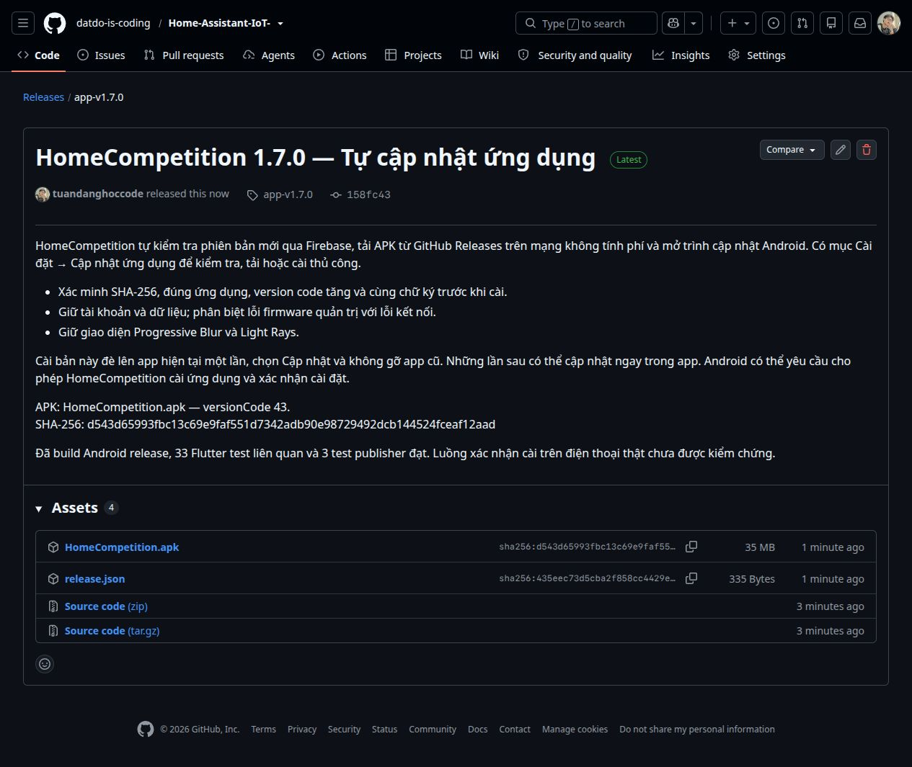

# HomeCompetition tự cập nhật — 1.7.0+43

App đọc catalog `app_releases/android/stable` của Firebase khi mở/trở lại
foreground, giới hạn một lần/giờ; nút Kiểm tra lại bỏ qua giới hạn. Khi có
version code lớn hơn, app tải trên mạng không tính phí. Mạng di động cần bấm
Tải bản mới. Gói tải xong có thông báo gọn và mục Cài đặt → Cập nhật ứng dụng.

APK nằm trên GitHub Releases theo lựa chọn giữ miễn phí. Project Firebase vẫn
Spark, đã xác minh trên Console. Spark chặn APK trên Hosting/Storage, nên không
đổi đuôi file hoặc đưa APK vào database để vượt giới hạn.

## Xác minh gói

- URL nguồn chỉ nhận repo phát hành hiện tại hoặc kho Firebase của đúng project.
- Redirect HTTPS được giới hạn; giới hạn size 120 MiB, timeout và file tải thiếu.
- File nằm trong cache riêng. Native Android kiểm tra SHA-256, đúng package,
  version code tăng và cùng tập chứng thư với ứng dụng đang cài.
- Kiểm hash/chữ ký chạy ngoài UI thread; tiến trình chỉ rebuild ô cập nhật.
- FileProvider không export và chỉ chia sẻ thư mục `app-updates/` với quyền đọc.
- Android quản lý quyền cài từ nguồn này và bước xác nhận cài. Không uninstall,
  không hạ version hoặc thay chữ ký; giữ dữ liệu/tài khoản khi cập nhật.

Rules đã triển khai chỉ cho tài khoản đăng nhập đọc catalog, client không được
ghi. Các namespace devices/commissioning và quyền điều khiển giữ nguyên.

## Quy trình phát hành tiếp theo

1. Tăng version/version code trong pubspec, build release bằng cùng keystore.
2. Giữ APK tại `releases/android/HomeCompetition.apk`, chạy
   `python3 App/HomeCompetition/tool/prepare_android_release.py`.
   Tool kiểm package, chứng thư, size/hash và sinh `releases/android/release.json`.
3. Push nguồn lên `main`, tạo GitHub Release tag `app-v<version>` từ main;
   đính kèm APK với đúng tên `HomeCompetition.apk` và release.json.
4. Chuyển catalog cùng `Gateway/tools/publish_android_catalog.py` lên Pi;
   dùng venv Gateway và cấu hình Firebase private đang có để chạy publisher.
   Publisher tải APK công khai, kiểm size/hash trước khi cập nhật catalog;
   không cho hạ version code hoặc thay nội dung một version code đã công bố.

```bash
/home/pi4/voice_gateway_venv/bin/python3 publish_android_catalog.py \
  --firebase-config /home/pi4/.config/homecompetition/firebase-commissioning.json \
  --manifest release.json
```

Không đưa credential, khóa ký, flash backup hoặc dữ liệu người dùng vào release.
App cũ chưa có updater cần cài bản bootstrap này một lần. Chưa kiểm chứng vòng
tải/xác nhận cài thực tế trên điện thoại; hiện ADB không có máy được kết nối.

## Kiểm tra đã chạy

- 33 Flutter test liên quan cập nhật, bảo trì và app shell đạt.
- Analyze các file liên quan sạch; APK Android release build thành công.
- APK được apksigner kiểm tra, cùng chứng thư với bản cài hiện tại.
- 3 test publisher kiểm hash tải thật qua HTTP mock, sai repo, hạ/tái dùng code.
- 7 test signer/coordinator OTA đạt trong lượt cập nhật DDF8.

Nguồn nền tảng: [Firebase Spark và APK](https://firebase.google.com/docs/hosting/faq-and-troubleshooting?hl=en),
[Android cài từ nguồn ngoài](https://developer.android.com/studio/publish).

## Phát hành đã xác minh

Release [app-v1.7.0](https://github.com/datdo-is-coding/Home-Assistant-IoT-/releases/tag/app-v1.7.0)
đã công khai từ commit `158fc4322311d75d77ed664f4ca557fb205474d4` trên `main`.
GitHub hiển thị APK và release.json; digest APK khớp catalog. Publisher trên Pi
đã tải APK từ URL công khai, xác minh đủ 36681531 byte/SHA-256 rồi ghi catalog
Firebase và đọc lại khớp. Không thay billing hoặc tạo nhánh Git mới.

APK SHA-256: `d543d65993fbc13c69e9faf551d7342adb90e98729492dcb144524fceaf12aad`.
Đây là bằng chứng phát hành và transport; chưa phải xác nhận cài OTA app trên
điện thoại. Người dùng tải APK và cài đè một lần để có updater.



[Bằng chứng không chứa bí mật](evidence.json).
